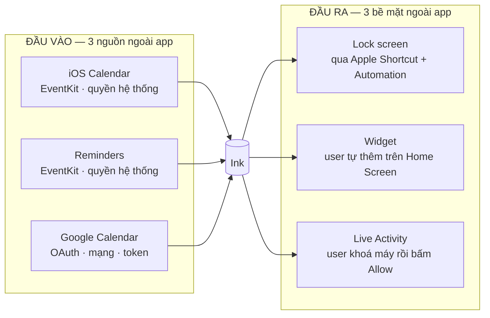

# Exploratory References — Ink: Lockscreen Calendar, Note

> **Bộ câu hỏi phải trả lời** để đánh giá Ink đã **đủ tốt để release** hay chưa.
> Đây là bản áp dụng riêng của *Mindset Product QC* vào đúng sản phẩm này — không phải checklist test case.
>
> **Cách dùng:** mở file này khi chạy exploratory. Trả lời bằng **quan sát đo được** (screenshot có timestamp,
> số bước đếm được, repro lặp lại ≥1 lần), không bằng cảm tính. Câu nào không kiểm được → ghi **coverage gap**,
> tuyệt đối không suy diễn kết quả.
>
> **Tham chiếu:** [wireframes](../requirements/ui/ux/wideframes/README.md) · [screenshots](../requirements/ui/ux/screenshots/iphone/index.md)
**Đào sâu:** [shortcut-flow-cases.md](shortcut-flow-cases.md) — happy/negative/edge case của Flow 03 ·
[permissions-matrix.md](permissions-matrix.md) — mọi quyền app cần và ma trận hỏng khi bị từ chối
> **Phiên bản đã khảo sát:** TestFlight 1.2.10 (27) · iPhone · tài khoản App Store Việt Nam

---

## 0 · Framing — trả lời TRƯỚC khi chạm tay

### Q1 — User mở Ink để làm gì?

**Giả thuyết từ wireframe** *(cần xác nhận với PO, không coi là chân lý)*:

> User đến để **biến lịch và to-do của mình thành hình nền lock screen tự cập nhật mỗi sáng**, để liếc một
> cái là biết cả ngày — không phải mở khoá máy rồi lạc vào app khác.

**Câu hỏi phải trả lời:**

- [ ] Job-to-be-done thật sự là **"xem lịch ở lock screen"** hay **"quản lý lịch/task/note trong app"**? Hai
      cái này dẫn tới hai bộ ưu tiên hoàn toàn khác nhau. Bằng chứng nào cho thấy cái nào là chính?
- [ ] Ink là **app quản lý lịch** (cạnh tranh Apple Calendar / Fantastical) hay **công cụ trang trí lock
      screen** (cạnh tranh app wallpaper)? 4 tab Discover/Calendar/Tasks/Notes gợi ý cái đầu, nhưng toàn bộ
      onboarding và Discover lại nói về cái sau.
- [ ] Nếu user **không bao giờ** hoàn tất setup Shortcut, app còn giá trị gì không? Đây là câu hỏi quyết
      định mức độ nghiêm trọng của mọi lỗi trong [Flow 03](../requirements/ui/ux/wideframes/03_shortcut-setup.md).
- [ ] Tần suất dùng kỳ vọng là bao nhiêu? Mỗi ngày (xem lock screen) hay mỗi tuần (đổi template)? Con số này
      quyết định ngưỡng chấp nhận cho ma sát lặp lại.

### Q8 — Feature này phục vụ đúng mục tiêu business không?

**Mô hình giá quan sát được:** Weekly (dùng thử 3 ngày) · Lifetime (mua đứt, chọn sẵn) · Annual.

**Câu hỏi phải trả lời:**

- [ ] 🔴 **Giá hiển thị trong app có khớp giá App Store thật tính không?** *(Đã phát hiện lệch: app hiện
      **₩3,300**, StoreKit tính **59 000đ** — xem [08_paywall](../requirements/ui/ux/wideframes/08_paywall.md#-giá-hiển-thị-trong-app-không-khớp-giá-thật).)*
      Kiểm cả 3 gói. Đây là rủi ro reject theo App Store guideline 3.1.2.
- [ ] **Ranh giới Free / Pro nằm ở đâu?** Chưa có screenshot nào cho thấy template nào là premium. Không
      biết ranh giới thì không đánh giá được có rò rỉ tính năng trả phí hay không.
- [ ] Có cách nào **dùng nội dung Pro mà không trả tiền** không? Thử: lưu template vào collection trước khi
      hết hạn dùng thử · huỷ subscription rồi mở lại app · đổi ngày hệ thống · restore purchase từ tài
      khoản khác.
- [ ] Sau khi **hết hạn dùng thử 3 ngày**, wallpaper đã đặt có bị gỡ không, hay vẫn chạy mãi? Nếu vẫn chạy →
      user không có lý do gia hạn → rò doanh thu.
- [ ] Gói **Lifetime chỉ đắt gấp 1,94 lần Annual** — hoà vốn sau chưa tới 2 năm. Đây là chủ ý hay lỗi cấu
      hình giá? Ai xác nhận?
- [ ] Paywall chọn sẵn **Lifetime**, Settings lại quảng bá **Annual**. Thông điệp nào đúng với chiến lược?

---

## 1 · Sáu vùng rủi ro xuyên suốt quyết định ship / không ship

Đây là các rủi ro **đặc thù của Ink**, không nằm gọn trong flow nào.

### 1.0 — Bản đồ phụ thuộc ngoài app

Ink là **app trung gian**: nó không sở hữu dữ liệu đầu vào, cũng không sở hữu bề mặt hiển thị đầu ra.
Cả hai đầu đều nằm ngoài tầm kiểm soát.



| # | Phụ thuộc | Kiểu hỏng | Ink phát hiện được? | Người dùng thấy gì |
|---|-----------|-----------|:---:|---|
| **Đầu vào** |
| I1 | iOS Calendar | quyền bị rút, calendar bị tắt | Có *(EventKit trả lỗi)* | ? |
| I2 | Reminders | quyền bị rút, từ chối riêng | Có | ? |
| I3 | **Google Calendar** | **token hết hạn · mất mạng · user thu hồi quyền bên Google · đổi mật khẩu · bật 2FA** | **?** | **?** |
| **Đầu ra** |
| O1 | Lock screen | 10 mắt xích, xem [shortcut-flow-cases](shortcut-flow-cases.md) | Không | wallpaper đứng yên |
| O2 | Widget | user tự khai `I've added the widget` | Không | widget trống/không có |
| O3 | Live Activity | user phải khoá máy + bấm Allow | Không | không thấy gì trên lock screen |

**Câu hỏi phải trả lời cho cả bản đồ:**

- [ ] Trong 6 phụ thuộc, Ink **kiểm tra lại trạng thái** của cái nào sau khi setup xong? *(Theo bộ ảnh hiện
      có: không cái nào.)*
- [ ] Có **một chỗ duy nhất** nào trong app cho biết "mọi thứ đang hoạt động" không? Nếu không, user lấy gì
      để tự chẩn đoán khi lock screen sai?
- [ ] Một user muốn dùng **đủ 3 tính năng** phải rời app **3 lần** qua 3 bề mặt iOS khác nhau. Có ai đo tỷ lệ
      hoàn thành cả 3 chưa?
- [ ] 🔴 **Nguồn dữ liệu hỏng một phần** thì wallpaper vẽ ra sao? Ví dụ Google token hết hạn → shortcut vẫn
      chạy, vẫn vẽ wallpaper, nhưng **thiếu toàn bộ event Google**. User nhìn lock screen thấy lịch "có vẻ
      đúng" nhưng thiếu nửa số cuộc họp. **Đây là kiểu hỏng nguy hiểm hơn cả không vẽ được gì.**

### 1.1 — Chuỗi setup có sống sót qua người dùng thật không?

Ink phụ thuộc một chuỗi 3 mắt xích ngoài tầm kiểm soát: **quyền Calendar → Apple Shortcut → Personal
Automation**. Đứt bất kỳ mắt nào là sản phẩm mất giá trị cốt lõi.

- [ ] 🔴 Ở dialog *"output 1 wallpaper?"*, chọn **`Allow Once`** thay vì `Always Allow` — app vẫn báo
      *"Shortcut is working!"* chứ? Hôm sau wallpaper có đổi không? *(Nghi vấn: hỏng trong im lặng.)*
- [ ] Nếu hỏng im lặng: **bao lâu** user mới nhận ra? Có tín hiệu nào trong app cho biết automation đã chết?
- [ ] App có **tự kiểm tra** được lần cuối wallpaper đổi là khi nào không? Nếu có, hiển thị ở đâu?
- [ ] Tỷ lệ **rơi rớt** ở từng bước của Flow 03 là bao nhiêu? *(Cần số liệu analytics — nếu chưa có, đây là
      gap về đo lường, ghi lại.)*
- [ ] User rời app sang Shortcuts rồi **không quay lại** — mở app lần sau có nhắc tiếp không, hay coi như
      xong?
- [ ] Sau khi thiết lập xong, user **xoá shortcut** hoặc **tắt automation** trong app Shortcuts → app có
      phát hiện và hướng dẫn lại không?

### 1.2 — Lock screen là ảnh tĩnh: dữ liệu cũ tới mức nào là chấp nhận được?

Toàn bộ panel lịch nằm trong ảnh nền ([Flow 10](../requirements/ui/ux/wideframes/10_lockscreen.md)), chỉ đổi
khi automation chạy.

- [ ] Tạo event lúc 10:00 sáng, automation đặt 8:00 — lock screen có hiện event đó không? **Bao giờ** mới hiện?
- [ ] Qua **nửa đêm**, lock screen còn hiện lịch hôm trước bao lâu? Hiển thị sai ngày là chấp nhận được không?
- [ ] Event bị **xoá hoặc dời giờ** sau khi wallpaper đã vẽ — user nhìn lock screen sẽ thấy thông tin sai.
      Mức độ nguy hiểm? (Trễ họp vì tin lock screen.)
- [ ] **Đổi múi giờ** (bay sang nước khác) → giờ trên wallpaper có sai không?
- [ ] Có cách nào **buộc cập nhật ngay** ngoài việc mở app Shortcuts chạy tay không?

### 1.3 — Lock screen thật có đọc được trong điều kiện thật không?

- [ ] 🔴 **Lock screen khi có thông báo đẩy** — thông báo iOS chiếm nửa dưới màn hình. Panel lịch còn đọc
      được bao nhiêu phần? *(Đây là trạng thái thường gặp NHẤT trong ngày mà chưa có ảnh nào.)*
- [ ] Nút **đèn pin / camera** của iOS đè lên đáy panel (đã quan sát được). Mất bao nhiêu dòng nội dung?
- [ ] Trên máy **màn hình nhỏ** (iPhone SE, mini) panel có bị cắt không?
- [ ] Với **Live Activity đang bật**, nó chồng lên panel thế nào?
- [ ] Ảnh nền **sáng/nhiều chi tiết** → chữ còn đủ tương phản không? *(Đo bằng số, không nhìn bằng mắt.)*
- [ ] Người dùng có **nhiều lock screen** (iOS Focus) — shortcut ghi đè cái nào?
- [ ] Chế độ **Always-On Display** hiển thị ra sao?

### 1.4 — Đồng bộ 2 chiều với Apple Calendar / Reminders có làm mất dữ liệu không?

Ink đọc **và ghi** vào dữ liệu gốc của người dùng. Đây là vùng rủi ro mất dữ liệu cao nhất.

- [ ] Xoá event trong Ink → nó biến mất khỏi **Apple Calendar** chứ? Có xác nhận trước khi xoá không?
- [ ] Xoá **event lặp** — xoá 1 lần hay cả chuỗi? Có hỏi không? *(Apple Calendar luôn hỏi.)*
- [ ] Sửa event trong Ink trong khi **Apple Calendar đang mở sửa cùng event** → ai thắng? Có mất dữ liệu không?
- [ ] Task tạo trong Ink có xuất hiện trong **Reminders** không, và ngược lại? Có bị **nhân đôi** không?
- [ ] Tạo calendar mới từ Ink → nó nằm ở tài khoản nào (iCloud / local / Google)? Xoá app có mất luôn không?
- [ ] Note tạo trong Ink lưu ở đâu? Có backup / iCloud sync không? **Gỡ app có mất hết note không?**
- [ ] Rút quyền Calendar trong iOS Settings sau khi đã dùng → app xử lý thế nào? Crash? Màn trắng? Có hướng
      dẫn bật lại không?

### 1.6 — Google Calendar: nguồn dữ liệu duy nhất cần mạng và tài khoản

iOS Calendar và Reminders dùng EventKit — dữ liệu nằm sẵn trên máy, chỉ cần quyền. **Google Calendar hoàn
toàn khác**: cần đăng nhập, cần token, cần mạng, và phụ thuộc một bên thứ ba. Đây là nguồn rủi ro riêng,
chưa có screenshot nào ngoài cái toggle trong Settings.

**Luồng đăng nhập — chưa có ảnh nào**

- [ ] Bật toggle `Google Calendar` mở ra cái gì? `ASWebAuthenticationSession`? WebView trong app? Safari?
      Google Sign-In SDK? *(Mỗi lựa chọn có rủi ro bảo mật và trải nghiệm khác nhau.)*
- [ ] Huỷ giữa chừng luồng OAuth → toggle có tự tắt lại không, hay kẹt ở trạng thái "bật nhưng chưa đăng nhập"?
- [ ] Trong ảnh Settings, toggle **đang bật** nhưng mô tả vẫn ghi *"Sign in to sync…"* — là đã đăng nhập rồi,
      hay bật mà chưa đăng nhập? Nếu là cái sau thì đây là **trạng thái hiển thị sai**.
- [ ] Đăng nhập bằng tài khoản Google **không có event nào** → app hiện gì?
- [ ] **Nhiều tài khoản Google** — hỗ trợ mấy tài khoản? Đổi tài khoản thế nào? Đăng xuất ở đâu?

**Token hết hạn & thu hồi quyền — vùng hỏng im lặng**

- [ ] 🔴 Token hết hạn → app có tự refresh không? Nếu không refresh được, **shortcut chạy lúc 8:00 sáng sẽ vẽ
      wallpaper thiếu toàn bộ event Google mà không báo gì.** Kiểm bằng cách: thu hồi quyền Ink trong
      [Google Account permissions](https://myaccount.google.com/permissions), rồi chờ automation chạy.
- [ ] Đổi mật khẩu Google / bật 2FA / bị buộc đăng nhập lại → app biết không? Có notification không?
- [ ] Admin Workspace thu hồi quyền OAuth của tổ chức → toàn bộ user công ty mất event cùng lúc.
- [ ] Có màn hình nào báo *"Google Calendar đã ngắt kết nối, bấm để đăng nhập lại"* không?

**Mạng — nguồn duy nhất không hoạt động offline**

- [ ] Mở app khi **offline** → event Google hiện từ cache hay biến mất? Nếu biến mất thì mở app trên máy bay
      là mất nửa lịch.
- [ ] Shortcut chạy khi **offline** → wallpaper vẽ thiếu event Google hay dừng lại giữ wallpaper cũ?
      *(Dừng lại an toàn hơn nhiều so với vẽ dữ liệu thiếu.)*
- [ ] Mạng chậm → app chờ bao lâu rồi bỏ cuộc? Có timeout không? Shortcut có bị iOS kill vì chạy quá lâu không?
- [ ] Google API **rate limit / quota** hết → hành vi ra sao?

**Ghi 2 chiều — Google có bị ghi đè không?**

- [ ] Tạo event trong Ink, chọn Calendar là một lịch Google → nó có đẩy lên Google thật không, hay chỉ nằm
      local? Kiểm chứng bằng cách mở Google Calendar trên web.
- [ ] Sửa/xoá event Google từ Ink → đồng bộ ngược lên đúng chứ? Xoá nhầm ở đây là **mất dữ liệu trên cloud**,
      ảnh hưởng cả người được mời trong event.
- [ ] Event Google có **người tham dự / lời mời** — Ink hiển thị và xử lý thế nào? Sửa giờ có gửi lại lời
      mời cho cả nhóm không? *(Rủi ro rất cao: một thao tác trong Ink có thể gửi email cho đồng nghiệp.)*
- [ ] Event từ lịch **chỉ đọc** (lịch công ty, lịch đăng ký) → app có chặn sửa không?

**Riêng tư — mâu thuẫn cần làm rõ**

- [ ] 🔴 Onboarding slide 5 khẳng định: *"Ink only reads events and reminders to draw your lock screen.
      **Your data stays on your device.**"* Nhưng đồng bộ Google Calendar về bản chất đưa dữ liệu **qua
      mạng**, và nếu OAuth xử lý phía server thì lịch của user còn đi qua **backend của Ink**.
      **Câu khẳng định này còn đúng không?**
- [ ] Có backend không? Token lưu ở đâu — Keychain trên máy hay server?
- [ ] Privacy policy và **App Privacy Label trên App Store** có khai báo việc thu thập/xử lý dữ liệu lịch
      không? Khai sai là lý do bị gỡ app.
- [ ] Google có yêu cầu **OAuth verification** cho scope nhạy cảm như Calendar — app đã qua duyệt chưa? Chưa
      duyệt thì user sẽ thấy màn cảnh báo "app chưa được xác minh" giữa luồng đăng nhập.

### 1.5 — Bốn cửa vào một dữ liệu: có nhất quán không?

Cùng một event xuất hiện ở List / Day / Week / Month view, ở template lock screen, ở widget, ở live activity.

- [ ] 🔴 **Tap event ở Day/Week/Month có mở được chi tiết không?** *(Nghi vấn đã ghi nhận: chỉ List mở được →
      3 view kia **không sửa/xoá được event nào**. Xem [05_calendar](../requirements/ui/ux/wideframes/05_calendar.md#-phân-tích-chỉ-mở-được-chi-tiết-event-ở-list-view).)*
- [ ] Ở Month view, tap **vùng trống của ô ngày** (vd 13/8 có `+4`) — có nhảy sang List view của ngày đó
      không? *(Đây là phép thử quyết định: có đường đi = khó khám phá; không có = ngõ cụt.)*
- [ ] Bật/tắt một calendar ở sheet Calendars → **cả 4 view** cùng cập nhật chứ? **Wallpaper** có tôn trọng
      lựa chọn đó không, hay vẫn vẽ event của calendar đã tắt?
- [ ] Widget, live activity và wallpaper có hiển thị **cùng một tập event** không?
- [ ] Event **all-day** hiển thị thế nào ở từng view? *(Week view hiện đang vẽ thành cột dọc suốt lưới giờ.)*

---

## 2 · Câu hỏi theo từng flow

### Flow 01 — Onboarding · [wireframe](../requirements/ui/ux/wideframes/01_onboarding.md)

**Mục tiêu:** đưa user từ mở app lần đầu tới lúc thấy được giá trị.

- [ ] **Q2 —** Người chưa từng thấy UI này đi hết 6 slide mất bao lâu? Có ai bỏ giữa chừng không?
- [ ] Không có nút **Skip** ở bất kỳ slide nào — là chủ ý hay thiếu sót? User quay lại lần 2 có phải xem lại từ đầu?
- [ ] Hai slide đầu chỉ là **số liệu thống kê**, chưa nói app làm gì. User có kiên nhẫn tới slide 3 không?
- [ ] **Q3 —** Slide 6 hiển thị data thật của user — nếu user **từ chối quyền** ở bước 5, slide này hiện gì?
      Trống? Placeholder? *(Chưa có ảnh — coverage gap.)*
- [ ] CTA ở slide 5 có 2 phiên bản khác nhau trong bộ ảnh (`See my lock screen` vs `Sync my data` + link
      `Skip for now`). Là A/B test, hay là trạng thái sau khi từ chối quyền lần đầu?

### Flow 02 — Permission · [wireframe](../requirements/ui/ux/wideframes/02_permission.md)

✅ **Đã có bằng chứng:** app **có** màn hình phục hồi dẫn ra Settings cho cả Calendar (S03) và Reminders (S04).

- [ ] 🔴 **Trạng thái `Add Events Only`** *(write-only, iOS 17+)* — app hiện gì? Đây là bẫy lớn nhất: user cấp
      quyền rồi mà app vẫn mù. Xem [permissions-matrix §1.1](permissions-matrix.md#-ba-trạng-thái-quyền--và-cái-ở-giữa-là-bẫy).
      Kiểm bằng: Settings → Ink → Calendars → chọn `Add Events Only` → quay lại app.
- [ ] 🔴 **Từ chối Reminders có chặn cả task nguồn `Ink` không?** *(S04 cho thấy toàn bộ tab bị thay thế.)*
      Xác định trước: task `Ink` lưu local hay chỉ là một list trong Apple Reminders?
- [ ] Nút `Open Settings` mở thẳng trang **Ink** hay chỉ Settings gốc?
- [ ] Bật quyền trong Settings rồi quay lại — app tự refresh hay phải kill và mở lại?
- [ ] **Discover** và **Notes** có màn hình phục hồi tương tự không? Template preview cần event để render.
- [ ] Ở màn Calendar denied, 2 icon header còn nguyên — bấm vào thì sao? Sheet Calendars trống hay lỗi?
- [ ] `Skip for now` dẫn tới đâu? App dùng được ở mức nào khi không có quyền?
- [ ] iOS chỉ cho hỏi quyền **một lần** — app có xử lý đúng lần thứ hai không?
- [ ] Quyền **Photos** và **Notifications** có cần không? Chưa thấy dialog nào.

### Flow 03 — Shortcut Setup · [wireframe](../requirements/ui/ux/wideframes/03_shortcut-setup.md)

**Đây là flow rủi ro nhất: 4/9 màn hình nằm ngoài app.**

> 📄 **Phân tích đầy đủ happy / negative / edge case:** [shortcut-flow-cases.md](shortcut-flow-cases.md)
> — 10 mắt xích điều kiện, 20 negative case, 23 edge case, cây chẩn đoán khi wallpaper không đổi.
> Các câu dưới đây chỉ là phần rút gọn để dùng nhanh trong phiên.

- [ ] **Q4 —** Bấm `Don't Allow` ở từng dialog trong 3 dialog (run actions / set wallpaper / output
      wallpaper) → app biết không? Hướng dẫn sửa thế nào?
- [ ] Sau S09 (Personal Automation), user còn phải **tự đặt giờ và gán shortcut** — không có hướng dẫn nào
      cho các bước này. Người dùng phổ thông có làm được không? Đo bằng cách để người thật làm thử.
- [ ] User đã setup rồi, vào Settings bấm `Set up shortcut` lần nữa → app hiện gì? Có tạo **shortcut trùng** không?
- [ ] Máy chưa cài app **Shortcuts** (đã gỡ) → deep link đi đâu?
- [ ] Automation đặt giờ mà máy đang **tắt nguồn / Low Power Mode / Focus** → có chạy không?
- [ ] Shortcut chạy khi máy **khoá** có được không, hay bắt buộc mở khoá?

### Flow 04 — Discover · [wireframe](../requirements/ui/ux/wideframes/04_discover.md)

- [ ] **Q3 —** Ba loại nội dung dùng ba động từ khác nhau (`Use` / `Open` / `Add`). User có hiểu khác biệt không?
- [ ] Bấm `Use` **không đổi wallpaper ngay** mà hiện tooltip bảo mở Shortcuts. User lần đầu có hiểu tại sao không?
- [ ] Có **93 widget · 28 lockscreen · 5 live activity** — tìm được cái mình muốn mất bao lâu? Có tìm kiếm không?
- [ ] Template nào là **Pro**? Bấm vào template Pro khi chưa mua thì thấy gì?
- [ ] `Your collection` khi **trống** hiện gì? *(Chưa có ảnh.)*
- [ ] Live Activity ở trạng thái **chưa chạy** — nút là `Start`? *(Chưa có ảnh.)*
- [ ] Nút `I've added the widget` là user **tự khai** — nếu user bấm mà chưa thêm thật thì sao?
- [ ] Cuộn danh sách 93 widget có **giật/lag** không? Đo FPS, không đoán.

### Flow 05 — Calendar · [wireframe](../requirements/ui/ux/wideframes/05_calendar.md)

- [ ] 🔴 Tap event ở Day/Week/Month — xem mục [1.5](#15--bốn-cửa-vào-một-dữ-liệu-có-nhất-quán-không).
- [ ] **Q3 —** Nút "về hôm nay" có **3 kiểu** (pill ở Month, FAB ở List, không có ở Day/Week). User có tìm được không?
- [ ] **Week view** với data dày: tên event cắt còn `Te…`, `R…`. Còn dùng được không? FAB che event khung 23:00.
- [ ] **Âm lịch** hiển thị có đúng không? Kiểm vài mốc: mùng 1, ngày rằm, tháng nhuận, Tết. *(Đối chiếu
      nguồn độc lập, đây là điểm bán hàng cho thị trường VN.)*
- [ ] Form tạo event: `Start` và `End` mở picker **cùng lúc** làm form dài gấp 3. Có khó dùng không?
- [ ] Đặt `End` **trước** `Start` → app chặn hay cho lưu event âm thời lượng?
- [ ] Bật `All day` → 2 picker giờ biến mất chứ? *(Chưa có ảnh.)*
- [ ] Icon **⭐** cạnh ô Title làm gì? *(Chưa xác định.)*
- [ ] Picker ngày dùng **màu đỏ** trong khi app dùng tím/đen — lỗi theme?
- [ ] **Không có trường Location** — event tạo bằng Ink mất địa điểm. Có chủ ý không?
- [ ] Tạo event vào calendar **read-only** (lịch đăng ký "Ngày lễ Việt Nam") → app xử lý thế nào?

### Flow 06 — Task · [wireframe](../requirements/ui/ux/wideframes/06_task.md)

- [ ] **Q3 —** Nút **"Delete reminder"** nằm trên màn hình **"Edit task"** — user có hoang mang không? Lỗi copy hay chủ ý?
- [ ] Task hiện ở **cả hai** section "Today" và "Plan tasks" — user có tưởng là 2 task khác nhau không?
- [ ] Bấm `Mark it completed` → task đi đâu? Có **undo** không? *(Chưa có ảnh.)*
- [ ] Filter `Reminder` vs `Ink` — user hiểu khác biệt không? Tạo task mới thì vào nhóm nào?
- [ ] Icon ☑ góc trên phải làm gì?
- [ ] Task **quá hạn** hiển thị khác không?
- [ ] Bật `Repeat` → hiện tuỳ chọn gì? *(Chưa có ảnh.)*

### Flow 07 — Note · [wireframe](../requirements/ui/ux/wideframes/07_note.md)

- [ ] Nút ✓ **enabled ngay cả khi note trống** — lưu note rỗng được không? Nó hiện thế nào trong danh sách?
- [ ] **Q4 —** Đang gõ note dài rồi bấm back / app bị kill → **mất nội dung không?** Có auto-save không?
      *(Đường mất dữ liệu rõ nhất trong app.)*
- [ ] Toolbar có 🔔 (nhắc nhở) — chồng lấn với Task. Ranh giới hai tính năng là gì?
- [ ] Note dài / nhiều ảnh đính kèm → widget hiển thị thế nào? Có cắt không?
- [ ] Nhiều note thì layout 1 cột hay 2 cột? Có tìm kiếm không?
- [ ] Xoá note ở đâu? Có xác nhận không?

### Flow 08 — Paywall · [wireframe](../requirements/ui/ux/wideframes/08_paywall.md)

**Vùng đụng tiền — ưu tiên cao nhất theo Q8.**

- [ ] 🔴 Giá 3 gói trong app **khớp** giá StoreKit chứ? Kiểm bằng cách vào tới sheet thanh toán từng gói.
- [ ] **Q4 —** Huỷ giữa chừng ở sheet Apple → app quay về trạng thái nào? Có kẹt ở `Processing…` không?
- [ ] **Mất mạng** khi đang thanh toán → app xử lý thế nào? Tiền đã trừ mà chưa mở khoá thì sao?
- [ ] Bấm `Continue` **2 lần liên tiếp** → có tạo 2 giao dịch không?
- [ ] Mua thành công → app mở khoá **ngay** hay phải khởi động lại?
- [ ] `Restore purchases` khi **chưa từng mua** → thông báo có rõ không?
- [ ] Mua trên máy A, đăng nhập máy B → restore có chạy không?
- [ ] Dòng `Auto-renew. Cancel anytime.` chỉ hiện với gói subscription, không hiện với Lifetime — đúng chủ ý chứ?
- [ ] Sau khi mua, **Settings** đổi thành gì? Có chỗ quản lý/huỷ subscription không?

### Flow 09 — Settings · [wireframe](../requirements/ui/ux/wideframes/09_settings.md)

- [ ] Toggle **Google Calendar** đang bật nhưng mô tả ghi *"Sign in to sync…"* — bật lên có mở luồng đăng nhập không?
- [ ] Tắt **iOS Calendar** → điều gì xảy ra với event đang có trên wallpaper?
- [ ] Không có mục **quản lý subscription** cho user đã mua — kiểm lại sau khi mua.
- [ ] Không có cài đặt **thông báo**, **ngôn ngữ**, **liên hệ hỗ trợ** — có thiếu so với kỳ vọng không?
- [ ] `Privacy policy` mở webview trong app hay Safari? Link còn sống không?

### Flow 10 — Lock Screen · [wireframe](../requirements/ui/ux/wideframes/10_lockscreen.md)

Xem toàn bộ mục [1.2](#12--lock-screen-là-ảnh-tĩnh-dữ-liệu-cũ-tới-mức-nào-là-chấp-nhận-được) và
[1.3](#13--lock-screen-thật-có-đọc-được-trong-điều-kiện-thật-không).

- [ ] Thử **cả 28 template** hay ít nhất mỗi kiểu bố cục 1 cái — vùng an toàn có đúng ở mọi bố cục không?
- [ ] Ngày **không có event nào** → panel hiện gì? Trống trơn có xấu không?
- [ ] Ngày có **rất nhiều event** (20+) → panel tràn hay cắt? Logic `+N more` có đúng không?
- [ ] Event có **tên rất dài** / emoji / tiếng Việt có dấu → xuống dòng đúng không?

---

## 3 · Coverage matrix — Q5

Đánh dấu state nào **đã chạm**, state nào **chưa**. Chưa chạm ≠ không có lỗi.

| Vùng | State cần phủ | Đã chạm |
|------|---------------|:-------:|
| Quyền | granted · denied · rút quyền sau khi cấp · hỏi lại lần 2 | ☐ |
| Shortcut | chưa cài · đã cài · Allow Once · Don't Allow · shortcut bị xoá · automation bị tắt | ☐ |
| Mua hàng | chưa mua · đang dùng thử · hết dùng thử · đã mua · huỷ · hết hạn · restore · thanh toán lỗi | ☐ |
| Dữ liệu | rỗng · 1 item · rất nhiều item · item tên dài · item lặp · item all-day | ☐ |
| Mạng | online · offline · mạng chập chờn khi thanh toán / sync | ☐ |
| Thời gian | qua nửa đêm · đổi múi giờ · đổi ngày hệ thống · năm nhuận · tháng nhuận âm lịch | ☐ |
| Lock screen | không thông báo · có thông báo · Always-On · nhiều Focus lock screen · máy màn hình nhỏ | ☐ |
| Vòng đời app | mở lần đầu · quay lại từ background · bị kill giữa chừng · gỡ & cài lại | ☐ |

---

## 4 · Nếu chỉ còn 15 phút — Q9

Chạy đúng thứ tự này. Đây cũng là bộ **smoke test** cho mỗi build.

1. **Giá 3 gói trong app vs sheet StoreKit** — đụng tiền, đã có nghi vấn lệch. *(3 phút)*
2. **Tạo → sửa → xoá 1 event**, kiểm tra nó đồng bộ đúng sang Apple Calendar và không xoá nhầm cả chuỗi lặp.
   *(4 phút)*
3. **Tap event ở Month view** — mở được chi tiết không, có sửa/xoá được không. *(2 phút)*
4. **Gõ note dài rồi thoát giữa chừng** — có mất nội dung không. *(2 phút)*
5. **Nhìn lock screen thật** khi có thông báo đẩy — còn đọc được không. *(2 phút)*
6. **Chạy shortcut tay** — wallpaper có đổi và đúng ngày hôm nay không. *(2 phút)*

---

## 5 · Mẫu kết luận phiên

```
Phiên: __________            Build: 1.2.10 (27)      Thiết bị: __________

Q1 Mục tiêu user:            ______________________________
Q8 Mục tiêu business:        ______________________________
— Chạy luồng chính —
Q2 Xong dễ lần đầu?          Có / Không — vì: __________
Q3 Điểm khựng/bối rối:       ______________________________
Q4 Thao tác sai / gián đoạn: ______________________________
Q5 State chưa test:          ______________________________
— Kết luận —
Q6 Rủi ro #1 nếu ship:       ______________________________
Q7 Tự mình dùng hằng ngày?   Có / Không — vì: __________
Q9 15 phút thì test gì:      ______________________________

=> Verdict: 🟢 ship được / 🟡 ship có điều kiện / 🔴 chưa nên ship
   Bằng chứng: ______________________________
```

**Ngưỡng riêng cho sản phẩm này:**

| Verdict | Điều kiện |
|---|---|
| 🔴 | Giá trong app lệch giá thật · mất note/event khi thao tác bình thường · xoá event lặp không hỏi · chuỗi setup hỏng im lặng · không sửa/xoá được event ở phần lớn view |
| 🟡 | Setup Shortcut quá khó nhưng có đường hoàn thành · lock screen bị thông báo che một phần · Week view khó đọc khi nhiều event |
| 🟢 | Luồng chính xong dễ lần đầu · không có đường mất tiền/mất dữ liệu · lock screen đọc được trong điều kiện thật |

---

## 6 · Nguyên tắc giữ khách quan cho app iOS

- **Đo, đừng đoán.** Tương phản chữ → đo giá trị màu, không nhìn. Độ trễ → quay màn hình đếm frame. Giá →
  đọc từ sheet StoreKit, không đọc từ UI app. Đồng bộ → mở Apple Calendar kiểm chứng, không tin UI Ink.
- **Bằng chứng phải có timestamp.** Screenshot lock screen phải thấy được giờ để chứng minh dữ liệu cũ.
- **Tách "khó chịu của mình" khỏi "vấn đề của user thật."** Gu cá nhân → ghi vào *Observations*, không thổi
  thành bug.
- **Phân biệt bug · ma sát · coverage gap.** Bug = sai hành vi, có repro. Ma sát = đúng nhưng khó/chậm/rối.
  Gap = chưa kiểm được — ghi rõ lý do, không suy diễn kết quả.
- **Tái hiện ≥1 lần** trước khi kết luận là defect. Đặc biệt với lỗi liên quan tới automation và thời gian,
  vì chúng phụ thuộc trạng thái máy.
- **Trung thực về giới hạn.** Không có tài khoản sandbox, không đổi được ngày hệ thống, không có máy màn
  hình nhỏ → nói thẳng là gap.
