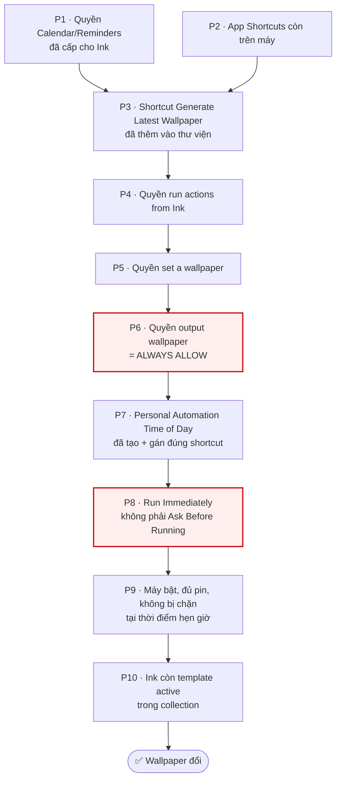
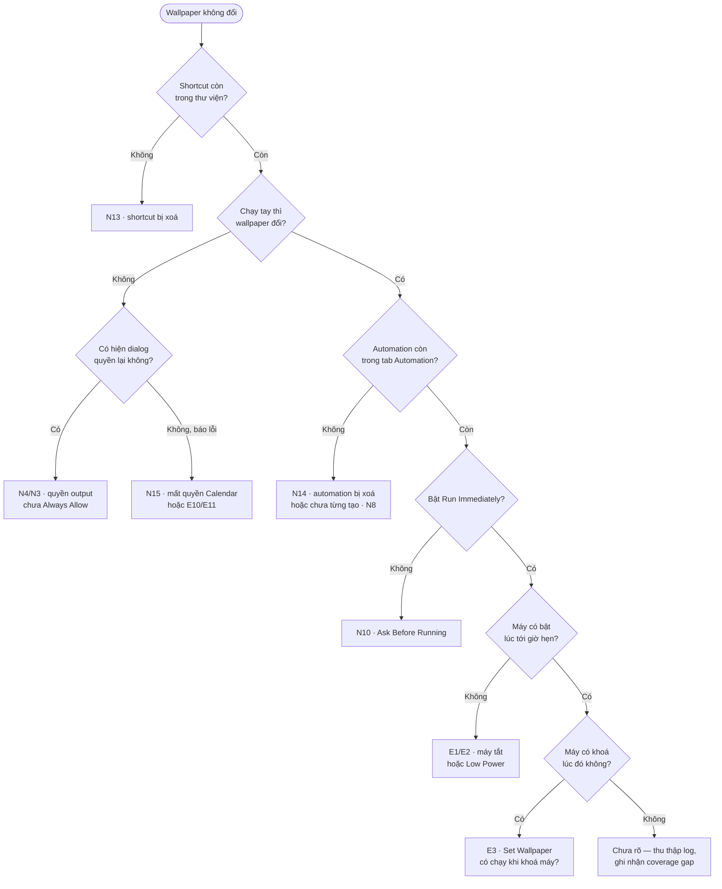

# Shortcut Setup — Phân tích case chi tiết

> Đào sâu [Flow 03](../requirements/ui/ux/wideframes/03_shortcut-setup.md) — flow rủi ro nhất của Ink.
> Dùng kèm [exploratory-references.md](exploratory-references.md) khi chạy phiên khám phá.
>
> **Vì sao flow này đáng được phân tích riêng:** đây là **điều kiện sống** của sản phẩm. Ink không tự đổi
> được wallpaper — iOS không cho phép. Nếu chuỗi này đứt, toàn bộ giá trị cốt lõi biến mất, trong khi 4/9
> màn hình nằm ngoài tầm kiểm soát của app và phần lớn kiểu đứt **không phát ra tín hiệu nào**.
>
> ⚠️ **Về các phát biểu liên quan hành vi iOS:** tài liệu này nêu **giả thuyết cần kiểm chứng trên máy thật**,
> không phải sự thật đã xác nhận. Mọi ô "Kỳ vọng" đều phải đo, không được chép vào PRD khi chưa test.

---

## 1 · Chuỗi điều kiện — thứ phải đúng để wallpaper đổi mỗi sáng

Wallpaper chỉ cập nhật khi **tất cả** mắt xích dưới đây còn nguyên. Đây là gốc của mọi case phía sau.

**Đặc điểm nguy hiểm:** trong 10 mắt xích, chỉ **P1 và P10** nằm trong app Ink. Tám mắt còn lại nằm ở iOS
hoặc app Shortcuts — Ink không đọc được trạng thái, không sửa được, và (theo bộ ảnh hiện có) **không kiểm
tra lại lần nào sau khi hiện "Shortcut is working!"**.

**Hai mắt xích đỏ (P6, P8)** là loại nguy hiểm nhất: user vẫn thấy setup "thành công", nhưng automation không
bao giờ chạy đúng. Xem [N4](#n4--allow-once-thay-vì-always-allow-) và [N10](#n10--automation-bật-ask-before-running-).

---

## 2 · Happy case — đường vàng

**Tiền đề:** máy sạch, chưa từng cài Ink, đã cấp quyền Calendar ở Flow 02, có sẵn event trong lịch.

| # | Thao tác | Màn hình | Phải quan sát được | Nếu không thấy |
|---|----------|----------|--------------------|----------------|
| 1 | Mở guide từ onboarding hoặc Settings → `Set up shortcut` | S01 *(Ink)* | Modal 2 bước, pager `● ○`, CTA `Tap to add shortcut` | — |
| 2 | Bấm CTA | S02 *(Shortcuts)* | Rời Ink, mở app Shortcuts, trang shortcut **Generate Latest Wallpaper**, banner `◀ Ink` góc trên trái | → [N16](#n16--máy-không-có-app-shortcuts), [E18](#e18--link-icloud-của-shortcut-hết-hạn) |
| 3 | Bấm `Add Shortcut` | S03 *(Shortcuts)* | Về thư viện **All Shortcuts**, shortcut mới nằm đầu danh sách | → [N5](#n5--không-bấm-add-shortcut-thoát-luôn) |
| 4 | Bấm vào card shortcut để chạy lần đầu | S04 | Dialog *"…to run actions from Ink?"* | — |
| 5 | `Allow` | S05 | Dialog *"…to set a wallpaper?"* | → [N1](#n1--dont-allow-ở-run-actions-from-ink) |
| 6 | `Allow` | S06 | Dialog *"…to output 1 wallpaper?"* **kèm preview wallpaper sắp đặt** | → [N2](#n2--dont-allow-ở-set-a-wallpaper) |
| 7 | **`Always Allow`** ⚠️ | S07 *(Ink)* | Tự quay về Ink, overlay ✓ xanh **"Shortcut is working!"** | → [N3](#n3--dont-allow-ở-output-1-wallpaper), [N4](#n4--allow-once-thay-vì-always-allow-) |
| 8 | — | S08 *(Ink)* | Guide bước 2/2 `Never think about it again.`, CTA `Open Automations` | — |
| 9 | Bấm CTA | S09 *(Shortcuts)* | Màn **Personal Automation**, danh sách trigger, `Time of Day` ở đầu | → [N8](#n8--bỏ-qua-hẳn-bước-2-automation) |
| 10 | Chọn `Time of Day` → đặt giờ → `Next` | *(không có ảnh)* | Màn chọn shortcut để chạy | **coverage gap** |
| 11 | Chọn `Generate Latest Wallpaper` → hoàn tất | *(không có ảnh)* | Automation xuất hiện trong tab Automation | **coverage gap** |
| 12 | **Khoá máy, xem lock screen** | Flow 10 | Wallpaper hiển thị lịch **đúng ngày hôm nay** | → chạy [cây chẩn đoán](#5--cây-chẩn-đoán-khi-wallpaper-không-đổi) |
| 13 | **Hôm sau, sau giờ hẹn** | Flow 10 | Wallpaper **tự đổi** sang lịch ngày mới, không cần thao tác | → chạy cây chẩn đoán |

**Bước 13 mới là happy case thật.** Bước 12 chỉ chứng minh shortcut chạy tay được — **không** chứng minh
automation hoạt động. Rất nhiều lỗi ở flow này chỉ lộ ra ở ngày thứ hai.

**Cần đo:**
- Tổng thời gian từ bước 1 → 11 với người **chưa từng dùng Shortcuts**.
- Số lần user phải tự phán đoán (không có hướng dẫn): tối thiểu ở bước 10, 11.
- Số lần rời/quay lại giữa Ink và Shortcuts: quan sát được là **2 lần**.

---

## 3 · Negative case — user từ chối, làm sai, hoặc bỏ dở

> Cột **Kỳ vọng** là hành vi *nên có*. Cột **Rủi ro** là điều xảy ra nếu app không xử lý.

### Nhóm 3.1 — Từ chối quyền

#### N1 · `Don't Allow` ở "run actions from Ink"

| | |
|---|---|
| **Thao tác** | Bước 5 happy case, chọn `Don't Allow` |
| **Kỳ vọng** | Shortcut dừng, Ink phát hiện được là chưa xong và hướng dẫn cách cấp lại |
| **Rủi ro** | Ink không biết gì, vẫn hiện "Shortcut is working!" hoặc treo ở guide 1/2 |
| **Cách cấp lại** | Không có UI trực tiếp — phải chạy lại shortcut hoặc vào Settings → Shortcuts. **Ink có hướng dẫn không?** |
| **Mức độ** | 🟠 Chặn setup, nhưng user còn thấy có gì đó sai |

#### N2 · `Don't Allow` ở "set a wallpaper"

| | |
|---|---|
| **Thao tác** | Bước 6, chọn `Don't Allow` |
| **Kỳ vọng** | Shortcut báo lỗi rõ ràng, Ink không báo thành công |
| **Rủi ro** | Shortcut vẫn chạy tới cuối, Ink báo thành công, nhưng wallpaper **không bao giờ** đổi |
| **Mức độ** | 🔴 Có khả năng hỏng im lặng |

#### N3 · `Don't Allow` ở "output 1 wallpaper"

Tương tự N2. Cần kiểm riêng vì đây là dialog **cuối cùng** — nếu Ink dựa vào "shortcut chạy xong" để báo
thành công thì từ chối ở đây rất dễ lọt.

#### N4 · **`Allow Once` thay vì `Always Allow`** 🔴

> **Đây là case nguy hiểm nhất của toàn sản phẩm.**

| | |
|---|---|
| **Thao tác** | Bước 7, chọn `Allow Once` (nút nằm **giữa**, dễ bấm nhầm hơn `Always Allow` ở dưới cùng) |
| **Kỳ vọng** | Ink phát hiện được, cảnh báo *"Bạn cần chọn Always Allow để tự động mỗi ngày"* |
| **Rủi ro** | Mọi thứ **trông như thành công**: shortcut chạy, wallpaper đổi ngay, Ink hiện ✓ "Shortcut is working!". Nhưng hôm sau automation chạy và **bị chặn ở dialog quyền** → wallpaper đứng yên |
| **Vì sao dễ xảy ra** | Guide S01/S08 **không nhắc một chữ nào** về 3 dialog quyền này. User không được cảnh báo trước, và `Allow Once` là lựa chọn nghe "an toàn" hơn với người cẩn thận |
| **User nhận ra khi nào** | Có thể vài ngày sau, khi nhận ra lịch trên lock screen sai ngày. Hoặc **không bao giờ** |
| **Đường phục hồi** | Không rõ. Chạy lại shortcut tay có hỏi lại dialog không? **Cần kiểm.** |
| **Mức độ** | 🔴 Hỏng im lặng, phá giá trị cốt lõi, không có tín hiệu |

**Phải kiểm bằng được:**
1. Chọn `Allow Once` → Ink có báo gì khác không? *(so sánh với luồng `Always Allow`)*
2. Hôm sau automation chạy → có notification lỗi không, hay im lặng?
3. Mở lại Ink → app có tự phát hiện wallpaper chưa cập nhật không?

#### N18 · Thiếu quyền Photos

Shortcut phải ghi ảnh wallpaper — nếu iOS đòi quyền Photos mà user từ chối thì sao? Bộ ảnh hiện tại **không
thấy** dialog Photos nào. Cần xác định shortcut có cần quyền này không.

### Nhóm 3.2 — Bỏ dở giữa chừng

#### N5 · Không bấm `Add Shortcut`, thoát luôn

| | |
|---|---|
| **Thao tác** | Ở S02, bấm ✕ hoặc vuốt về Ink mà không thêm shortcut |
| **Kỳ vọng** | Ink biết chưa thêm, vẫn ở guide bước 1/2 |
| **Rủi ro** | Ink coi như xong, nhảy sang bước 2/2 hoặc báo thành công |
| **Cách kiểm** | Quay lại Ink và quan sát màn hình đang ở đâu |

#### N6 · Đóng modal guide bằng nút ✕

Guide là modal (có ✕), tức bỏ được. Sau khi bỏ:
- [ ] Ink có nhắc lại không, hay phải tự tìm vào Settings?
- [ ] Discover có hiện trạng thái "chưa setup" nào không?
- [ ] Bấm `Use` một template khi chưa setup shortcut → hiện gì?

#### N7 · Không quay lại Ink sau khi thêm shortcut

User thêm shortcut xong rồi chuyển sang app khác / khoá máy. Vài giờ sau mở lại Ink:
- [ ] App còn nhớ đang ở giữa flow không, hay bắt đầu lại từ đầu?
- [ ] Nếu bắt đầu lại và user bấm `Tap to add shortcut` lần nữa → tạo **shortcut trùng tên**? *(xem [N12](#n12--thêm-shortcut-hai-lần))*

#### N8 · Bỏ qua hẳn bước 2 (Automation)

| | |
|---|---|
| **Thao tác** | Sau S07 "Shortcut is working!", đóng guide, không tạo automation |
| **Hậu quả** | Shortcut chạy tay được, nhưng **không tự động** — mỗi sáng user phải tự mở Shortcuts |
| **Kỳ vọng** | Ink phân biệt được 2 trạng thái: *"đã thêm shortcut"* vs *"đã tự động hoá"* và nhắc tiếp |
| **Rủi ro** | App coi như hoàn tất. User nghĩ đã xong, hôm sau thất vọng |
| **Mức độ** | 🔴 Rất dễ xảy ra vì bước 2 nằm sau overlay success — tâm lý user là "xong rồi" |

**Đây có thể là lỗi thiết kế:** đặt màn hình ✓ "Shortcut is working!" **trước** bước automation khiến user
tưởng đã hoàn thành. Nên cân nhắc đổi thành "Bước 1/2 xong" thay vì dấu ✓ thành công.

### Nhóm 3.3 — Cấu hình automation sai

#### N9 · Chọn nhầm trigger

Màn Personal Automation có 8+ lựa chọn (Time of Day, Alarm, Sleep, Arrive, Leave, Email, Message, Airplane
Mode, Wi-Fi…). Guide bảo chọn `Time of Day` nhưng không chặn được lựa chọn khác.

- [ ] Chọn `Alarm` hoặc `Sleep` → wallpaper đổi theo báo thức, có phải hành vi hợp lý không?
- [ ] Chọn trigger không bao giờ xảy ra (vd `Airplane Mode`) → automation im luôn, Ink có biết không?

#### N10 · Automation bật "Ask Before Running" 🔴

| | |
|---|---|
| **Thao tác** | Ở bước tạo automation, không bật `Run Immediately` |
| **Hậu quả** | Mỗi sáng iOS gửi **thông báo hỏi** có chạy không. Không bấm → wallpaper không đổi |
| **Vì sao dễ xảy ra** | Guide S08 chỉ nói *"Pick Time of Day, choose a time, then tap Next"* — **không nhắc gì** tới tuỳ chọn này |
| **Rủi ro** | Hoặc user bị phiền mỗi sáng, hoặc wallpaper âm thầm không đổi |
| **Mức độ** | 🔴 Cùng loại với N4 — hỏng im lặng do hướng dẫn thiếu |

> ⚠️ Tuỳ chọn này thay đổi theo phiên bản iOS. **Cần kiểm trên đúng iOS đang hỗ trợ** để biết mặc định là gì.

#### N11 · Gán nhầm shortcut cho automation

Bước 11 happy case, chọn nhầm shortcut khác trong thư viện. Automation chạy nhưng làm việc khác.
- [ ] Ink có cách nào phát hiện không? *(Nhiều khả năng là không.)*

#### N12 · Thêm shortcut hai lần

| | |
|---|---|
| **Thao tác** | Chạy lại flow setup từ Settings sau khi đã setup xong |
| **Kỳ vọng** | Ink phát hiện shortcut đã tồn tại, không thêm nữa, hoặc hỏi trước |
| **Rủi ro** | Thư viện có 2 shortcut trùng tên → automation gán vào bản nào? Người dùng bối rối |
| **Mức độ** | 🟠 |

### Nhóm 3.4 — Phá vỡ sau khi đã setup xong

| # | Thao tác | Câu hỏi phải trả lời | Mức độ |
|---|----------|----------------------|--------|
| **N13** | Xoá shortcut khỏi thư viện | Automation trở thành mồ côi? Ink có phát hiện không? | 🔴 |
| **N14** | Xoá / tắt automation | Ink có biết không? Có nhắc tạo lại không? | 🔴 |
| **N15** | Rút quyền Calendar của Ink trong iOS Settings | Shortcut chạy nhưng Ink không đọc được lịch → vẽ wallpaper **trống**? Ghi đè mất wallpaper đang có? Hay báo lỗi? | 🔴 |
| **N16** | Gỡ app Shortcuts | Deep link `Tap to add shortcut` đi đâu? Crash? Mở App Store? | 🟠 |
| **N17** | Screen Time / MDM chặn Shortcuts | Máy công ty hoặc máy trẻ em có thể bị chặn — app xử lý ra sao? | 🟡 |
| **N19** | Gỡ và cài lại **Ink** | Shortcut và automation còn nguyên. Shortcut trỏ tới app đã mất dữ liệu → chạy ra gì? Ink có nhận ra shortcut cũ để khỏi bắt setup lại không? | 🟠 |
| **N20** | Đổi tên shortcut trong Shortcuts | Nếu Ink dò theo **tên** thì mất dấu. Nếu dò theo ID thì không sao. **Cần biết cơ chế dò.** | 🟡 |

---

## 4 · Edge case — môi trường, thời gian, trạng thái máy

### 4.1 — Thời điểm automation chạy

| # | Tình huống | Câu hỏi | Mức độ |
|---|-----------|---------|--------|
| **E1** | Máy **tắt nguồn** lúc tới giờ hẹn | Chạy bù khi bật lại, hay bỏ luôn ngày đó? | 🟠 |
| **E2** | **Low Power Mode** | Automation có bị hoãn/bỏ không? | 🟠 |
| **E3** | Máy **đang khoá** lúc chạy | Action *Set Wallpaper* có chạy được khi máy khoá không? *(Nếu không → automation đặt 8:00 sáng lúc user còn ngủ sẽ vô dụng — cần kiểm gấp)* | 🔴 |
| **E4** | **Đổi múi giờ** (bay sang nước khác) | Automation chạy theo giờ mới hay giờ cũ? Event trên wallpaper có đúng giờ địa phương không? | 🟠 |
| **E5** | Automation đặt **00:00–01:00** | Vẽ lịch của ngày nào — ngày vừa qua hay ngày mới? | 🟡 |
| **E6** | Máy **Do Not Disturb / Focus** | Có ảnh hưởng automation không? | 🟡 |
| **E19** | Chạy tay **đúng lúc** automation chạy | Hai lần chạy đồng thời → race condition, wallpaper hỏng? | 🟡 |

### 4.2 — Dữ liệu bất thường

| # | Tình huống | Câu hỏi | Mức độ |
|---|-----------|---------|--------|
| **E6b** | Ngày **không có event nào** | Panel trống trơn? Có ẩn panel đi không? Trông có tệ không? | 🟡 |
| **E7** | **50+ event** trong ngày | Render bao lâu? Shortcut có bị iOS timeout không? Panel cắt thế nào? | 🟠 |
| **E8** | Event tên **rất dài** / nhiều emoji / tiếng Việt có dấu | Xuống dòng đúng không? Tràn panel? | 🟡 |
| **E9** | **Tất cả calendar bị tắt** ở sheet Calendars | Wallpaper vẽ trống hay giữ nguyên cái cũ? | 🟠 |
| **E10** | Template đã chọn **bị xoá** khỏi collection | Automation vẫn chạy → vẽ bằng gì? Fallback về template mặc định hay lỗi? | 🟠 |
| **E11** | **Bộ nhớ máy đầy** | Không lưu được ảnh → shortcut lỗi im lặng? Wallpaper cũ giữ nguyên? | 🟡 |

### 4.3 — Vòng đời máy & tài khoản

| # | Tình huống | Câu hỏi | Mức độ |
|---|-----------|---------|--------|
| **E12** | **Khôi phục máy từ backup** | Shortcut còn không? Automation còn không? Quyền còn không? Nếu chỉ mất 1 trong 3 → hỏng im lặng | 🟠 |
| **E13** | **Đổi sang máy mới** | Phải setup lại toàn bộ? Ink có nhận ra và hướng dẫn không, hay im lặng? | 🟠 |
| **E14** | **Cập nhật iOS lớn** | Automation/shortcut có bị vô hiệu không? *(Đã từng xảy ra với nhiều app dùng Shortcuts)* | 🟠 |
| **E15** | Nhiều **lock screen theo Focus** | *Set Wallpaper* ghi đè cái nào? Cái đang hiển thị hay tất cả? | 🟠 |
| **E16** | Wallpaper đang là **Photo Shuffle** | Ghi đè được không? Hay iOS chặn? | 🟡 |
| **E17** | **Always-On Display** | Panel lịch hiển thị thế nào ở chế độ mờ? | 🟡 |
| **E18** | **Link iCloud của shortcut hết hạn / bị thu hồi** | Shortcut được chia sẻ qua link iCloud *(Shared 18 May 2026)*. Nếu link chết, **mọi user mới không setup được** — rủi ro phía server, không phải phía máy user. Có giám sát không? | 🔴 |
| **E20** | **Đổi ngôn ngữ máy** | Nếu Ink dò shortcut theo tên tiếng Anh, đổi ngôn ngữ có mất dấu không? | 🟡 |

### 4.4 — Giao với mô hình kinh doanh

| # | Tình huống | Câu hỏi | Mức độ |
|---|-----------|---------|--------|
| **E21** | Chọn **template Pro** trong lúc dùng thử, rồi **hết hạn dùng thử** | Automation vẫn vẽ template Pro mỗi sáng? Nếu có → **user không có lý do trả tiền**, rò doanh thu ngay trong mô hình giá | 🔴 |
| **E22** | **Huỷ subscription** sau khi đã setup | Wallpaper có bị hạ về template free không? Có báo cho user không? | 🔴 |
| **E23** | Shortcut chạy khi **subscription hết hạn** | Vẽ template free? Vẽ watermark? Hay dừng hẳn và giữ wallpaper cũ? | 🟠 |

> E21–E23 là giao điểm giữa Flow 03 và [Flow 08](../requirements/ui/ux/wideframes/08_paywall.md). Vì automation
> chạy **ngoài app**, việc kiểm tra quyền Pro phải xảy ra **bên trong shortcut/app extension** — đây là chỗ
> rất dễ bị bỏ sót khi implement.

---

## 5 · Cây chẩn đoán khi wallpaper không đổi

Dùng khi gặp triệu chứng *"sáng nay wallpaper không cập nhật"*. Cũng chính là quy trình mà **app nên tự làm
thay user** — hiện tại chưa có.

**Ghi chú cho QC:** cây này có **7 nhánh lỗi khác nhau**, tất cả cho ra **cùng một triệu chứng** mà user
nhìn thấy. Đó chính là lý do "hỏng im lặng" ở flow này nghiêm trọng — user không có khả năng tự chẩn đoán,
và support cũng không, nếu app không ghi lại trạng thái.

---

## 6 · Xếp hạng rủi ro tổng hợp

| Hạng | Case | Vì sao xếp hạng này |
|:---:|------|---------------------|
| **1** | [N4](#n4--allow-once-thay-vì-always-allow-) · `Allow Once` | Hỏng im lặng · không được cảnh báo trước · nút dễ bấm nhầm · phá đúng giá trị cốt lõi |
| **2** | [N10](#n10--automation-bật-ask-before-running-) · `Ask Before Running` | Cùng cơ chế N4, hướng dẫn cũng không nhắc |
| **3** | [N8](#n8--bỏ-qua-hẳn-bước-2-automation) · Bỏ bước automation | Rất dễ xảy ra do màn ✓ success đặt sai chỗ |
| **4** | [E3](#41--thời-điểm-automation-chạy) · Set Wallpaper khi máy khoá | Nếu không chạy được thì automation buổi sáng vô dụng với mọi user |
| **5** | [E21–E23](#44--giao-với-mô-hình-kinh-doanh) · Pro hết hạn vẫn vẽ | Rò doanh thu, khó phát hiện, nằm ngoài app |
| **6** | [N15](#nhóm-34--phá-vỡ-sau-khi-đã-setup-xong) · Mất quyền Calendar sau setup | Có thể ghi đè wallpaper bằng ảnh trống |
| **7** | [E18](#43--vòng-đời-máy--tài-khoản) · Link iCloud shortcut chết | Một điểm hỏng làm **mọi user mới** không setup được |

**Điểm chung của 3 case đầu:** đều là **hỏng im lặng do hướng dẫn thiếu**, không phải lỗi code. Cách sửa rẻ
nhất là sửa nội dung guide S01/S08 — nhắc rõ `Always Allow`, nhắc rõ `Run Immediately`, và đổi màn hình ✓
thành "1/2 xong" thay vì báo thành công.

---

## 7 · Điểm mù — không kiểm được bằng bộ ảnh hiện có

Ghi rõ là **coverage gap**, không suy diễn kết quả:

- Bước 10–11 của happy case (đặt giờ, gán shortcut) **không có screenshot nào** — đây lại đúng là chỗ user
  phải tự xoay xở nhiều nhất.
- Không biết Ink **dò shortcut theo cơ chế nào** (tên? ID? có dò không?) → không đánh giá được N19, N20.
- Không biết Ink có **kiểm tra lại trạng thái** sau khi setup không → không đánh giá được N13, N14.
- Không rõ shortcut có cần **quyền Photos** không → N18 chưa kết luận được.
- Hành vi iOS ở E1, E2, E3, E14 **thay đổi theo phiên bản** — phải test trên đúng dải iOS mà app hỗ trợ,
  không được suy từ tài liệu.
- Không có **log hay analytics** để biết tỷ lệ rơi rớt thật ở từng bước.

---

## 8 · Đề xuất kiểm chứng theo thứ tự

Nếu chỉ có một buổi, chạy theo thứ tự này:

1. **Happy case đầy đủ tới ngày thứ 2** — đây là phép thử duy nhất chứng minh sản phẩm hoạt động. *(2 ngày)*
2. **N4 `Allow Once`** — làm lại setup trên máy sạch, cố tình chọn Allow Once, chờ qua hôm sau. *(2 ngày)*
3. **E3 máy khoá** — đặt automation vào lúc chắc chắn máy đang khoá, xem có chạy không. *(1 đêm)*
4. **N8 bỏ bước automation** — quan sát app có nhắc lại không. *(15 phút)*
5. **N15 rút quyền Calendar** rồi chạy shortcut tay — xem có ghi đè wallpaper trống không. *(10 phút)*
6. **E21 template Pro sau khi hết dùng thử** — cần tài khoản sandbox. *(tuỳ setup)*

Ba mục đầu cần **thời gian thực chờ qua đêm**, không rút ngắn được bằng cách đổi giờ hệ thống — vì đổi giờ
hệ thống có thể chính nó làm automation không chạy, gây kết luận sai.
