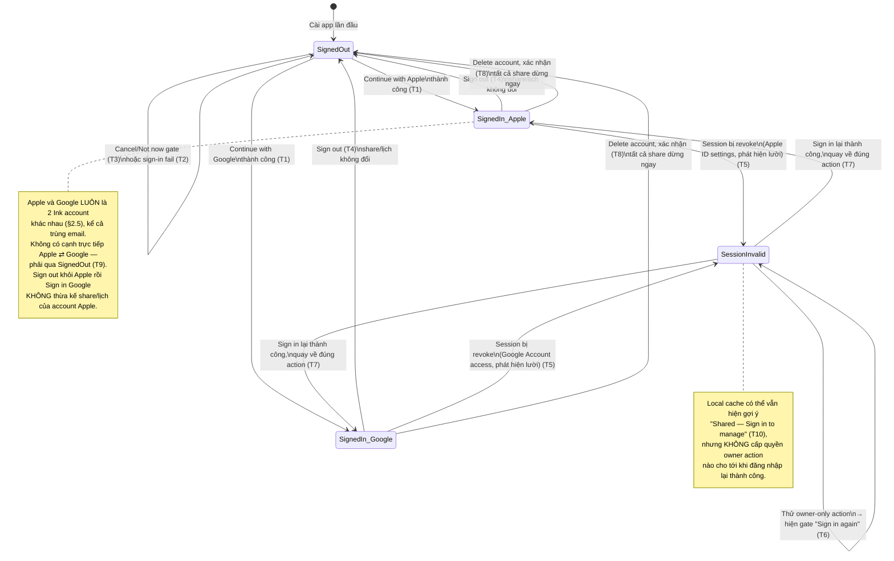

# Mermaid — Account State Diagram (Scope A)

> Minh hoạ trực quan cho bảng "State Transition chi tiết — Account" (T1–T11) ở
> [../test-plans/login-account-deep-dive.md](../test-plans/login-and-calendar-sharing/login-account-deep-dive.md) mục 2. Test case tương
> ứng nằm ở [../../test-cases/login-signin.md](../../test-cases/login-and-calendar-sharing/login-signin.md).
> Ký hiệu: `❓` trên nhãn cạnh = hành vi chưa được tài liệu nào xác nhận rõ, xem "Open" ở deep-dive.

