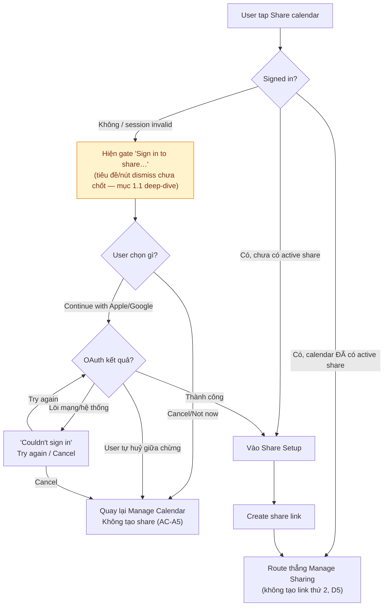
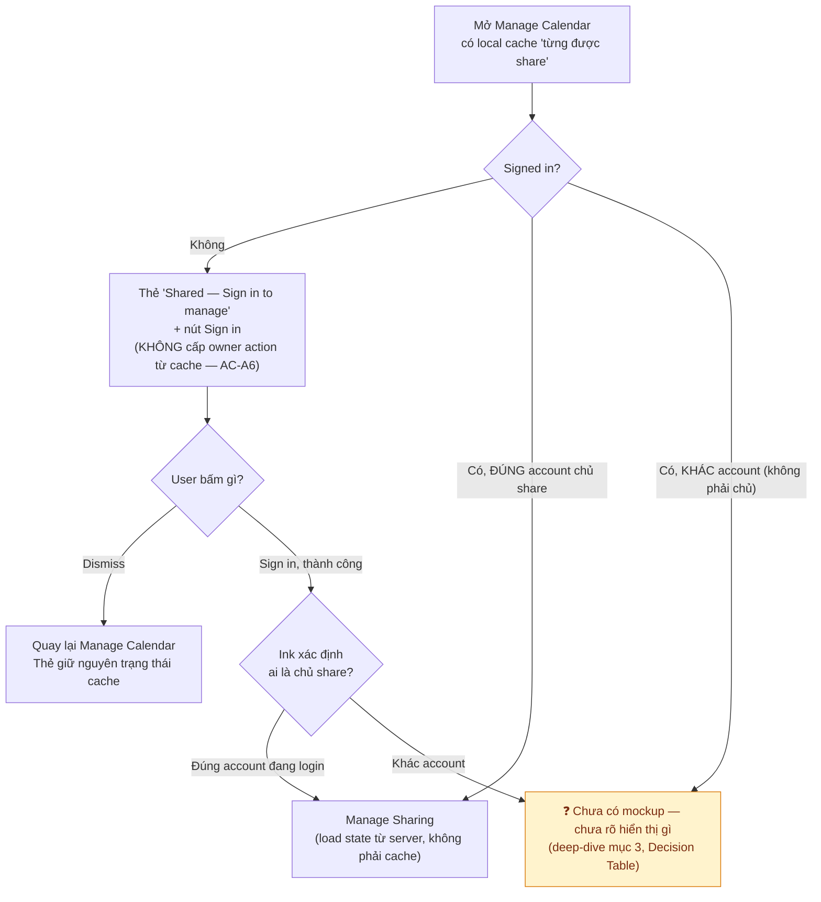
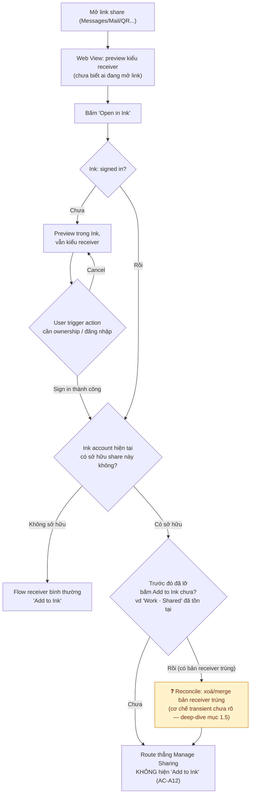

# Mermaid — Login Gate Decision Flows (Scope A)

> Minh hoạ cho Decision Table "Entry point đăng nhập × trạng thái account × gate hiển thị" ở
> [../test-plans/login-account-deep-dive.md](../test-plans/login-and-calendar-sharing/login-account-deep-dive.md) mục 3. Test case tương
> ứng: [../../test-cases/login-signin.md](../../test-cases/login-and-calendar-sharing/login-signin.md) Suite B/D/E/F/G/I.
> Node màu vàng = còn câu hỏi mở (copy chưa chốt hoặc hành vi chưa có mockup) — xem chi tiết ở deep-dive tương ứng.

## Flow 1 — Tap "Share calendar"

## Flow 2 — Mở Manage Calendar của lịch đã từng/đang share

## Flow 3 — Owner mở link share của chính mình (D10, cross Scope A/B)

