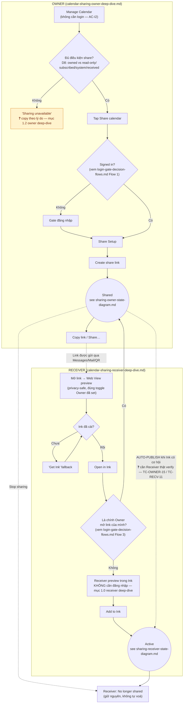

# Mermaid — Sharing End-to-End Flow (Owner ⇄ Receiver, toàn cảnh)

> Ghép Owner + Receiver + login vào 1 bức tranh để thấy chỗ nào 2 side thật sự giao nhau. Chi tiết từng nhánh
> nằm ở 4 file kia trong thư mục này; xem
> [../test-plans/calendar-sharing-deep-dive.md](../test-plans/login-and-calendar-sharing/calendar-sharing-deep-dive.md) mục "Suite liên-side"
> cho danh sách case buộc phải chạy đồng thời cả 2 role.

## Ghi chú đọc sơ đồ

- **Đường nét đứt (`-.->`)** = điểm giao nhau thật sự giữa 2 side, cần cả Owner lẫn Receiver cùng hoạt động để
  verify trọn vẹn — khớp đúng bảng "Suite liên-side" ở file mục lục `calendar-sharing-deep-dive.md`.
- **Node vàng** = còn câu hỏi mở, chưa chốt copy/hành vi — tra cứu chi tiết ở deep-dive tương ứng trước khi viết
  assertion literal-string.
- Sơ đồ này **không thay thế** 4 file state-diagram/flow chi tiết — dùng để định hướng, khi cần drill-down thì
  mở đúng file nhánh đó.
