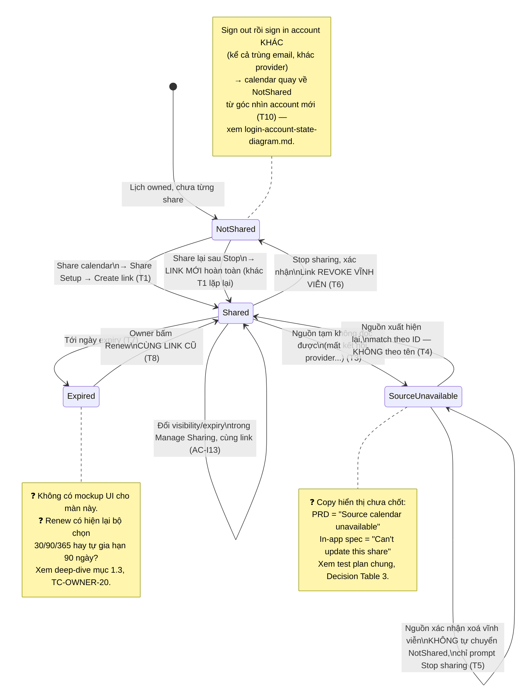

# Mermaid — Sharing State Diagram, Owner side (Scope B)

> Minh hoạ cho bảng "State Transition — Sender/Owner" (T1–T10) ở
> [../test-plans/calendar-sharing-owner-deep-dive.md](../test-plans/calendar-sharing-owner-deep-dive.md) mục 2.
> Test case tương ứng: file đó, Suite O2–O4 (TC-OWNER-07…26).
> Đây là state của **1 calendar cụ thể** dưới góc nhìn Owner — không nhầm với Account state (xem
> [login-account-state-diagram.md](login-account-state-diagram.md), đã tách riêng vì 2 state machine độc lập
> nhau: 1 calendar có thể `not_shared` dù account đang `signed_in`, và ngược lại.

