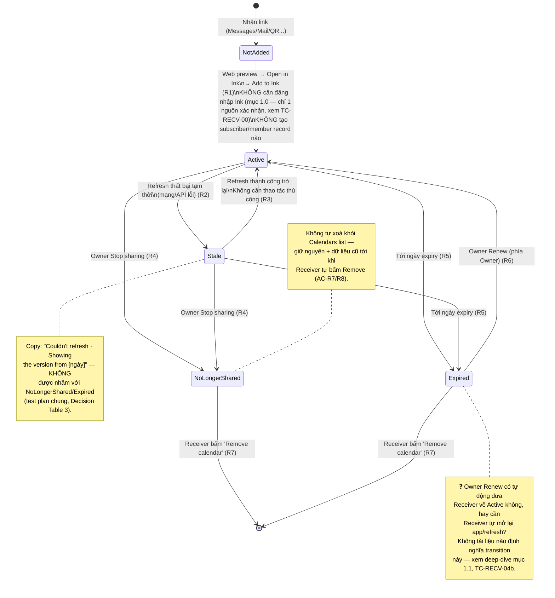

# Mermaid — Sharing State Diagram, Receiver side (Scope B)

> Minh hoạ cho bảng "State Transition — Receiver" (R1–R7) ở
> [../test-plans/calendar-sharing-receiver-deep-dive.md](../test-plans/login-and-calendar-sharing/calendar-sharing-receiver-deep-dive.md)
> mục 2. Test case tương ứng: file đó, Suite R0/R2/R3 (TC-RECV-00…14).

