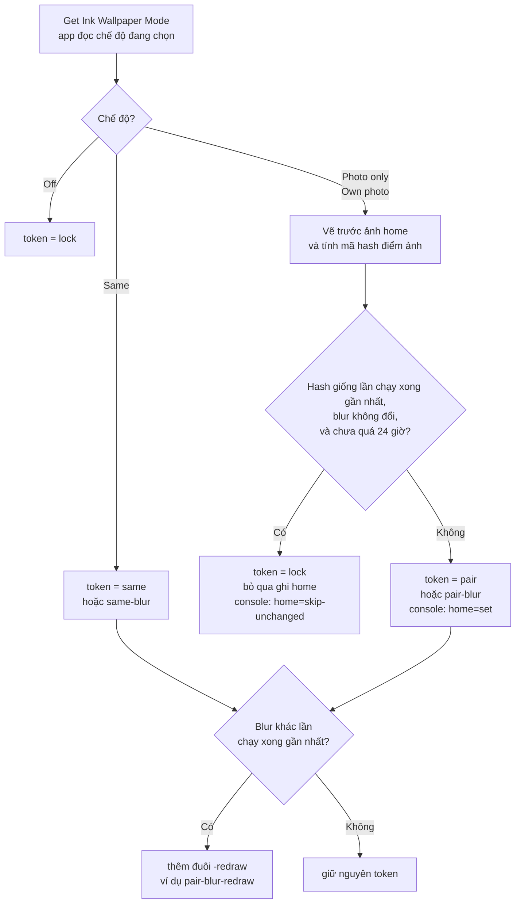
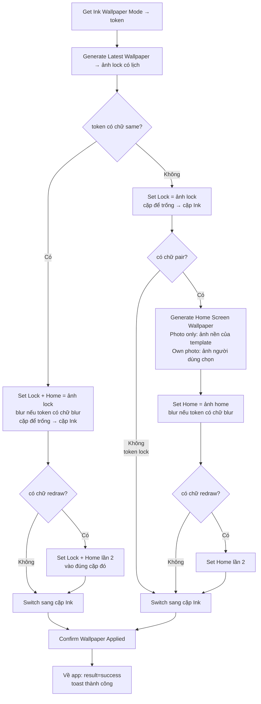
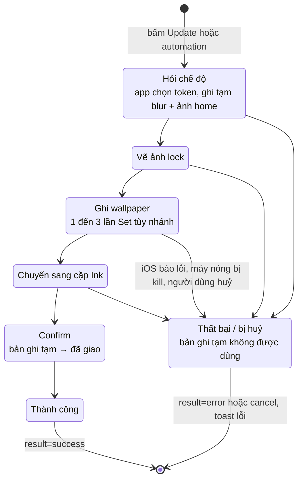

# Bàn giao QC — Shortcut wallpaper mới: Home Screen (iOS 26) và Automation (iOS 27)

Nhánh **`fix/ios27-shortcut-automation`** · **chưa vào `main`** ·
test trên bản **Ink Dev** dựng từ nhánh này bằng Xcode, không phải bản TestFlight/App Store.

Chín mảng cần test, xếp theo mức rủi ro giảm dần:

1. **Luồng set wallpaper cũ không được vỡ** — nút Set/Update, xác nhận đã set, shortcut bị xoá,
   toast báo kết quả hiện ngay trên màn đang mở.
2. **Bốn chế độ Home Screen** — Off / Same / Photo only / Own photo, có và không có Blur.
3. **Ảnh home riêng** — chọn trong Ink (Own photo), hoặc tự chọn trong iOS rồi để Off giữ nguyên.
4. **Cặp wallpaper** — shortcut ghi vào cặp riêng của Ink và chuyển màn khoá sang cặp đó.
5. **Automation iOS 27** — automation Sunrise đi kèm shortcut, chạy khi máy khoá.
6. **Chéo phiên bản** — file iOS 27 cài lên iOS 26.
7. **Cảnh báo "Needs the new Ink shortcut"** trong editor.
8. **Ảnh HEIC** — wallpaper giờ xuất ra HEIC thay vì PNG: soi chất lượng.
9. **Tốc độ** — Photo only / Own photo chạy lại nhanh khi ảnh home không đổi.

> **Bản này đổi gì so với đợt trước:** **Photo only** và **Own photo** bỏ qua bước ghi home khi
> ảnh home không đổi (chạy lại nhanh gần bằng Off; mỗi ngày vẫn ghi đầy đủ một lần); Blur đổi ngay
> sau **một** lần chạy; Same ghi Lock + Home trong **một** action nên nhanh hơn; wallpaper
> xuất ra **HEIC**; toast thành công/thất bại hiện **trên màn edit** (trước chỉ hiện ở Home);
> mục **Debug** trong Settings có thêm đồng hồ đo và chọn định dạng ảnh (mục 12).

> ⚠️ Mục 4, 5, 6 có phần **thăm dò**: chưa ai biết trước kết quả đúng. Ghi lại **chính xác**
> những gì thấy vào bảng ở mục 11 — kết quả đó quyết định thiết kế bản phát hành, nên
> "không chạy" cũng là một kết quả có giá trị.

---

## 1. File shortcut

Thư mục **`Ink Shortcut Final`** (lấy từ người bàn giao, gửi qua AirDrop):

```
iOS 26/Dev/Ink Refresh Lock Screen.shortcut     35 action, không có automation
iOS 26/Prod/Ink Refresh Lock Screen.shortcut
iOS 27/Dev/Ink Refresh Lock Screen.shortcut     35 action + automation Sunrise
iOS 27/Prod/Ink Refresh Lock Screen.shortcut
```

- **Dev / Prod** là bản app mà shortcut gọi tới. Máy cài **Ink Dev** thì dùng file trong
  `Dev/`. Cài nhầm bản thì các action của Ink hiện **màu đỏ** — do cài nhầm, không phải bug.
- **Bản Prod chưa test được**: bản Ink Prod trên store chưa có các action mới. Chỉ dùng
  `Dev/` trong đợt này.
- Để so sánh với hành vi cũ, **shortcut production hiện tại** cài từ link
  `https://www.icloud.com/shortcuts/199d89e6742143cea54c2f4bc2268fd2` — nó set cả lock lẫn
  home bằng một ảnh có lịch, kèm blur, và **không** hiểu các chế độ Home Screen.

---

## 2. Môi trường test

| Máy | Bắt buộc | Lý do |
|---|---|---|
| iPhone **iOS 26.x** | ✅ | Shortcut iOS 26 (mục 3–8) |
| iPhone **iOS 27** | ✅ | Shortcut iOS 27 có automation (mục 9) |
| Máy thứ hai, **Apple Account khác** | ✅ | Automation có đi theo khi cài trên máy người khác |
| iPad | Nếu có | Ảnh home trên màn vuông, xoay ngang/dọc |

**Chuẩn bị trên mỗi máy:** thư viện wallpaper (giữ tay trên màn khoá) có **ít nhất 3 cặp**,
trong đó ít nhất 1 cặp là **ảnh riêng của bạn** — để thấy rõ Ink có ghi đè lên nó không.

---

## 3. Cài shortcut và chuyển qua lại giữa nhiều shortcut

**Quy tắc duy nhất cần nhớ:** app chạy shortcut **theo tên**. Shortcut nào tên **đúng từng
ký tự** là `Ink Refresh Lock Screen` thì app chạy cái đó. Các shortcut khác tên không bị
đụng tới.

Vì vậy có thể **cài nhiều shortcut cùng lúc** và đổi qua lại bằng cách đổi tên, không cần
xoá rồi cài lại.

### 3.1 Cài lần đầu

1. Mở file bằng AirDrop → **Add Shortcut**. Shortcut được thêm với tên
   `Ink Refresh Lock Screen`.
2. Lần chạy đầu iOS hỏi quyền đặt wallpaper → chọn **Always Allow**.
3. **Chỉ iOS 27:** mở shortcut → **ⓘ → Privacy → bật "Allow Running When Locked"**.
   Cài đặt này **không** đi theo file.

- [ ] Mở shortcut: có **11 action "Set Wallpaper"** và **3 action "Switch"**, không action
      nào hiện màu đỏ. Nhánh **Same** dùng action **Lock + Home** (một lần ghi cho cả hai
      màn); nhánh còn lại set Lock rồi mới set Home
- [ ] Cả 3 action **"Switch Between Wallpapers"**: ô cặp wallpaper hiện biến
      **"Wallpaper"** (kết quả của action Set đầu tiên). Nếu ô này **trống**, hoặc khi chạy
      shortcut **hiện popup bắt chọn wallpaper** → báo ngay, lỗi chặn phát hành

### 3.2 Giữ nhiều shortcut, đổi bằng tên

Đặt tên các shortcut **không dùng** theo một quy ước dễ đọc, ví dụ:

| Tên trong app Shortcuts | Là gì |
|---|---|
| `Ink Refresh Lock Screen` | **Shortcut app đang chạy** — chỉ một cái được mang tên này |
| `Ink · Production` | Shortcut production cũ (link `199d89e6…`) |
| `Ink · iOS 26` | File `iOS 26/Dev` |
| `Ink · iOS 27` | File `iOS 27/Dev` |

**Đổi sang shortcut khác:**

1. Đổi tên shortcut đang mang tên `Ink Refresh Lock Screen` → tên của nó trong bảng
   (giữ tay trên shortcut → **Rename**).
2. Đổi tên shortcut muốn test → **`Ink Refresh Lock Screen`**.
3. Vào app bấm **Update** — app sẽ chạy shortcut vừa đổi tên.

**Cài thêm một file khi đã có shortcut tên `Ink Refresh Lock Screen`:** an toàn nhất là
**đổi tên shortcut đang có trước** (bước 1 ở trên), rồi mới cài file mới. Nếu cài luôn,
iOS có thể hỏi **thay thế** shortcut cũ hoặc thêm bản mới với số ở cuối
(`Ink Refresh Lock Screen 1`) — chọn giữ cả hai, rồi đổi tên theo bảng. Ghi lại iOS hỏi
kiểu nào vào mục 11.

**Ba điều dễ nhầm:**

- **Không bao giờ để hai shortcut cùng tên `Ink Refresh Lock Screen`.** App không chọn
  được cái nào, kết quả không đoán trước được.
- **Automation không theo tên.** Automation (iOS 26: trong tab Automation; iOS 27: nằm
  bên trong shortcut) gắn với **chính shortcut đó**, không phải với cái tên. Shortcut
  bị đổi tên vẫn chạy automation của nó. Trên iOS 27, **tắt automation Sunrise của các
  shortcut không dùng** (mở shortcut → Edit → Automation), nếu không sáng ra nhiều
  shortcut cùng chạy và ghi đè nhau.
- **Quyền "Always Allow" tính riêng từng shortcut.** Shortcut mới đổi tên sang lần đầu
  chạy có thể hỏi quyền lại — chọn Always Allow như bước 3.1.

- [ ] Sau khi đổi tên, bấm Update: đúng shortcut vừa đổi tên chạy (kiểm tra bằng chế độ
      Home Screen — shortcut production **không** làm theo chế độ, shortcut mới thì có)

---

## 4. Luồng set wallpaper cũ không được vỡ (mục rủi ro nhất)

Để chế độ Home Screen ở **Off** cho toàn bộ mục này.

- [ ] Discover → chọn một template → **Set as current** → shortcut chạy → lock screen đổi
      đúng template, app quay lại, template hiện nhãn đang dùng
- [ ] Mở template đang dùng → sửa gì đó → **Update** → lock screen đổi theo
- [ ] Lần chạy đầu, ở hộp thoại hỏi quyền chọn **Don't Allow** → mở lại app: app **không**
      được coi là đã set thành công (không hiện nhãn đang dùng cho template mới)
- [ ] Đổi tên shortcut `Ink Refresh Lock Screen` sang tên khác (coi như xoá) → bấm Set trong
      app → app phải nhận ra không còn shortcut và đưa vào luồng cài đặt, **không** kẹt
      ở màn Shortcuts. Đổi tên lại để tiếp tục.
- [ ] Spotlight: gõ "Ink" → **Refresh Lock Screen** → wallpaper đổi, **không** mở app
- [ ] Template **note** (Notes) và template **lịch** đều set được như trên

**Toast báo kết quả** (trước đây chỉ hiện ở Home, bị màn edit che mất):

- [ ] Trong **màn edit template** bấm **Update** → shortcut chạy xong quay về app → toast
      **"Lock screen updated"** hiện **ngay trên màn edit**, không phải đợi thoát ra Home
- [ ] Làm shortcut lỗi (ví dụ đổi tên shortcut để app không tìm thấy) → toast lỗi cũng hiện
      trên màn đang mở
- [ ] Toast hiện trên cả **sheet/popup** đang mở, và **không chặn** thao tác — vẫn bấm được
      nút bên dưới trong lúc toast đang hiện
- [ ] Trong **luồng cài shortcut lần đầu**, nếu chạy lỗi: chỉ thấy thông báo lỗi **của màn cài
      đặt**, **không** có thêm một toast lỗi thứ hai chồng lên

---

## 5. Bốn chế độ Home Screen

Đường vào: mở một template → editor → tab **Background** → mục **Home Screen** (dưới
phần ảnh nền). Chọn chế độ → bấm **Set as current / Update** để shortcut chạy.

### Sơ đồ: một lần chạy shortcut rẽ nhánh thế nào

Sơ đồ vẽ bằng Mermaid, xem được trên GitHub hoặc bằng bản xem trước Markdown có hỗ trợ Mermaid.
Mỗi lần chạy có **hai bên quyết định**: app chọn một **token** (chữ gửi cho shortcut), rồi
shortcut rẽ nhánh theo các chữ có trong token đó.

**Bước 1: app chọn token** (action `Get Ink Wallpaper Mode`, chạy đầu tiên)



**Bước 2: shortcut chạy theo token**



**Trạng thái của một lần chạy.** Shortcuts chạy lần lượt từng action và **dừng ngay ở action
đầu tiên bị lỗi**. Vì thế `Confirm` chỉ chạy khi mọi bước trước đã xong. App chỉ ghi nhận
"đã giao" blur và ảnh home **sau Confirm**, nên một lần chạy dở dang không làm lần sau bỏ qua
nhầm.



**Bảng tra nhanh:**

| Chế độ | Tình huống | Token | Số lần Set | Home bị ghi? |
|---|---|---|---|---|
| Off | mọi lần | `lock` | 1 (Lock) | Không |
| Same | bình thường | `same` / `same-blur` | 1 (Lock + Home cùng lúc) | Có |
| Same | vừa đổi Blur | `…-redraw` | 2 | Có |
| Photo only / Own photo | ảnh home đổi, lần đầu, hoặc quá 24 giờ | `pair` / `pair-blur` | 2 (Lock, rồi Home) | Có |
| Photo only / Own photo | vừa đổi Blur | `pair…-redraw` | 3 | Có |
| Photo only / Own photo | ảnh home **không** đổi | `lock` | 1 (Lock) | Không (giữ ảnh cũ) |

Mỗi lần Set tốn khoảng **4 giây**, nên số lần Set gần như quyết định thời gian chạy. Khi test
tốc độ, đọc cột này cùng dòng `modeIntent token=…` trên console Xcode để biết lần chạy đó đi
nhánh nào.

| Chế độ | Blur | Lock screen | Home screen |
|---|---|---|---|
| **Off** (mặc định) | — | Wallpaper có lịch | **Không bị Ink set** (xem lưu ý bên dưới) |
| **Same** | Tắt | Wallpaper có lịch | **Cùng ảnh** có lịch, nét |
| **Same** | Bật | Wallpaper có lịch | Cùng ảnh có lịch, **mờ** |
| **Photo only** | Tắt | Wallpaper có lịch | **Ảnh nền của template, không có lịch**, không tối đi |
| **Photo only** | Bật | Wallpaper có lịch | Ảnh nền không lịch, **mờ** |
| **Own photo** | Tắt | Wallpaper có lịch | **Ảnh người dùng chọn** trong Ink, nét |
| **Own photo** | Bật | Wallpaper có lịch | Ảnh người dùng chọn, **mờ** |

- [ ] Chạy đủ **7 dòng** của bảng trên, mỗi dòng xem cả lock và home
- [ ] Có **4 chip**: Off / Same / Photo only / Own photo
- [ ] Toggle **Blur Home Screen** chỉ hiện khi chế độ **khác Off**
- [ ] Lock screen **luôn nét** kể cả khi Blur bật
- [ ] **Blur đổi ngay sau MỘT lần chạy:** ở Same hoặc Photo only, bật Blur → bấm Update
      **một lần** → home mờ ngay. Tắt Blur → Update một lần → home nét ngay. Làm cả hai chiều,
      mỗi chiều 2 lượt. Nếu phải bấm lần thứ hai mới đổi → báo lỗi.
- [ ] Photo only: home **không bị tối** dù thanh **Darken** của lock kéo cao
- [ ] Template có **nhiều ảnh nền đổi theo ngày**: Photo only dùng đúng ảnh của **hôm nay**,
      trùng với ảnh dưới lịch trên lock
- [ ] Mỗi lần chạy Photo only có **bị hỏi quyền 2 lần** không (có 2 action
      set wallpaper trong một lần chạy)? Ghi vào mục 11
- [ ] **Same nhanh hơn Photo only khi Photo only phải ghi home** (lần đầu, hoặc vừa đổi ảnh
      nền): Same chỉ ghi một lần cho cả hai màn, nên phải nhanh hơn khoảng 3–4 giây (xem Settings → Debug → Last shortcut run; nghỉ ~1 phút giữa
      hai lần bấm, máy không nóng)
- [ ] Đổi chế độ rồi bấm **✕ (Cancel)** thoát editor → mở lại: chế độ phải **quay về như
      trước khi mở** editor

**Photo only và Own photo bỏ qua bước set home khi ảnh home không đổi** (lịch đổi nhưng ảnh nền giữ
nguyên thì home không cần ghi lại; mỗi lần ghi home tốn khoảng 4 giây):

- [ ] Photo only, bấm Update lần 1 → ghi lại thời gian ở Settings → Debug → Last shortcut run
- [ ] Không đổi gì, bấm Update lần 2 (nghỉ ~1 phút) → **nhanh hơn rõ** (gần bằng Off), home
      **vẫn đúng** ảnh nền, lock có lịch mới. Console Xcode ghi `home=skip-unchanged`
- [ ] Thêm hoặc sửa một sự kiện → Update → vẫn nhanh, home vẫn đúng
- [ ] **Đổi ảnh nền** (ảnh khác, crop lại, hoặc đổi template) → Update → home **đổi theo**
      ngay lần đó (console `home=set`)
- [ ] **Crop lại cùng một ảnh** → Update → home đổi theo khung mới
- [ ] Đổi Blur → Update → home đổi blur ngay (không bị bỏ qua)
- [ ] Photo only → Off → tự đổi ảnh home trong iOS → quay lại Photo only → Update → home
      **về ảnh nền template** (không được giữ ảnh tự chọn)
- [ ] Template **nhiều ảnh nền đổi theo ngày**: sáng hôm sau automation chạy → home là ảnh
      của **hôm nay**
- [ ] Để qua hơn 24 giờ không đổi gì → lần chạy kế tiếp **ghi home đầy đủ một lần** (chậm lại
      một lần là đúng)

**Chất lượng ảnh HEIC** (wallpaper trước là PNG, giờ là HEIC chất lượng cao nhất):

- [ ] Chọn vài template có **thẻ bán trong suốt** đè lên ảnh nền (lịch dạng thẻ, agenda) → set
      → soi kỹ lock screen: có **vệt màu, sọc, mảng loang** ở mép thẻ hay vùng chuyển màu không?
- [ ] Chữ nhỏ trên lịch (giờ, tên sự kiện) có **nhoè viền** không?
- [ ] Nếu nghi: Settings → Debug → **Wallpaper format → PNG**, set lại cùng template, chụp màn
      hình cả hai bản để so. Báo kèm cả hai ảnh.

> **Vì sao có khối "redraw":** iOS lưu đúng trạng thái blur ngay khi set, nhưng vẽ home
> theo trạng thái **trước đó** (mở màn chỉnh wallpaper của iOS là thấy nó tự chuyển). Nên
> ngay sau khi đổi Blur, app báo shortcut **set home thêm một lần** để iOS vẽ lại. Các lần
> chạy khác, kể cả automation lúc sáng, chỉ set một lần.

> **Off không có nghĩa là home đứng yên — đây không phải bug.** Mọi chế độ, kể cả Off, đều
> **chuyển màn khoá sang cặp của Ink** (mục 7), nên home hiện ra là **home của cặp Ink**:
> - Cặp Ink chưa từng được set home riêng → home **đi theo lock** (cùng ảnh có lịch).
> - Đã chạy Same / Photo only, hoặc đã tự chỉnh home của cặp Ink trong iOS, ít nhất một
>   lần → Off **giữ nguyên** home đó.
> - Đang dùng một cặp **khác** có home riêng → chạy Off thì home **đổi sang home của cặp
>   Ink**. Shortcuts không đọc được ảnh trong cặp khác để giữ lại; muốn home giống cũ thì
>   tự chọn lại ảnh đó cho home của cặp Ink trong iOS (mục 6).

---

## 6. Ảnh home riêng

**A. Own photo (chọn trong Ink)**

- [ ] Chọn **Own photo** → hiện hàng ảnh: ô **+** (mở Photos), ảnh đã upload, ảnh catalog
- [ ] Chọn ảnh từ Photos → Update → home là **đúng ảnh đó**, lock vẫn có lịch
- [ ] Chọn ảnh catalog (có vòng xoay tải về) → Update → home đúng ảnh đó
- [ ] Update lần 2 không đổi gì → **nhanh**, home giữ nguyên (console `home=skip-unchanged`)
- [ ] Đổi sang ảnh khác → Update → home **đổi theo** ngay lần đó
- [ ] **Đổi template** khác → Update → home **vẫn là ảnh riêng** (không theo template)
- [ ] Chuyển sang Photo only rồi quay lại Own photo → ảnh đã chọn **vẫn còn được chọn**
- [ ] Own photo nhưng **chưa chọn ảnh nào** → Update → home dùng ảnh nền của lock (không trống)
- [ ] Ảnh vừa chọn từ Photos cũng xuất hiện trong hàng ảnh nền của **lock**

**B. Tự chọn trong iOS, Ink để Off**

- [ ] Màn khoá đang ở **cặp Ink** → giữ tay → **Customize** → **Home Screen** → chọn một ảnh
      trong Photos → Done
- [ ] Về Ink, chế độ **Off**, bấm **Update** → lock đổi lịch mới, home **vẫn là ảnh vừa chọn**
- [ ] Chạy thêm 2 lần (và để automation sáng hôm sau chạy) → home **vẫn giữ nguyên**
- [ ] Chuyển sang **Same**, **Photo only** hoặc **Own photo** rồi Update → home **bị thay** —
      đúng, vì chính người dùng chọn chế độ đó

---

## 7. Cặp wallpaper (một phần thăm dò)

**Cách shortcut làm:**

1. Action Set đầu tiên ghi ảnh lock vào **cặp riêng của Ink**. File không chọn sẵn cặp nào:
   lần chạy đầu iOS **tạo một cặp mới**, các lần sau ghi lại vào đúng cặp đó.
2. Các action Set cho home ghi vào **chính cặp đó** (qua biến "Wallpaper").
3. **Switch** chuyển màn khoá sang cặp đó. Nên **mỗi lần chạy, màn khoá luôn hiện cặp của
   Ink**, kể cả khi trước đó user đang ở cặp khác.

Ink **không bao giờ ghi đè** lên cặp của user, chỉ chuyển màn khoá khỏi cặp đó.

**Đã xác nhận trên máy (không cần test lại):** xoá một cặp **khác** → shortcut vẫn ghi đúng
cặp của Ink (số hiển thị tự đổi, ví dụ 6 → 5).

**Cần test:**

- [ ] **Cài mới khi đang ở cặp của bạn:** chuyển màn khoá sang một cặp **ảnh riêng**, đếm
      số cặp. Cài shortcut, bấm Set trong app:
      - Màn khoá **chuyển sang cặp mới** và hiện lịch?
      - Số cặp **tăng đúng một**?
      - Chuyển lại cặp ảnh riêng: ảnh **vẫn nguyên**, không bị thay bằng lịch?
- [ ] **Không sinh thêm cặp:** bấm Update **3 lần** liên tiếp → số cặp **không đổi**.
- [ ] **Đủ bốn chế độ vẫn một cặp:** chạy lần lượt Off → Same → Photo only → Own photo. Sau
      mỗi lần đếm số cặp. Chế độ nào **tạo thêm cặp mới** → báo ngay, lỗi chặn phát hành.
- [ ] **Tự chuyển sang cặp khác rồi bấm Update:** màn khoá **tự quay về cặp của Ink**, lịch
      là bản mới nhất.
- [ ] **Xoá chính cặp của Ink** (giữ tay màn khoá → vuốt lên trên cặp → thùng rác) → bấm
      Update → iOS tạo cặp mới **và chuyển sang cặp đó**, không báo **"Unable to switch"**.
      Chạy thêm 2 lần: số cặp không tăng tiếp.

---

## 8. Cảnh báo "Needs the new Ink shortcut"

Dòng chữ **vàng** trong mục Home Screen, khi chế độ khác Off.

- [ ] Đổi tên để app chạy **shortcut production** (mục 3.2) → chọn Same/Photo only
      → cảnh báo **hiện** (với máy chưa từng chạy shortcut mới)
- [ ] Đổi tên để app chạy **shortcut mới**, bấm Update **một lần** → **đóng rồi mở lại**
      editor → cảnh báo **biến mất**
- [ ] Với shortcut production, chọn Photo only rồi set: nó **không** hiểu chế độ này — vẫn
      set cả lock và home bằng ảnh có lịch kèm blur như trước. Đúng như dự kiến

---

## 9. Automation iOS 27

File `iOS 27/Dev` mang sẵn **một** automation: **Sunrise** (lúc bình minh, hằng ngày).
Bình minh tính theo vị trí từng máy nên không phụ thuộc múi giờ.

Sau khi cài (mục 3.1, nhớ bật Allow Running When Locked), mở shortcut → **Edit → Automation**:

- [ ] Có automation **Sunrise** không? Đang **bật hay tắt**?
- [ ] **Allow Running When Locked** ngay sau khi cài (trước khi tự bật) đang bật hay tắt?

Chạy thật:

- [ ] **Sunrise** có xin **quyền vị trí** không?
- [ ] Để máy **khoá** qua đêm → sáng hôm sau wallpaper có đổi không? Có bị hỏi xác nhận không?
- [ ] Muốn khỏi chờ tới sáng: tạm đổi automation sang **Time of Day, 2–3 phút tới** →
      khoá máy → chờ → kiểm tra như trên. Test xong đổi lại Sunrise.
- [ ] Sau khi automation chạy lúc khoá máy, mở app: **không** hiện cảnh báo "automation
      không chạy" ở Home/Settings
- [ ] Cài lại **cùng file lần nữa**: có sinh **automation trùng** không?
- [ ] Máy **Apple Account khác**: cài file → có automation Sunrise không, bật hay tắt?

---

## 10. Chéo phiên bản

- [ ] Cài file **`iOS 27/Dev`** lên máy **iOS 26**: có cài được không? Nếu được, các action có
      chạy bình thường không (phần automation mong đợi là bị bỏ qua)?

Nếu iOS 26 cài được và chạy đúng, bản phát hành chỉ cần **một link cho cả hai phiên bản**.

---

## 11. Bảng ghi kết quả thăm dò

| Câu hỏi | iOS 26 | iOS 27 | Ghi chú |
|---|---|---|---|
| Photo only hỏi quyền mấy lần? | | | |
| Same / Photo only mất bao nhiêu giây (máy nguội, nghỉ 1 phút)? | | | |
| HEIC: lock có vệt màu / chữ nhoè ở template nào? | | | |
| Đổi Blur rồi Update một lần: home đổi ngay? | | | |
| Cài file khi đã có shortcut cùng tên: iOS hỏi thay thế hay thêm bản số 1? | | | |
| Switch hiện biến "Wallpaper" sau khi cài (không trống, không popup)? | | | |
| Cài mới khi đang ở cặp riêng: màn khoá có chuyển sang cặp Ink? | | | |
| Cài mới: ảnh trong cặp riêng có bị thay bằng lịch? | | | |
| Cài mới: số cặp có tăng thêm một? | | | |
| Bấm Update 3 lần / đổi 4 chế độ: số cặp có tăng? | | | |
| Xoá cặp Ink rồi Update: tạo cặp mới và chuyển sang, không lỗi? | | | |
| Sau khi cài, automation Sunrise bật hay tắt? | — | | |
| Allow Running When Locked sau khi cài? | — | | |
| Sunrise có xin quyền vị trí? | — | | |
| Automation chạy khi khoá máy, không hỏi? | — | | |
| Cài lại lần 2 có automation trùng? | — | | |
| Account khác: automation có về máy? | — | | |
| File iOS 27 cài được trên iOS 26? | | — | |

---

## 12. Công cụ trong mục Debug (chỉ bản Dev)

Settings → cuộn xuống dưới cùng → **Debug**:

| Ô | Dùng để |
|---|---|
| **Last shortcut run** | Số giây của lần chạy gần nhất: *After render → confirm* (phần Set/Switch) và *total* (cả lần chạy) |
| **Wallpaper format** | PNG / JPEG / **HEIC 1.0** (mặc định). Chỉ để so sánh — test chính thức luôn để **HEIC 1.0** |

**Đo tốc độ đúng cách:** máy **không nóng**, nghỉ **~1 phút** giữa hai lần bấm Update (bấm liền
nhau luôn chậm hơn ~3 giây vì iOS còn đang xử lý lần trước), bỏ lần đầu tiên.

**Log chi tiết** (khi chạy app từ Xcode): gõ `Ink` vào ô lọc của Debug console. Mỗi lần chạy có
các dòng `[InkShortcut] …`: token chế độ, thời gian, mức nhiệt của máy (`thermal=`), kết quả
callback. Khi gặp lỗi, copy nguyên đoạn từ dòng `launch` tới dòng `callback`.

---

## 13. Không phải bug (đừng report)

- Chữ trong mục Home Screen **chỉ có tiếng Anh**, ở mọi ngôn ngữ máy — bản test, sẽ dịch
  trước khi phát hành.
- **Off** vẫn làm home đổi theo lock khi home đang đi theo lock — xem lưu ý ở mục 5.
- **Mỗi lần shortcut chạy, màn khoá bị kéo về cặp của Ink**, kể cả khi user vừa tự chuyển
  sang cặp khác, và kể cả lần chạy bằng automation lúc sáng. Đúng thiết kế: đó là cách để
  lịch mới luôn hiện ra.
- **Cặp đang dùng có home riêng, chạy Off → home đổi** sang home của cặp Ink — xem lưu ý ở
  mục 5.
- Nút **Add shortcut** trong luồng setup của app vẫn mở **link production** — shortcut mới
  chưa có link phát hành. Test bằng file ở mục 1.
- Photo only / Own photo **chậm lại một lần** sau hơn 24 giờ không đổi gì: đó là lần ghi home
  đầy đủ mỗi ngày, có chủ đích.
- Thời gian chạy **dao động** 4–9 giây cho cùng một thao tác khi máy nóng hoặc bấm liên tục —
  xem cách đo ở mục 12.
- Chạy liên tục nhiều lần làm **máy nóng** — do iOS xử lý ảnh mỗi lần set wallpaper.
- Mục **Debug** chỉ có trên bản Dev; chữ trong đó chỉ có tiếng Anh.

## 14. Khi report lỗi, ghi kèm

- Phiên bản iOS, iPhone hay iPad
- **Tên shortcut nào đang mang tên `Ink Refresh Lock Screen`** lúc lỗi (production, iOS 26
  hay iOS 27)
- Chế độ Home Screen + Blur bật/tắt lúc lỗi
- Chạy từ đâu: nút trong app, Spotlight, automation, hay bấm trong app Shortcuts
- Cảnh báo vàng lúc đó có hiện không
- Số cặp wallpaper trước và sau khi chạy
- Số giây ở **Last shortcut run** (mục 12), và nếu có Xcode: đoạn log `[InkShortcut]` của lần lỗi
- Ảnh chụp **lock screen và home screen**, và nếu nghi shortcut: ảnh chụp màn **Edit** của
  shortcut (các khối If và action Set Wallpaper)
