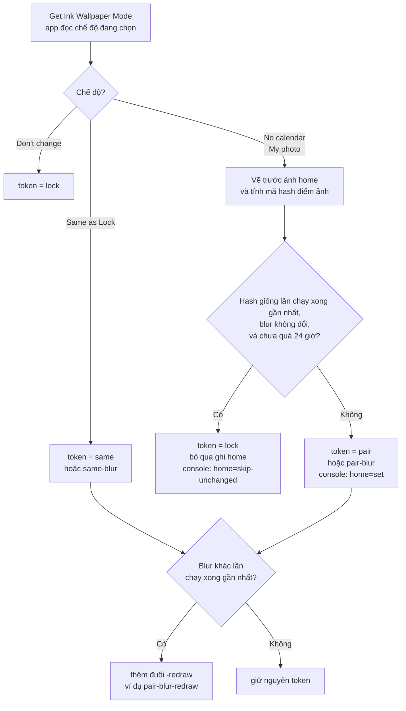
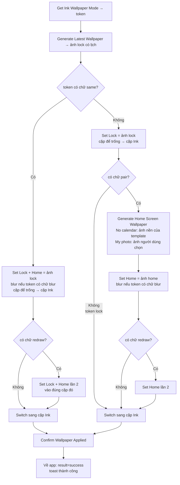
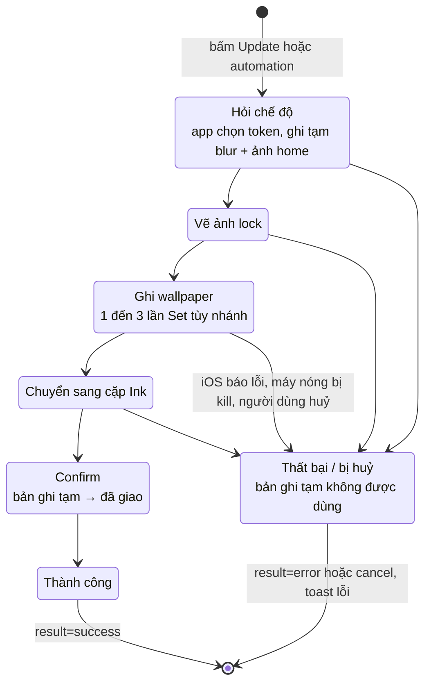

# Bàn giao QC — Shortcut V2: Home Screen, automation iOS 27 và chuyển từ shortcut cũ

**Đã vào `main`** (PR #302, 2026-09-24) · test trên bản **Ink Dev** dựng từ `main` bằng Xcode
hoặc bản Dev trên App Distribution, không phải bản App Store.

Các mảng cần test, xếp theo mức rủi ro giảm dần:

1. **Luồng set wallpaper cũ không được vỡ** — nút Set/Update, xác nhận đã set, shortcut bị xoá,
   toast báo kết quả hiện ngay trên màn đang mở.
2. **Chuyển từ shortcut cũ sang V2** — cửa sổ "Update your shortcut", luồng update, nhắc xoá
   shortcut cũ, thẻ giới thiệu trong tab Guide (mục 13).
3. **Bốn chế độ Home Screen** — Don't change / Same as Lock / No calendar / My photo, có và không có Blur.
4. **Ảnh home riêng** — chọn trong Ink (My photo), hoặc tự chọn trong iOS rồi để Don't change giữ nguyên.
5. **Cặp wallpaper** — shortcut ghi vào cặp riêng của Ink và chuyển màn khoá sang cặp đó.
6. **Automation iOS 27** — 5 automation đi kèm shortcut (mục 9, và hai doc riêng).
7. **Ảnh HEIC** — wallpaper giờ xuất ra HEIC thay vì PNG: soi chất lượng.
8. **Tốc độ** — No calendar / My photo chạy lại nhanh khi ảnh home không đổi.
9. **Trang "How updates work"** — mục mới về làm mới ngay bằng thông báo (mục 14).

> **Đợt này đổi gì so với đợt trước:**
> - Shortcut giờ tên **`Ink Refresh Lock Screen V2`** và cài từ **link iCloud** (mục 1), cùng một
>   link cho iOS 26 và iOS 27. Nút **Add shortcut** trong app mở đúng link này.
> - Chip Home Screen đổi tên: **Don't change / Same as Lock / No calendar / My photo**. Hai chip
>   sau là **Pro**. Toggle blur tên **Blur behind app icons**.
> - Dòng cảnh báo vàng "Needs the new Ink shortcut" **đã bỏ**, thay bằng cửa sổ
>   **"Update your shortcut"** khi bấm Update (mục 8).
> - Người đang dùng shortcut cũ được mời chuyển sang V2 (mục 13).
> - iOS 27: shortcut mang **5 automation** (sunrise, thông báo từ Ink, đóng Ink / Calendar /
>   Google Calendar). Guide và luồng setup có ảnh chụp mới.
> - Trang **How updates work** có thêm mục "Refresh it right after every change" (mục 14).

> ⚠️ Mục 5 và 9 còn phần **thăm dò**: ghi lại **chính xác** những gì thấy vào bảng ở mục 11.
> "Không chạy" cũng là một kết quả có giá trị.

Doc liên quan: automation iOS 27 → [`qc-shortcut-triggers-ios27.md`](qc-shortcut-triggers-ios27.md);
automation chạy theo thông báo → [`qc-notification-automation-ios27.md`](qc-notification-automation-ios27.md).

---

## 1. Cài shortcut

Shortcut V2 tên **`Ink Refresh Lock Screen V2`**, 35 action, mang sẵn 5 automation. **Một link
cho mọi iOS**: iOS 26 cài vào thì tự bỏ phần automation, các action vẫn chạy.

| Bản app | Link |
|---|---|
| **Ink Dev** | `https://www.icloud.com/shortcuts/007226dffb9240439830f196201a5ed6` |
| **Ink** (Prod) | `https://www.icloud.com/shortcuts/dd5b40be467c4ed2aecd38316471b2d7` |

- Link nào gọi đúng bản app đó. Cài nhầm bản thì các action của Ink hiện **màu đỏ** — do cài
  nhầm, không phải bug.
- Bình thường không cần cài tay: luồng setup trong app (nút **Add shortcut**) mở đúng link của
  bản app đang chạy.
- **Shortcut cũ (V1)** tên `Ink Refresh Lock Screen`, link
  `https://www.icloud.com/shortcuts/199d89e6742143cea54c2f4bc2268fd2` — là shortcut người dùng
  bản App Store đang có. Dùng nó để test chuyển sang V2 (mục 13). Nó set cả lock lẫn home bằng
  một ảnh có lịch, kèm blur, và **không** hiểu các chế độ Home Screen. Trên máy chỉ cài Ink Dev,
  nó chạy với Ink Dev.

## 2. Môi trường test

| Máy | Bắt buộc | Lý do |
|---|---|---|
| iPhone **iOS 26.x** | ✅ | Home Screen, chuyển từ shortcut cũ (mục 3–8, 13) |
| iPhone **iOS 27** | ✅ | Automation đi kèm shortcut (mục 9) |
| Máy thứ hai, **Apple Account khác** | ✅ | Automation có đi theo khi cài trên máy người khác |
| iPad | Nếu có | Ảnh home trên màn vuông, xoay ngang/dọc |

**Chuẩn bị trên mỗi máy:** thư viện wallpaper (giữ tay trên màn khoá) có **ít nhất 3 cặp**,
trong đó ít nhất 1 cặp là **ảnh riêng của bạn** — để thấy rõ Ink có ghi đè lên nó không.

---

## 3. Cài shortcut và giữ nhiều shortcut

**Quy tắc cần nhớ:** app chạy shortcut **theo tên**. Máy cài mới chạy shortcut tên **đúng từng
ký tự** `Ink Refresh Lock Screen V2`. Máy đã chuyển từ shortcut cũ (mục 13) cũng chạy tên này.

### 3.1 Cài lần đầu

1. Mở Ink → luồng setup (nút **Set** trên một template, hoặc Settings → shortcut) → **Add
   shortcut** → Shortcuts mở link → **Add Shortcut**. Hoặc mở thẳng link ở mục 1.
2. Lần chạy đầu iOS hỏi quyền đặt wallpaper → chọn **Always Allow**.
3. **Chỉ iOS 27:** mở shortcut → **ⓘ → Privacy → bật "Allow Running When Locked"**.
   Cài đặt này **không** đi theo link.

- [ ] Shortcut được thêm với tên **`Ink Refresh Lock Screen V2`**
- [ ] Mở shortcut: có **11 action "Set Wallpaper"** và **3 action "Switch"**, không action
      nào hiện màu đỏ. Nhánh **Same as Lock** dùng action **Lock + Home** (một lần ghi cho cả hai
      màn); nhánh còn lại set Lock rồi mới set Home
- [ ] Cả 3 action **"Switch Between Wallpapers"**: ô cặp wallpaper hiện biến
      **"Wallpaper"** (kết quả của action Set đầu tiên). Nếu ô này **trống**, hoặc khi chạy
      shortcut **hiện popup bắt chọn wallpaper** → báo ngay, lỗi chặn phát hành

### 3.2 Ba điều dễ nhầm

- **Không bao giờ để hai shortcut cùng tên `Ink Refresh Lock Screen V2`.** App không chọn được
  cái nào, kết quả không đoán trước được. Cài lại link khi đã có shortcut cùng tên, iOS hỏi
  **Replace** — xem cảnh báo ở mục 13.
- **Automation không theo tên.** Automation gắn với **chính shortcut đó**, không phải với cái
  tên. Đổi tên shortcut thì automation của nó vẫn chạy. Xoá shortcut thì automation của nó
  **bị xoá theo**.
- **Đừng đổi tên shortcut cũ thành tên V2 để test.** App phân biệt shortcut cũ và V2 bằng
  **action** (V2 hỏi app chế độ Home Screen trước khi vẽ), không bằng tên. Shortcut cũ mang
  tên V2 vẫn bị coi là shortcut cũ, và sẽ bật nhắc **"Two Ink shortcuts are running"** (mục 13).
  Muốn so với shortcut cũ, dùng máy khác.
- **Quyền "Always Allow" tính riêng từng shortcut.** Shortcut mới lần đầu chạy có thể hỏi quyền
  lại — chọn Always Allow như bước 3.1.

---

## 4. Luồng set wallpaper cũ không được vỡ (mục rủi ro nhất)

Để chế độ Home Screen ở **Don't change** cho toàn bộ mục này.

- [ ] Discover → chọn một template → **Set as current** → shortcut chạy → lock screen đổi
      đúng template, app quay lại, template hiện nhãn đang dùng
- [ ] Mở template đang dùng → sửa gì đó → **Update** → lock screen đổi theo
- [ ] Lần chạy đầu, ở hộp thoại hỏi quyền chọn **Don't Allow** → mở lại app: app **không**
      được coi là đã set thành công (không hiện nhãn đang dùng cho template mới)
- [ ] Đổi tên shortcut `Ink Refresh Lock Screen V2` sang tên khác (coi như xoá) → bấm Set trong
      app → app phải nhận ra không còn shortcut và đưa vào luồng cài đặt, **không** kẹt
      ở màn Shortcuts. Đổi tên lại để tiếp tục.
- [ ] Spotlight: gõ "Ink" → **Refresh Lock Screen** → wallpaper đổi, **không** mở app
- [ ] Template **note** (Notes) và template **lịch** đều set được như trên

**Toast báo kết quả** (trước đây chỉ hiện ở Home, bị màn edit che mất):

- [ ] Trong **màn edit template** bấm **Update** → shortcut chạy xong quay về app → toast
      **"Lock screen updated"** hiện **ngay trên màn edit**, không phải đợi thoát ra Home
- [ ] Làm shortcut lỗi (ví dụ đổi tên shortcut để app không tìm thấy) → toast lỗi cũng hiện
      trên màn đang mở
- [ ] Toast hiện trên cả **sheet/popup** đang mở, và **không chặn** thao tác — vẫn bấm được
      nút bên dưới trong lúc toast đang hiện
- [ ] Trong **luồng cài shortcut lần đầu**, nếu chạy lỗi: chỉ thấy thông báo lỗi **của màn cài
      đặt**, **không** có thêm một toast lỗi thứ hai chồng lên

---

## 5. Bốn chế độ Home Screen

Đường vào: mở một template → editor → tab **Background** → mục **Home Screen** (dưới
phần ảnh nền). Chọn chế độ → bấm **Set as current / Update** để shortcut chạy.

### Sơ đồ: một lần chạy shortcut rẽ nhánh thế nào

Sơ đồ vẽ bằng Mermaid, xem được trên GitHub hoặc bằng bản xem trước Markdown có hỗ trợ Mermaid.
Mỗi lần chạy có **hai bên quyết định**: app chọn một **token** (chữ gửi cho shortcut), rồi
shortcut rẽ nhánh theo các chữ có trong token đó.

**Bước 1: app chọn token** (action `Get Ink Wallpaper Mode`, chạy đầu tiên)

**Bước 2: shortcut chạy theo token**

**Trạng thái của một lần chạy.** Shortcuts chạy lần lượt từng action và **dừng ngay ở action
đầu tiên bị lỗi**. Vì thế `Confirm` chỉ chạy khi mọi bước trước đã xong. App chỉ ghi nhận
"đã giao" blur và ảnh home **sau Confirm**, nên một lần chạy dở dang không làm lần sau bỏ qua
nhầm.

**Bảng tra nhanh:**

| Chế độ | Tình huống | Token | Số lần Set | Home bị ghi? |
|---|---|---|---|---|
| Don't change | mọi lần | `lock` | 1 (Lock) | Không |
| Same as Lock | bình thường | `same` / `same-blur` | 1 (Lock + Home cùng lúc) | Có |
| Same as Lock | vừa đổi Blur | `…-redraw` | 2 | Có |
| No calendar / My photo | ảnh home đổi, lần đầu, hoặc quá 24 giờ | `pair` / `pair-blur` | 2 (Lock, rồi Home) | Có |
| No calendar / My photo | vừa đổi Blur | `pair…-redraw` | 3 | Có |
| No calendar / My photo | ảnh home **không** đổi | `lock` | 1 (Lock) | Không (giữ ảnh cũ) |

Mỗi lần Set tốn khoảng **4 giây**, nên số lần Set gần như quyết định thời gian chạy. Khi test
tốc độ, đọc cột này cùng dòng `modeIntent token=…` trên console Xcode để biết lần chạy đó đi
nhánh nào.

| Chế độ | Blur | Lock screen | Home screen |
|---|---|---|---|
| **Don't change** (mặc định) | — | Wallpaper có lịch | **Không bị Ink set** (xem lưu ý bên dưới) |
| **Same as Lock** | Tắt | Wallpaper có lịch | **Cùng ảnh** có lịch, nét |
| **Same as Lock** | Bật | Wallpaper có lịch | Cùng ảnh có lịch, **mờ** |
| **No calendar** | Tắt | Wallpaper có lịch | **Ảnh nền của template, không có lịch**, không tối đi |
| **No calendar** | Bật | Wallpaper có lịch | Ảnh nền không lịch, **mờ** |
| **My photo** | Tắt | Wallpaper có lịch | **Ảnh người dùng chọn** trong Ink, nét |
| **My photo** | Bật | Wallpaper có lịch | Ảnh người dùng chọn, **mờ** |

- [ ] Chạy đủ **7 dòng** của bảng trên, mỗi dòng xem cả lock và home
- [ ] Có **4 chip**: Don't change / Same as Lock / No calendar / My photo. Dưới chip có một
      dòng giải thích ngắn cho chế độ đang chọn
- [ ] **No calendar** và **My photo** là **Pro**: tài khoản free bấm vào → hiện **paywall**,
      chip **không** được chọn. Mua xong → chọn được ngay
- [ ] Đang ở No calendar / My photo mà **hết Pro** → chế độ về **Don't change**, ảnh đã chọn và
      blur vẫn giữ để khi mua lại dùng tiếp
- [ ] Toggle **Blur behind app icons** chỉ hiện khi chế độ **khác Don't change**
- [ ] Lock screen **luôn nét** kể cả khi Blur bật
- [ ] **Blur đổi ngay sau MỘT lần chạy:** ở Same as Lock hoặc No calendar, bật Blur → bấm Update
      **một lần** → home mờ ngay. Tắt Blur → Update một lần → home nét ngay. Làm cả hai chiều,
      mỗi chiều 2 lượt. Nếu phải bấm lần thứ hai mới đổi → báo lỗi.
- [ ] No calendar: home **không bị tối** dù thanh **Darken** của lock kéo cao
- [ ] Template có **nhiều ảnh nền đổi theo ngày**: No calendar dùng đúng ảnh của **hôm nay**,
      trùng với ảnh dưới lịch trên lock
- [ ] Mỗi lần chạy No calendar có **bị hỏi quyền 2 lần** không (có 2 action
      set wallpaper trong một lần chạy)? Ghi vào mục 11
- [ ] **Same as Lock nhanh hơn No calendar khi No calendar phải ghi home** (lần đầu, hoặc vừa đổi ảnh
      nền): Same as Lock chỉ ghi một lần cho cả hai màn, nên phải nhanh hơn khoảng 3–4 giây (xem Settings → Debug → Last shortcut run; nghỉ ~1 phút giữa
      hai lần bấm, máy không nóng)
- [ ] Đổi chế độ rồi bấm **✕ (Cancel)** thoát editor → mở lại: chế độ phải **quay về như
      trước khi mở** editor

**No calendar và My photo bỏ qua bước set home khi ảnh home không đổi** (lịch đổi nhưng ảnh nền giữ
nguyên thì home không cần ghi lại; mỗi lần ghi home tốn khoảng 4 giây):

- [ ] No calendar, bấm Update lần 1 → ghi lại thời gian ở Settings → Debug → Last shortcut run
- [ ] Không đổi gì, bấm Update lần 2 (nghỉ ~1 phút) → **nhanh hơn rõ** (gần bằng Don't change), home
      **vẫn đúng** ảnh nền, lock có lịch mới. Console Xcode ghi `home=skip-unchanged`
- [ ] Thêm hoặc sửa một sự kiện → Update → vẫn nhanh, home vẫn đúng
- [ ] **Đổi ảnh nền** (ảnh khác, crop lại, hoặc đổi template) → Update → home **đổi theo**
      ngay lần đó (console `home=set`)
- [ ] **Crop lại cùng một ảnh** → Update → home đổi theo khung mới
- [ ] Đổi Blur → Update → home đổi blur ngay (không bị bỏ qua)
- [ ] No calendar → Don't change → tự đổi ảnh home trong iOS → quay lại No calendar → Update → home
      **về ảnh nền template** (không được giữ ảnh tự chọn)
- [ ] Template **nhiều ảnh nền đổi theo ngày**: sáng hôm sau automation chạy → home là ảnh
      của **hôm nay**
- [ ] Để qua hơn 24 giờ không đổi gì → lần chạy kế tiếp **ghi home đầy đủ một lần** (chậm lại
      một lần là đúng)

**Chất lượng ảnh HEIC** (wallpaper trước là PNG, giờ là HEIC chất lượng cao nhất):

- [ ] Chọn vài template có **thẻ bán trong suốt** đè lên ảnh nền (lịch dạng thẻ, agenda) → set
      → soi kỹ lock screen: có **vệt màu, sọc, mảng loang** ở mép thẻ hay vùng chuyển màu không?
- [ ] Chữ nhỏ trên lịch (giờ, tên sự kiện) có **nhoè viền** không?
- [ ] Nếu nghi: Settings → Debug → **Wallpaper format → PNG**, set lại cùng template, chụp màn
      hình cả hai bản để so. Báo kèm cả hai ảnh.

> **Vì sao có khối "redraw":** iOS lưu đúng trạng thái blur ngay khi set, nhưng vẽ home
> theo trạng thái **trước đó** (mở màn chỉnh wallpaper của iOS là thấy nó tự chuyển). Nên
> ngay sau khi đổi Blur, app báo shortcut **set home thêm một lần** để iOS vẽ lại. Các lần
> chạy khác, kể cả automation lúc sáng, chỉ set một lần.

> **Don't change không có nghĩa là home đứng yên — đây không phải bug.** Mọi chế độ, kể cả Don't change, đều
> **chuyển màn khoá sang cặp của Ink** (mục 7), nên home hiện ra là **home của cặp Ink**:
> - Cặp Ink chưa từng được set home riêng → home **đi theo lock** (cùng ảnh có lịch).
> - Đã chạy Same as Lock / No calendar, hoặc đã tự chỉnh home của cặp Ink trong iOS, ít nhất một
>   lần → Don't change **giữ nguyên** home đó.
> - Đang dùng một cặp **khác** có home riêng → chạy Don't change thì home **đổi sang home của cặp
>   Ink**. Shortcuts không đọc được ảnh trong cặp khác để giữ lại; muốn home giống cũ thì
>   tự chọn lại ảnh đó cho home của cặp Ink trong iOS (mục 6).

---

## 6. Ảnh home riêng

**A. My photo (chọn trong Ink)**

- [ ] Chọn **My photo** → hiện hàng ảnh: ô **+** (mở Photos), ảnh đã upload, ảnh catalog
- [ ] Chọn ảnh từ Photos → Update → home là **đúng ảnh đó**, lock vẫn có lịch
- [ ] Chọn ảnh catalog (có vòng xoay tải về) → Update → home đúng ảnh đó
- [ ] Update lần 2 không đổi gì → **nhanh**, home giữ nguyên (console `home=skip-unchanged`)
- [ ] Đổi sang ảnh khác → Update → home **đổi theo** ngay lần đó
- [ ] **Đổi template** khác → Update → home **vẫn là ảnh riêng** (không theo template)
- [ ] Chuyển sang No calendar rồi quay lại My photo → ảnh đã chọn **vẫn còn được chọn**
- [ ] My photo nhưng **chưa chọn ảnh nào** → Update → home dùng ảnh nền của lock (không trống)
- [ ] Ảnh vừa chọn từ Photos cũng xuất hiện trong hàng ảnh nền của **lock**

**B. Tự chọn trong iOS, Ink để Don't change**

- [ ] Màn khoá đang ở **cặp Ink** → giữ tay → **Customize** → **Home Screen** → chọn một ảnh
      trong Photos → Done
- [ ] Về Ink, chế độ **Don't change**, bấm **Update** → lock đổi lịch mới, home **vẫn là ảnh vừa chọn**
- [ ] Chạy thêm 2 lần (và để automation sáng hôm sau chạy) → home **vẫn giữ nguyên**
- [ ] Chuyển sang **Same as Lock**, **No calendar** hoặc **My photo** rồi Update → home **bị thay** —
      đúng, vì chính người dùng chọn chế độ đó

---

## 7. Cặp wallpaper (một phần thăm dò)

**Cách shortcut làm:**

1. Action Set đầu tiên ghi ảnh lock vào **cặp riêng của Ink**. File không chọn sẵn cặp nào:
   lần chạy đầu iOS **tạo một cặp mới**, các lần sau ghi lại vào đúng cặp đó.
2. Các action Set cho home ghi vào **chính cặp đó** (qua biến "Wallpaper").
3. **Switch** chuyển màn khoá sang cặp đó. Nên **mỗi lần chạy, màn khoá luôn hiện cặp của
   Ink**, kể cả khi trước đó user đang ở cặp khác.

Ink **không bao giờ ghi đè** lên cặp của user, chỉ chuyển màn khoá khỏi cặp đó.

**Đã xác nhận trên máy (không cần test lại):** xoá một cặp **khác** → shortcut vẫn ghi đúng
cặp của Ink (số hiển thị tự đổi, ví dụ 6 → 5).

**Cần test:**

- [ ] **Cài mới khi đang ở cặp của bạn:** chuyển màn khoá sang một cặp **ảnh riêng**, đếm
      số cặp. Cài shortcut, bấm Set trong app:
      - Màn khoá **chuyển sang cặp mới** và hiện lịch?
      - Số cặp **tăng đúng một**?
      - Chuyển lại cặp ảnh riêng: ảnh **vẫn nguyên**, không bị thay bằng lịch?
- [ ] **Không sinh thêm cặp:** bấm Update **3 lần** liên tiếp → số cặp **không đổi**.
- [ ] **Đủ bốn chế độ vẫn một cặp:** chạy lần lượt Don't change → Same as Lock → No calendar → My photo. Sau
      mỗi lần đếm số cặp. Chế độ nào **tạo thêm cặp mới** → báo ngay, lỗi chặn phát hành.
- [ ] **Tự chuyển sang cặp khác rồi bấm Update:** màn khoá **tự quay về cặp của Ink**, lịch
      là bản mới nhất.
- [ ] **Xoá chính cặp của Ink** (giữ tay màn khoá → vuốt lên trên cặp → thùng rác) → bấm
      Update → iOS tạo cặp mới **và chuyển sang cặp đó**, không báo **"Unable to switch"**.
      Chạy thêm 2 lần: số cặp không tăng tiếp.

---

## 8. Cửa sổ "Update your shortcut"

Dòng cảnh báo vàng trong editor **đã bỏ**. Thay vào đó, ai còn dùng **shortcut cũ** mà chọn chế
độ Home Screen **khác Don't change** rồi bấm **Update / Set** thì app **không chạy shortcut**, mà
hiện cửa sổ **"Update your shortcut"** với hai nút.

- [ ] Máy đang dùng shortcut cũ (mục 13.1), chọn **Same as Lock** → **Update** → hiện cửa sổ,
      shortcut **chưa** chạy
- [ ] **Just update my Lock Screen** → shortcut cũ chạy như trước: lock đổi, home **không** theo
      chế độ đã chọn. Bấm Update lần nữa → cửa sổ **hiện lại**
- [ ] **Get the new shortcut** → mở luồng update (mục 13.2)
- [ ] Vuốt đóng cửa sổ → không có gì chạy; bấm Update lần nữa → cửa sổ hiện lại
- [ ] Chế độ **Don't change** → bấm Update → **không** hiện cửa sổ, shortcut cũ chạy bình thường
- [ ] Sau khi chuyển xong sang V2 → mọi chế độ bấm Update đều chạy thẳng, **không** hiện cửa sổ

---

## 9. Automation iOS 27

Shortcut V2 mang sẵn **5 automation**, tất cả **tắt** khi mới cài. Tab Automation xếp theo thứ
tự của iOS, không theo file:

| Automation | App hướng dẫn bật ở đâu |
|---|---|
| **At sunrise, daily** | Bước automation trong luồng setup, và Guide |
| **When I get a notification from Ink** | Bước automation trong luồng setup, và Guide |
| **When Ink is closed** | Guide |
| **When Calendar is closed** | Guide |
| **When Google Calendar is closed** | Guide |

Test chi tiết từng automation: [`qc-shortcut-triggers-ios27.md`](qc-shortcut-triggers-ios27.md).
Automation theo thông báo: [`qc-notification-automation-ios27.md`](qc-notification-automation-ios27.md).

Ở đây chỉ kiểm tra phần app:

- [ ] Luồng setup trên iOS 27: bước automation có **video** hướng dẫn (giọng đọc tiếng Anh,
      mọi ngôn ngữ đều dùng bản này) gạt **At sunrise, daily** rồi **When I get a notification
      from Ink**; tiêu đề "Turn on the shortcut's automations."; sau video là **2 ảnh**, mỗi ảnh
      khoanh một công tắc
- [ ] Bấm **Open Automations** lần đầu → iOS **hỏi quyền thông báo** ngay trong Ink → chọn gì
      cũng mở tab Automation của Shortcuts. Cho phép → rời Ink, Ink bắt đầu tự gửi thông báo
      (không cần vào Guide bấm thêm)
- [ ] Từ chối quyền → vẫn vào được tab Automation, bật sunrise bình thường; Ink **không** gửi
      thông báo nào
- [ ] Guide trên iOS 27: các mục automation theo thứ tự **daily → notification → đóng Ink →
      đóng app lịch**, mỗi mục có ảnh chụp đúng dòng cần bật
- [ ] Guide trên **iOS 26**: **không** có mục notification, các mục automation vẫn là hướng
      dẫn tự tạo automation như trước

---

## 10. Chéo phiên bản

Đã chốt: **một link cho mọi iOS**. iOS 26 cài link V2 thì bỏ phần automation, các action chạy
bình thường.

- [ ] iOS 26: cài link V2 → shortcut chạy đủ bốn chế độ Home Screen, tab Automation **không**
      có dòng nào tự thêm vào
- [ ] Máy iOS 26 đã chuyển sang V2 rồi **lên iOS 27**: app **không** mời cài lại link (cài lại
      cùng tên sẽ thành Replace). Automation người dùng tự tạo trên iOS 26 vẫn chạy

---

## 11. Bảng ghi kết quả thăm dò

| Câu hỏi | iOS 26 | iOS 27 | Ghi chú |
|---|---|---|---|
| No calendar hỏi quyền mấy lần? | | | |
| Same as Lock / No calendar mất bao nhiêu giây (máy nguội, nghỉ 1 phút)? | | | |
| HEIC: lock có vệt màu / chữ nhoè ở template nào? | | | |
| Đổi Blur rồi Update một lần: home đổi ngay? | | | |
| Switch hiện biến "Wallpaper" sau khi cài (không trống, không popup)? | | | |
| Cài mới khi đang ở cặp riêng: màn khoá có chuyển sang cặp Ink? | | | |
| Cài mới: ảnh trong cặp riêng có bị thay bằng lịch? | | | |
| Cài mới: số cặp có tăng thêm một? | | | |
| Bấm Update 3 lần / đổi 4 chế độ: số cặp có tăng? | | | |
| Xoá cặp Ink rồi Update: tạo cặp mới và chuyển sang, không lỗi? | | | |
| Chuyển từ shortcut cũ: xoá shortcut cũ xong, nhắc "Two Ink shortcuts" có tự hết? | | | |
| Thẻ "Ink's new shortcut" trong Guide tự biến mất khi chuyển xong? | | | |

Câu hỏi về từng automation iOS 27 nằm ở bảng của [`qc-shortcut-triggers-ios27.md`](qc-shortcut-triggers-ios27.md).

---

## 12. Công cụ trong mục Debug (chỉ bản Dev)

Settings → cuộn xuống dưới cùng → **Debug**:

| Ô | Dùng để |
|---|---|
| **Last shortcut run** | Số giây của lần chạy gần nhất: *After render → confirm* (phần Set/Switch) và *total* (cả lần chạy) |
| **Wallpaper format** | PNG / JPEG / **HEIC 1.0** (mặc định). Chỉ để so sánh — test chính thức luôn để **HEIC 1.0** |

**Đo tốc độ đúng cách:** máy **không nóng**, nghỉ **~1 phút** giữa hai lần bấm Update (bấm liền
nhau luôn chậm hơn ~3 giây vì iOS còn đang xử lý lần trước), bỏ lần đầu tiên.

**Log chi tiết** (khi chạy app từ Xcode): gõ `Ink` vào ô lọc của Debug console. Mỗi lần chạy có
các dòng `[InkShortcut] …`: token chế độ, thời gian, mức nhiệt của máy (`thermal=`), kết quả
callback. Khi gặp lỗi, copy nguyên đoạn từ dòng `launch` tới dòng `callback`.

---

## 13. Chuyển từ shortcut cũ sang V2

Người dùng bản App Store đang có shortcut cũ `Ink Refresh Lock Screen` (V1). Bản mới mời họ
chuyển sang V2 — **không bắt buộc**: shortcut cũ vẫn chạy, chỉ không dùng được chế độ Home Screen.

**Chuẩn bị một máy "người dùng cũ":** cài **bản Ink cũ** (App Store, hoặc bản Dev trước V2) →
setup shortcut như bình thường (được shortcut cũ, link `199d89e6…`) và bật automation hằng ngày
→ bấm Set vài lần cho chắc → **cài đè** bản Ink mới lên, **không xoá app**.

> ⚠️ **Không cài link V2 bằng Replace.** Nếu máy đã có shortcut cùng tên mà iOS hỏi **Replace**,
> automation cũ vẫn gọi bản cũ đã bị ẩn khỏi thư viện, không xoá được nữa. Luồng update của app
> luôn cài V2 **bên cạnh** shortcut cũ (khác tên), nên không bao giờ gặp Replace.

### 13.1 Lời mời chuyển

- [ ] Mở app **lần đầu** sau khi cập nhật → **không** hiện lời mời (không bao giờ hiện ở lần mở
      đầu tiên)
- [ ] Lần mở sau: hiện sheet mời chuyển. **iOS 26:** "A better way to update your lock screen".
      **iOS 27:** "Ink is ready for iOS 27". Nút chính **Get the new shortcut** mở luồng update
      (13.2). Chữ dưới: "Takes about a minute. No rush, your lock screen keeps updating as usual."
- [ ] Đóng sheet → trong **3 ngày** không hiện lại; tối đa **3 lần** tổng cộng
- [ ] Tab **Guide** mở đầu bằng thẻ lớn **"See what's new"** → mở bài **Ink's new shortcut**:
      ảnh đầu bài (iOS 26 và iOS 27 khác nhau), **What you get** (iOS 27 có thêm dòng
      "Updates itself every morning"), **How to switch** 3 bước, nút **Get the new shortcut**
- [ ] Máy **chưa có shortcut** nào (cài mới): thẻ vẫn hiện; bài viết có **How to set it up** chỉ
      **2 bước** (không có bước xoá shortcut cũ), nút mở luồng setup lần đầu
- [ ] Chọn chế độ Home Screen khác Don't change rồi Update → cửa sổ **Update your shortcut**
      (mục 8)

### 13.2 Luồng update

Mở từ lời mời, thẻ Guide, cửa sổ ở mục 8, hoặc bất kỳ nút "set up shortcut" nào (Settings,
Guide, banner Home, ⓘ trong editor, trang How updates work). Người đã có shortcut cũ luôn vào
luồng **update**, không phải luồng cài lần đầu.

- [ ] **Bước 1 — thêm shortcut mới:** Add shortcut → Shortcuts mở link V2 → **Add Shortcut** →
      thư viện có **cả hai** shortcut, V2 tên `Ink Refresh Lock Screen V2`, **không** có Replace
- [ ] App chạy thử V2 để xác nhận → về app, bước này đánh dấu xong. Nếu lần chạy thử lại gọi
      shortcut cũ → **không** được tính là xong
- [ ] **Bước 2 — xoá shortcut cũ:** hướng dẫn nêu **đúng tên** shortcut cũ. Xoá trong Shortcuts
      → về app → sang bước sau. Có nút **bỏ qua** bước này
- [ ] **Bước 3 — automation:** iOS 26 hướng dẫn tạo lại automation cho V2 (xoá shortcut cũ thì
      automation của nó mất theo); iOS 27 hướng dẫn bật **At sunrise, daily** có sẵn
- [ ] Xong luồng: bấm Update với **Same as Lock** / **No calendar** → chạy thẳng V2, home theo chế độ
- [ ] Bỏ dở giữa chừng (sau bước 1) → mở lại từ thẻ Guide: bước 1 hiện **đã xong** (dấu ✓), nút chính
      vẫn mở luồng update

### 13.3 Shortcut cũ vẫn còn chạy

Nếu đã chuyển V2 nhưng **bỏ qua** bước xoá, automation cũ vẫn gọi shortcut cũ mỗi sáng.

- [ ] Bỏ qua bước xoá, giữ automation cũ → sáng hôm sau (hoặc chạy tay shortcut cũ trong app
      Shortcuts) → mở Ink: hiện sheet **"Two Ink shortcuts are running"**, hướng dẫn giữ tay
      trên shortcut cũ → Delete, nút **Open Shortcuts** mở app Shortcuts
- [ ] Lần chạy của shortcut cũ **vẫn đặt được wallpaper**, không hiện toast lỗi
- [ ] Thẻ Guide lúc này đổi tiêu đề thành "Two Ink shortcuts are running", nút chính **Open
      Shortcuts**
- [ ] Sau khi sheet nhắc đã hiện, xoá shortcut cũ → mở lại Ink: thẻ Guide **biến mất** (không
      còn lần chạy cũ nào sau lúc nhắc). Bài viết đang mở tự đóng khi quay lại app
- [ ] **Không** xoá → shortcut cũ chạy tiếp → nhắc hiện lại sau **3 ngày**, tối đa **3 lần**.
      Không có lần chạy cũ nào trong **7 ngày** → nhắc và thẻ Guide tự hết
- [ ] Settings → **Debug → In-app messages**: dòng `old still running` đúng với thực tế. Các nút
      **Show iOS ≤26 / Show iOS 27 / Show remove old shortcut** xem trước từng sheet; **Reset show
      history** cho hiện lại từ đầu

---

## 14. Trang "How updates work"

Settings → **How updates work** (hoặc banner FAQ trong tab Guide). Mục mới **"Refresh it right
after every change"** nằm sau thẻ **Ways to refresh it**, trước phần Live Activities / widgets.

- [ ] **iOS 27, đã có shortcut:** đoạn giải thích + nút **How to set it up** (icon chuông) → mở
      Guide đúng mục "Refresh the moment your schedule changes"
- [ ] **iOS 27, chưa có shortcut:** chỉ có đoạn giải thích, **không** có nút (nút **Set up
      shortcut** ở trên đã lo)
- [ ] **iOS 26:** đoạn giải thích + dòng mờ "Needs iOS 27. Update your iPhone in Settings ›
      General › Software Update to use it.", **không** có nút
- [ ] Nút mũi tên cuộn xuống vẫn đi từng phần, và nút **I understand** chỉ sáng khi đã cuộn tới
      cuối (trang dài thêm)
- [ ] Đổi ngôn ngữ máy (ví dụ Tiếng Việt, Arabic): mục mới được dịch; tiêu đề giữ đoạn tô màu

---

## 15. Event analytics

Dùng bản Dev, xem event trong Firebase Console, project dev, ở **DebugView** hoặc **Realtime**.
Không cần đăng ký gì trong GA4 để thấy event. Danh sách đầy đủ ở
[analytics.md](runbooks/analytics.md).

| Làm gì | Event cần thấy |
|---|---|
| Lời mời update (IAM) hiện rồi bấm nút / vuốt tắt | `in_app_message_shown`, rồi `in_app_message_action` với `action` = `primary` hoặc `dismiss` |
| Bấm nút chính của IAM update rồi đi hết luồng | `setup_started` … `setup_completed`, `source` = `in_app_message`, `kind` = `setup_shortcut_update` |
| Cửa sổ "Update your shortcut" (mục 8), chọn cài | `shortcut_upgrade_gate` `action` = `install`, rồi các event `setup_*` với `source` = `upgrade_gate` |
| Mở luồng setup từ Guide / Settings / bài announcement | Các event `setup_*` với `source` = `guide` / `settings` / `announcement` |
| iOS 27, máy **chưa từng** trả lời hỏi thông báo: bước automation → Open Automations | `push_permission_result` với `status` đúng lựa chọn, `source` = `setup` (trong luồng setup) hoặc `guide` (nút trong Guide) |
| Mở tiếp app ở lần sau đó | **Không** có thêm `push_permission_result` với `source` = `second_open` |
| Mở Guide | `screen_view` `how_to_guide` |
| Bấm nút trong một topic của Guide | `guide_action_tapped`, `action` = tên nút (vd `open_notification_automation`), `source` = id topic (vd `automation-notification`) |
| iOS 27, đã bật thông báo, shortcut V2 mới nhất: mở rồi thoát Ink một lần trong ngày trước, sau đó sửa một event hôm nay rồi thoát Ink lần nữa | `refresh_notification_posted` (một lần cho mỗi lần đổi lịch). Lần thoát ĐẦU TIÊN trong ngày không gửi gì — app chỉ so với ảnh chụp lịch trước đó cùng ngày |

## 16. Không phải bug (đừng report)

- Chữ trong mục Home Screen của editor (tên chip, dòng giải thích, Blur) **chỉ có tiếng Anh** —
  đã biết, sẽ dịch trước khi phát hành. Các màn khác trong doc này đều đã dịch: chữ tiếng Anh
  ở đó **là** bug.
- **Don't change** vẫn làm home đổi theo lock khi home đang đi theo lock — xem lưu ý ở mục 5.
- **Mỗi lần shortcut chạy, màn khoá bị kéo về cặp của Ink**, kể cả khi user vừa tự chuyển
  sang cặp khác, và kể cả lần chạy bằng automation lúc sáng. Đúng thiết kế: đó là cách để
  lịch mới luôn hiện ra.
- **Cặp đang dùng có home riêng, chạy Don't change → home đổi** sang home của cặp Ink — xem lưu ý ở
  mục 5.
- Automation trên iOS 27 cài về đều **tắt** — iOS làm vậy với mọi automation đi kèm shortcut.
- Máy đã chuyển V2 trên iOS 26 rồi lên iOS 27 **không** được mời cài lại để lấy automation —
  có chủ đích (mục 10).
- No calendar / My photo **chậm lại một lần** sau hơn 24 giờ không đổi gì: đó là lần ghi home
  đầy đủ mỗi ngày, có chủ đích.
- Thời gian chạy **dao động** 4–9 giây cho cùng một thao tác khi máy nóng hoặc bấm liên tục —
  xem cách đo ở mục 12.
- Chạy liên tục nhiều lần làm **máy nóng** — do iOS xử lý ảnh mỗi lần set wallpaper.
- Mục **Debug** chỉ có trên bản Dev; chữ trong đó chỉ có tiếng Anh.

## 17. Khi report lỗi, ghi kèm

- Phiên bản iOS, iPhone hay iPad
- Shortcut đang dùng: **V2** (`Ink Refresh Lock Screen V2`) hay **shortcut cũ**, và máy đã
  chuyển từ shortcut cũ sang chưa
- Chế độ Home Screen + Blur bật/tắt lúc lỗi
- Chạy từ đâu: nút trong app, Spotlight, automation, hay bấm trong app Shortcuts
- Cửa sổ "Update your shortcut" có hiện không
- Số cặp wallpaper trước và sau khi chạy
- Số giây ở **Last shortcut run** (mục 12), và nếu có Xcode: đoạn log `[InkShortcut]` của lần lỗi
- Ảnh chụp **lock screen và home screen**, và nếu nghi shortcut: ảnh chụp màn **Edit** của
  shortcut (các khối If và action Set Wallpaper)
