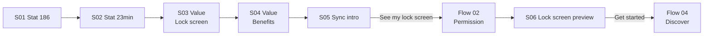

# 01 — Onboarding

**Mục tiêu:** thuyết phục user bằng số liệu → giới thiệu giá trị cốt lõi (lịch trên lock screen) → dẫn sang xin quyền.

**Nguồn:** 6 screenshot trong [`screenshots/iphone/01_onboarding/`](../screenshots/iphone/01_onboarding/)
**Kiểu:** carousel 6 slide, pager dot ở dưới, nút Back tròn xuất hiện từ slide 2.

---

## Flow



---

## S01 — Stat 186 · `01_onboarding_01_stat-186_default.png`

```
┌────────────────────────────────────────┐
│ 12:30                      ▮▮▮ ᯤ ▮▮   │
│ ◀ TestFlight
│
│ ┌────────────────────────────────────┐
│ │                                    │
│ │   [ ILLUSTRATION ]                 │
│ │   Người dùng cầm điện thoại,       │
│ │   xung quanh là card lịch & noti    │
│ │                                    │
│ └────────────────────────────────────┘
│
│ Did you know?  On average          ← kicker, xám
│
│ 186                                ← display, gradient tím→đen
│
│ times a day you check               ← headline
│ your phone
│
│ Reviews.org, 2026                   ← nguồn, xám nhỏ
│
│
│              ● ○ ○ ○ ○ ○            ← pager 1/6
│ ┌────────────────────────────────────┐
│ │              Next                  │  ← primary, full width
│ └────────────────────────────────────┘
└────────────────────────────────────────┘
```

**Thành phần:** illustration · kicker · số liệu lớn · headline 2 dòng · citation · pager · CTA `Next`
**Tương tác:** `Next` → S02. Không có nút Back (slide đầu). Không có nút Skip.

---

## S02 — Stat 23 phút · `01_onboarding_02_stat-23min_default.png`

```
┌────────────────────────────────────────┐
│ ┌────────────────────────────────────┐
│ │   [ ILLUSTRATION ]                 │
│ │   2 người ngồi tựa lưng, mỗi người │
│ │   1 điện thoại, noti bay xung quanh │
│ └────────────────────────────────────┘
│
│ The hidden cost                     ← kicker
│
│ 23 min                              ← display
│
│ to refocus after just               ← headline
│ one glance
│
│ Gloria Mark, UC Irvine, 2008        ← nguồn
│
│              ○ ● ○ ○ ○ ○
│ ┌────┐ ┌─────────────────────────────┐
│ │ ‹  │ │           Next              │
│ └────┘ └─────────────────────────────┘
└────────────────────────────────────────┘
```

**Khác S01:** xuất hiện nút Back tròn bên trái, nút Next thu ngắn lại.
**Tương tác:** `‹` → S01 · `Next` → S03

---

## S03 — Giá trị: lock screen · `01_onboarding_03_value-lockscreen_default.png`

```
┌────────────────────────────────────────┐
│ ┌────────────────────────────────────┐
│ │   [ MOCKUP 3 ĐIỆN THOẠI ]          │
│ │   • lock screen cam: timetable +   │
│ │     to-do + linh vật vịt            │
│ │   • lock screen xanh: lịch tháng    │
│ │   • home screen: widget note        │
│ └────────────────────────────────────┘
│
│ Ink puts your day on                ← headline, "Ink"+"lock" nhấn tím
│ your lock screen
│
│ Your calendar, to-dos and schedule, ← body
│ updated automatically every day —
│ one glance replaces the unlock.
│
│              ○ ○ ● ○ ○ ○
│ ┌────┐ ┌─────────────────────────────┐
│ │ ‹  │ │           Next              │
│ └────┘ └─────────────────────────────┘
└────────────────────────────────────────┘
```

**Ghi chú:** slide đầu tiên nêu tên sản phẩm và cơ chế (wallpaper tự cập nhật).

---

## S04 — Giá trị: lợi ích · `01_onboarding_04_value-benefits_default.png`

```
┌────────────────────────────────────────┐
│ ┌────────────────────────────────────┐
│ │   [ ILLUSTRATION ĐỘNG ]            │
│ │   Card event màu (Gym/Call/Lunch/  │
│ │   Sync/Read) rơi xuống thành list  │
│ │   gọn gàng (Standup 9:00, Read...)  │
│ └────────────────────────────────────┘
│
│ Less scrolling,                     ← headline
│ more doing
│
│ ┌────────────────────────────────────┐
│ │ 📅  See your day at a glance       │
│ └────────────────────────────────────┘
│ ┌────────────────────────────────────┐
│ │ ☑   To-dos always in view          │
│ └────────────────────────────────────┘
│ ┌────────────────────────────────────┐
│ │ 🔒  No unlock, no rabbit hole      │
│ └────────────────────────────────────┘
│
│              ○ ○ ○ ● ○ ○
│ ┌────┐ ┌─────────────────────────────┐
│ │ ‹  │ │           Next              │
│ └────┘ └─────────────────────────────┘
└────────────────────────────────────────┘
```

**Thành phần mới:** 3 benefit row dạng card xám, icon tím bên trái.

---

## S05 — Dẫn dắt xin quyền · `01_onboarding_05_sync-intro_default.png`

```
┌────────────────────────────────────────┐
│ ┌────────────────────────────────────┐
│ │  [ MOCK DIALOG QUYỀN ]             │
│ │  "Ink" Would Like Full Access to   │
│ │  Your Calendar                     │
│ │  ┌──────────────────────────────┐  │
│ │  │ WEDNESDAY, 20 AUG            │  │
│ │  │ ▎Design review  9:00–10:00   │  │
│ │  └──────────────────────────────┘  │
│ │  ┌──────────────────────────────┐  │
│ │  │   Allow Full Access      ⟵   │  │ ← viền tím + mũi tên chỉ dẫn
│ │  └──────────────────────────────┘  │
│ │  ┌──────────────────────────────┐  │
│ │  │   Don't Allow                │  │
│ │  └──────────────────────────────┘  │
│ └────────────────────────────────────┘
│
│ One last thing before the magic     ← kicker
│
│ Sync your calendar & to-dos         ← headline
│ to see your real day
│
│ Ink only reads events and reminders ← body (trấn an quyền riêng tư)
│ to draw your lock screen. Your data
│ stays on your device.
│
│              ○ ○ ○ ○ ● ○
│ ┌────┐ ┌─────────────────────────────┐
│ │ ‹  │ │    See my lock screen       │
│ └────┘ └─────────────────────────────┘
└────────────────────────────────────────┘
```

**Pattern:** pre-permission priming — mô phỏng dialog thật + mũi tên chỉ vào "Allow Full Access" trước khi gọi dialog hệ thống.
**Tương tác:** CTA → bắn dialog quyền của iOS → **Flow 02**.

> 🔴 **Cần kiểm chứng lời hứa riêng tư.** Câu *"Your data stays on your device"* đúng với iOS Calendar và
> Reminders (đọc qua EventKit, không rời máy). Nhưng Settings có **đồng bộ Google Calendar** — dữ liệu lịch
> khi đó đi qua mạng, và nếu OAuth xử lý phía server thì còn đi qua backend của Ink. Câu khẳng định này có
> còn đúng cho user bật Google Calendar không? Đây là vấn đề **niềm tin và pháp lý** (App Privacy Label),
> không chỉ là câu chữ marketing. Xem [09_settings](09_settings.md#phân-tích).

> ⚠️ **Biến thể chưa rõ:** trong 2 ảnh của Flow 02, cùng màn hình này có **CTA label là `Sync my data`** và có thêm link **`Skip for now`** dưới body. Có thể là 2 phiên bản A/B, hoặc màn hình đổi trạng thái sau khi user từ chối quyền đầu tiên. **Cần xác nhận** — chưa có screenshot chứng minh.

---

## S06 — Preview lock screen · `01_onboarding_06_lockscreen-preview_default.png`

```
┌────────────────────────────────────────┐
│ ┌──────────┐ ┌──────────┐ ┌──────
│ │ [WALL 1] │ │ [WALL 2] │ │ [WALL
│ │ nền cam  │ │ nền xanh │ │  ...
│ │ timetable│ │ lịch     │ │        ← carousel tràn viền phải
│ │ + to-do  │ │ tháng 8  │ │
│ │ + vịt    │ │          │ │
│ └──────────┘ └──────────┘ └──────
│
│ Your day, ready on your             ← headline
│ lock screen
│
│ Just a quick one-time setup — then  ← body
│ Ink refreshes your lock screen
│ every morning, automatically.
│
│              ○ ○ ○ ○ ○ ●
│ ┌────┐ ┌─────────────────────────────┐
│ │ ‹  │ │        Get started          │
│ └────┘ └─────────────────────────────┘
└────────────────────────────────────────┘
```

**Ghi chú:** wallpaper hiển thị là **data thật của user** (event tiếng Việt: "Uống Creatine", "Gia hạn Gym Membership…") → slide này chỉ render đúng **sau khi** đã cấp quyền ở Flow 02.
**Tương tác:** `Get started` → thoát onboarding, vào app (tab Discover).

---

## Tổng kết flow

| # | Màn hình | State có ảnh | CTA |
|---|----------|--------------|-----|
| S01 | Stat 186 | default | Next |
| S02 | Stat 23 min | default | Back · Next |
| S03 | Value — lock screen | default | Back · Next |
| S04 | Value — benefits | default | Back · Next |
| S05 | Sync intro | default | Back · See my lock screen |
| S06 | Lock screen preview | default | Back · Get started |

**Possible missing screen**
- Trạng thái khi user bấm **Don't Allow** ở dialog quyền — app quay lại S05? hiện màn hình lỗi? Chưa có ảnh.
- Không thấy nút **Skip onboarding** ở bất kỳ slide nào — cần xác nhận là chủ ý thiết kế.
