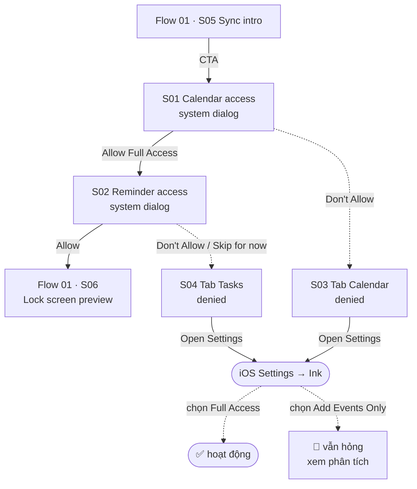

# 02 — Permission

**Mục tiêu:** lấy quyền đọc Calendar và Reminders — điều kiện bắt buộc để Ink vẽ được lock screen.

**Nguồn:** 4 screenshot trong [`screenshots/iphone/02_permission/`](../screenshots/iphone/02_permission/)
**Đặc điểm:** S01–S02 là **dialog hệ thống của iOS**. S03–S04 là **màn hình phục hồi do Ink dựng**, hiện thay
cho nội dung tab khi quyền bị từ chối.

---

## Flow



---

## S01 — Quyền Calendar · `02_permission_01_calendar-access_system-dialog.png`

```
┌────────────────────────────────────────┐
│ ░░ nền mờ: màn hình Sync intro ░░      │
│   ┌──────────────────────────────────┐ │
│   │  📅🖐                            │ │ ← icon Calendar + icon quyền
│   │                                  │ │
│   │  "Ink" would like full access    │ │
│   │  to your Calendar.               │ │
│   │                                  │ │
│   │  Ink needs calendar access to    │ │ ← purpose string của app
│   │  show and create your events.    │ │
│   │                                  │ │
│   │  ┌────────────────────────────┐  │ │
│   │  │ THURSDAY, 6 AUG            │  │ │ ← iOS preview 1 event thật
│   │  │ ▎Uống Omega-3  1–1:10PM    │  │ │
│   │  └────────────────────────────┘  │ │
│   │                                  │ │
│   │  1.872 events in the next year   │ │ ← iOS thống kê phạm vi dữ liệu
│   │  Calendar events may include     │ │
│   │  additional data, such as        │ │
│   │  locations, email addresses,     │ │
│   │  or notes.                       │ │
│   │                                  │ │
│   │  ┌────────────────────────────┐  │ │
│   │  │     Allow Full Access      │  │ │
│   │  └────────────────────────────┘  │ │
│   │  ┌────────────────────────────┐  │ │
│   │  │       Don't Allow          │  │ │
│   │  └────────────────────────────┘  │ │
│   └──────────────────────────────────┘ │
└────────────────────────────────────────┘
```

**Loại:** `EKEventStore` — full access to Calendar (iOS 17+).
**Chuỗi cần chuẩn bị:** `NSCalendarsFullAccessUsageDescription` = *"Ink needs calendar access to show and create your events."*
**Lưu ý:** iOS tự render preview 1 event và số lượng event — Ink không kiểm soát phần này.

---

## S02 — Quyền Reminders · `02_permission_02_reminder-access_system-dialog.png`

```
┌────────────────────────────────────────┐
│ ░░ nền mờ: màn hình Sync intro ░░      │
│    ...  Skip for now                   │ ← link lộ ra ở nền, xem ghi chú
│   ┌──────────────────────────────────┐ │
│   │  ☰🖐                             │ │ ← icon Reminders + icon quyền
│   │                                  │ │
│   │  "Ink" would like to access      │ │
│   │  your Reminders.                 │ │
│   │                                  │ │
│   │  Ink needs reminders access to   │ │
│   │  show and create your reminders. │ │
│   │                                  │ │
│   │  ┌───────────┐  ┌─────────────┐  │ │
│   │  │Don't Allow│  │   Allow     │  │ │ ← 2 nút nằm ngang
│   │  └───────────┘  └─────────────┘  │ │
│   └──────────────────────────────────┘ │
└────────────────────────────────────────┘
```

**Loại:** `EKEventStore` — access to Reminders.
**Chuỗi cần chuẩn bị:** `NSRemindersFullAccessUsageDescription` = *"Ink needs reminders access to show and create your reminders."*
**Khác S01:** dialog ngắn hơn, 2 nút nằm ngang, **không có** preview dữ liệu — vì Ink xin quyền Reminders sau, khi app chưa đọc được gì để preview.

---

## S03 — Tab Calendar khi bị từ chối · `02_permission_03_calendar-access_denied.png`

```
┌────────────────────────────────────────┐
│ Aug, 2026                    ☰     📅  │ ← header GIỮ NGUYÊN cả 2 icon
│                                        │
│      ⚠️ KHÔNG có week strip            │
│                                        │
│                                        │
│              ┌────────┐                │
│              │  📅    │                │ ← icon tím, outline
│              └────────┘                │
│                                        │
│        Turn on Calendar access         │
│                                        │
│   Ink can't show your events without   │
│   it — tap to allow in Settings.       │
│                                        │
│        ┌──────────────────────┐        │
│        │    Open Settings     │        │ ← primary, mở iOS Settings
│        └──────────────────────┘        │
│                                        │
│                                        │
│      ⚠️ KHÔNG có FAB "+" và "về hôm nay"│
│ ┌────────┬──────────┬───────┬───────┐  │
│ │Discover│ Calendar │ Tasks │ Notes │  │
│ └────────┴──────────┴───────┴───────┘  │
└────────────────────────────────────────┘
```

**Điểm tốt:** app **có** đường phục hồi rõ ràng — icon, tiêu đề, giải thích hậu quả (*"can't show your
events"*), và nút mở thẳng Settings. Đây là thứ nhiều app bỏ quên.

**Vấn đề 1 — nội dung không gọi tên lựa chọn.** Settings → Ink → Calendars có **3 lựa chọn**: `None` /
`Add Events Only` / `Full Access`. Chỉ `Full Access` mới dùng được. Câu *"tap to allow in Settings"* không
nêu tên nào → user hoàn toàn có thể chọn `Add Events Only` (nghe an toàn hơn) rồi quay lại thấy **vẫn trống**.
Xem [permissions-matrix §1.1](../../../../references/permissions-matrix.md#-ba-trạng-thái-quyền--và-cái-ở-giữa-là-bẫy).

**Vấn đề 2 — mất luôn khả năng tạo event.** FAB `+` biến mất. Đúng về kỹ thuật *(không ghi được khi `None`)*,
nhưng nếu user cấp `Add Events Only` thì app **ghi được** — lúc đó FAB có hiện lại không? **Cần kiểm.**

**Còn phải kiểm:**
- [ ] 2 icon header còn nguyên — bấm vào thì sao? Menu chọn view vẫn mở? Sheet Calendars trống hay lỗi?
- [ ] `Open Settings` mở thẳng trang **Ink** hay chỉ mở Settings gốc? *(`openSettingsURLString` mở đúng trang app.)*
- [ ] Bật quyền rồi quay lại — app tự refresh, hay phải tự kill và mở lại? *(Đổi quyền Calendar thường khiến
      iOS kill app.)*
- [ ] Discover và tab Notes có màn hình tương tự không? Template preview cần event để render.

---

## S04 — Tab Tasks khi bị từ chối · `02_permission_04_reminder-access_denied.png`

```
┌────────────────────────────────────────┐
│ Tasks                            ☑     │ ← icon góc phải GIỮ NGUYÊN
│                                        │
│      ⚠️ KHÔNG có section "Today"        │
│      ⚠️ KHÔNG có segmented All/Reminder/Ink
│                                        │
│              ┌────────┐                │
│              │  ☰≡    │                │ ← icon tím, outline
│              └────────┘                │
│                                        │
│       Turn on Reminders access         │
│                                        │
│   Ink can't show your tasks without    │
│   it — tap to allow in Settings.       │
│                                        │
│        ┌──────────────────────┐        │
│        │    Open Settings     │        │
│        └──────────────────────┘        │
│                                        │
│      ⚠️ KHÔNG có FAB "+"                │
│ ┌────────┬──────────┬───────┬───────┐  │
│ │Discover│ Calendar │ Tasks │ Notes │  │
│ └────────┴──────────┴───────┴───────┘  │
└────────────────────────────────────────┘
```

**Nhất quán tốt với S03:** cùng bố cục, cùng cấu trúc câu, chỉ đổi danh từ (`events` → `tasks`). Đây là điểm
cộng về hệ thống thiết kế.

### 🔴 Nhưng ở đây có vấn đề nặng hơn: chặn cả tính năng không cần quyền

Tab Tasks vốn có **2 nguồn dữ liệu**, thấy rõ qua segmented control ở
[Flow 06 · S01](06_task.md#s01--task-list--2-state): `All` | `Reminder` | `Ink`.

| Nguồn | Cần quyền Reminders? |
|---|:---:|
| `Reminder` — đồng bộ từ Apple Reminders | ✅ Có |
| `Ink` — task tạo trong app | ❌ **Không** |

Khi từ chối Reminders, **toàn bộ tab bị thay thế** — mất luôn segmented control, mất FAB `+`. User không tạo
được và không xem được **task nguồn `Ink`**, dù chúng không hề phụ thuộc quyền này.

**Nghịch lý:** app tự coi quyền Reminders là **tuỳ chọn** *(có link `Skip for now` ở bước xin quyền)*, nhưng
lại xử lý việc từ chối như một lỗi chặn toàn bộ. Hai thông điệp mâu thuẫn nhau.

**Đúng ra nên là:** tab vẫn chạy với nguồn `Ink`, riêng filter `Reminder` hiện empty state kèm nút
`Open Settings`.

**Cần xác nhận trước khi kết luận là bug:** task nguồn `Ink` lưu ở đâu?
- Nếu lưu **local** (Core Data / SwiftData) → chắc chắn là bug, degrade quá tay.
- Nếu `Ink` thực ra chỉ là **một list bên trong Apple Reminders** → hành vi hiện tại đúng, nhưng tên gọi
  `Ink` đang gây hiểu nhầm là task nội bộ.

---

## Quan sát quan trọng

**Thứ tự cố định:** Calendar trước → Reminders sau. Hai dialog bắn liên tiếp trong cùng một lần bấm CTA, user không quay lại giữa chừng được.

**`Skip for now`** xuất hiện ở màn hình nền của S02 nhưng **không có** ở S01 (ảnh S01 nền vẫn là nút CTA đầy đủ). Hai khả năng:
1. Link chỉ hiện sau khi user đã xử lý xong dialog Calendar.
2. Đây là 2 phiên bản UI khác nhau.

Chưa đủ ảnh để kết luận → ghi nhận là **Possible Missing Screen**, không suy diễn trong PRD.

**Quyền là bắt buộc hay tuỳ chọn?** Sự tồn tại của `Skip for now` gợi ý app vẫn vào được khi từ chối, nhưng lúc đó lock screen sẽ trống. Cần ảnh trạng thái `denied` để xác nhận.

---

## Tổng kết flow

| # | Màn hình | State có ảnh | Kết quả |
|---|----------|--------------|---------|
| S01 | Calendar access | system-dialog | Allow Full Access / Don't Allow |
| S02 | Reminder access | system-dialog | Allow / Don't Allow |
| S03 | Tab Calendar — từ chối | denied | Open Settings |
| S04 | Tab Tasks — từ chối | denied | Open Settings |

**Vấn đề đã nhận diện**
1. 🔴 **S04 chặn cả task nguồn `Ink`** — mất tính năng không phụ thuộc quyền bị từ chối.
2. 🔴 **Nội dung S03/S04 không gọi tên lựa chọn** cần chọn trong Settings. Với Calendar có 3 lựa chọn mà chỉ
   `Full Access` dùng được → user dễ chọn `Add Events Only` rồi vẫn hỏng. Đây là **lần thứ 3** cùng mẫu lỗi
   này lặp lại trong sản phẩm (xem [permissions-matrix](../../../../references/permissions-matrix.md#đây-là-lần-thứ-ba-cùng-một-mẫu-lỗi-lặp-lại)).
3. Xin **2 quyền liên tiếp** trong một lần bấm — chưa đo tỷ lệ đồng ý từng dialog.

**Possible missing screen**
- Trạng thái **`Add Events Only`** *(write-only)* — app hiển thị gì? Đây là trạng thái nguy hiểm nhất và
  **chưa có ảnh nào**.
- **Discover** và **Notes** khi bị từ chối quyền — có màn hình tương tự S03/S04 không?
- Màn hình sau khi bật lại quyền từ Settings và quay lại app.
- Quyền **Photos** và **Notifications** — chưa thấy dialog nào trong toàn bộ bộ ảnh.
