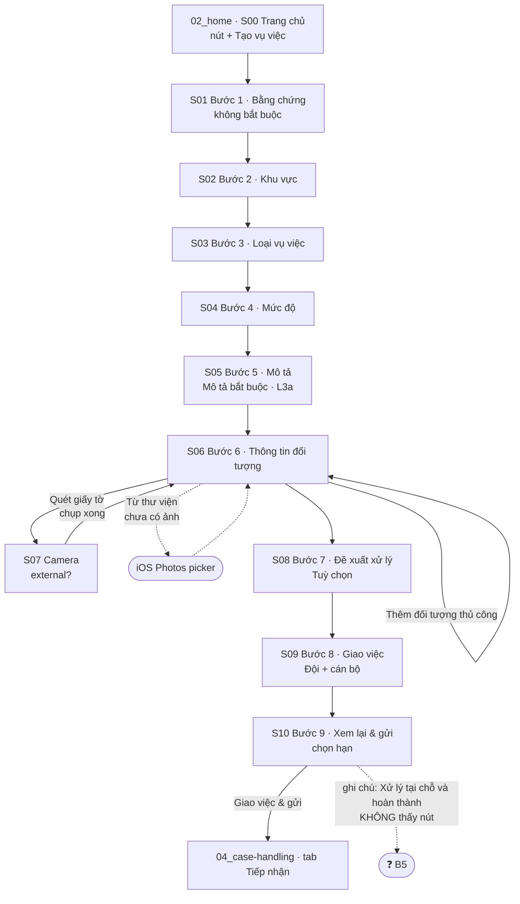

# 03 — Case Create (Tạo vụ việc xử lý vi phạm)

> ⚠️ **Lập trước khi có [đặc tả v2.1](../../specs/xu-ly-vi-pham-giao-viec/dac-ta-chuc-nang-v2.1.md)** (đưa vào repo 2026-10-26). Đặc tả đã trả lời nhiều điểm đang để `❓` (bước bắt buộc, giao Đội/cán bộ, trạng thái ban đầu, hạn quá khứ, lưu ảnh giấy tờ, nút "Xử lý tại chỗ"…) và định nghĩa lại "uỷ quyền Tổ phó". **Cần đối chiếu lại trước khi dùng.**

**Mục tiêu:** người có quyền giao việc ghi nhận một vụ việc vi phạm ngay tại hiện trường (bằng chứng, phân
loại, đối tượng) và giao cho cán bộ xử lý, trong một wizard 9 bước trên iPhone.

**Nguồn:** 14 screenshot trong [`screenshots/iphone/03_case-create/`](../screenshots/iphone/03_case-create/) + điểm vào
ở [`02_home`](../screenshots/iphone/02_home/) và kết quả ở [`04_case-handling`](../screenshots/iphone/04_case-handling/) —
tra ảnh gốc ở [index.md](../screenshots/iphone/index.md). Build 1.0.0 (52), chụp 20/10/2026.
**Test basis đối chiếu:** [mo-ta-chuc-nang-v1.md](../../specs/xu-ly-vi-pham-giao-viec/mo-ta-chuc-nang-v1.md) mục
"Giao diện và thao tác" 1 · [lam-ro-2026-10-26.md](../../specs/xu-ly-vi-pham-giao-viec/lam-ro-2026-10-26.md) ·
phân tích: test-analysis-mo-ta-v1-SUPERSEDED.md (đã xoá 2026-10-28, xem git `5fc75a6`) (mã `T…`, `B…`, `O…`).
**Vai trò:** người giao việc (6 vai trò, Tổ phó phải được uỷ quyền). Toàn bộ ảnh chụp bằng tài khoản **Đội
trưởng / Chỉ huy Đội** — chưa có ảnh nào của vai trò khác.

> 🔒 Ảnh chứa dữ liệu cá nhân — wireframe chỉ ghi **tên trường**, giá trị dùng ký hiệu `<…>`.

**Đặc điểm:** wizard trình bày dạng **sheet** (bo góc trên, nền xám phía sau), tiêu đề cố định "Tạo vụ việc",
mỗi bước có "Bước N/9" + tên bước + thanh tiến trình. Thanh nút dưới: "Quay lại" (viền) + "Tiếp tục" (đặc;
**mờ** khi chưa đủ điều kiện). Bước 1 chỉ có "Tiếp tục". **Không thấy nút đóng/✕** trên sheet ở mọi ảnh.

---

## Flow



Mọi bước 2–9 có "Quay lại" về bước trước (chưa có ảnh nào chứng minh dữ liệu được giữ — O4).

---

## S00 — Điểm vào · `02_home_01_statistics_default.png` *(flow 02)*

```
┌────────────────────────────────────────┐
│            Trang chủ             [QR]  │
│ Xin chào, <tên>                        │
│ <vai trò> - <Đội> - <mã>               │ ← vai trò hiển thị ngay đầu trang
│ ┌ Nhà ga <…> · Đang trực: <Đội> ─────┐ │
│ ┌ Giao việc · Không có việc đang mở >┐ │
│ [Hôm nay] [Tuần này] [Tùy chọn]        │
│ Tổng vụ việc · Chờ tiếp nhận · Chờ chỉ đạo│
│ Quá hạn · Đã đóng · Khẩn cấp mở        │ ← "Quá hạn" phụ thuộc hạn hoàn thành ở S10
│ XU HƯỚNG (biểu đồ cột)                 │
│ VỤ VIỆC THEO KHU VỰC ⌄            (+)  │ ← FAB "+" = Tạo vụ việc
│ Trang chủ | Tiếp nhận | Của tôi | Cá nhân│
└────────────────────────────────────────┘
```

**Ghi chú:** mũi tên đỏ "Button Tạo vụ việc" là chú thích của người viết spec, không phải UI.
**Còn phải kiểm:** FAB "+" có hiện với tài khoản Cán bộ / Tổ phó chưa uỷ quyền không (B1).

---

## S01 — Bước 1/9 Hình ảnh / bằng chứng · `03_case-create_01_evidence_empty.png`

```
┌────────────────────────────────────────┐
│             Tạo vụ việc                │ ← sheet
│ Bước 1/9                               │
│ Hình ảnh / bằng chứng                  │
│ ▓▓▓░░░░░░░░░░░░░░░░░░░░░░░░░           │
│ ┌──────────────┐ ┌──────────────┐      │
│ │ 📷 Chụp ảnh  │ │ 🖼 Thư viện  │      │
│ └──────────────┘ └──────────────┘      │
│ Chưa có hình ảnh. Bằng chứng giúp xử   │ ← empty state
│ lý nhanh hơn.                          │
│                                        │
│ ┌────────────── Tiếp tục ────────────┐ │ ← bật khi chưa có ảnh (đúng spec "không bắt buộc")
└────────────────────────────────────────┘
```

**Khớp spec:** bước 1 "(không bắt buộc)" → "Tiếp tục" bật khi chưa có ảnh.
**Chưa có ảnh:** sau khi thêm ảnh (thumbnail, xoá), màn Chụp ảnh / Thư viện, dialog quyền Camera/Ảnh.

---

## S02 — Bước 2/9 Khu vực phát sinh · `03_case-create_02_area_selected.png`

```
│ Bước 2/9 · Khu vực phát sinh           │
│ ┌ 📍 Boarding                     ✔ ┐  │ ← mục ĐẦU đang được chọn
│ ┌ 📍 Vị trí cổng cửa               ┐  │
│ ┌ 📍 Đơn Vị                        ┐  │
│ ┌ 📍 Kho Hàng                      ┐  │
│ ┌ ⑂ Sảnh Công cộng                 ┐  │ ← icon khác (nhánh)
│ ┌ ⑂ Soi chiếu an ninh quốc nội     ┐  │
│ ┌ 📍 Sân đỗ tàu bay                ┐  │
│ ┌ 📍 Trạm gác, hàng rào            ┐  │
│ [ Quay lại ]        [ Tiếp tục ]       │ ← Tiếp tục bật
```

**Không xác định được:** "Boarding" được chọn sẵn mặc định hay do người dùng đã chọn trước khi chụp (O5).
2 icon khác nhau (📍 / ⑂) — ý nghĩa chưa rõ. Danh sách chọn **một** (radio).

---

## S03 — Bước 3/9 Loại vụ việc · `03_case-create_03_case-type_default.png`

```
│ Bước 3/9 · Loại vụ việc                │
│ ┌ ⓘ Gây rối trật tự                 ┐  │
│ ┌ ⓘ Khách không hợp tác trong quá   ┐  │
│ │   trình kiểm tra                  │  │
│ ┌ ⓘ Hỗ trợ y tế                     ┐  │
│ ┌╌ Khác (tự nhập loại vụ việc) ╌╌╌╌┐  │ ← viền đứt, kiểu ô nhập
│ [ Quay lại ]   [ Tiếp tục ] (mờ)       │ ← chưa chọn → không đi tiếp được
```

**Ghi chú:** Hình 17 có loại "Phát hiện vật phẩm nguy hiểm" **không có** trong danh sách này (O6).

---

## S04 — Bước 4/9 Mức độ · `03_case-create_04_severity_default.png`

```
│ Bước 4/9 · Mức độ                      │
│ ┌ 🟢 Bình thường                    ┐  │
│ ┌ 🟠 Nghiêm trọng                   ┐  │
│ ┌ 🔴 Khẩn cấp                       ┐  │
│ │    Cảnh báo Lãnh đạo + BCH đội    │  │ ← chữ đỏ — chỉ có trên ảnh (B6)
│ [ Quay lại ]   [ Tiếp tục ] (mờ)       │
```

---

## S05 — Bước 5/9 Mô tả · `03_case-create_05_description_default.png`

```
│ Bước 5/9 · Mô tả                       │
│ ┌ Mô tả vụ việc...            (🎤) ┐  │ ← BẮT BUỘC (L3a-b), ô nhiều dòng
│ ┌ Vị trí cụ thể (tuỳ chọn)    (🎤) ┐  │
│ Hành động đã thực hiện (tuỳ chọn)      │
│ ┌ <gợi ý: đã báo hãng hàng không,…> (🎤)┐│ ← nhiều khả năng là placeholder
│ [ Quay lại ]   [ Tiếp tục ] (mờ)       │ ← Mô tả trống → mờ (khớp L3a-b)
```

**Chỉ có trên ảnh:** nút micro ở cả 3 ô (B6), 2 ô "(tuỳ chọn)".
**Chưa có ảnh:** đã nhập Mô tả → "Tiếp tục" bật; Mô tả chỉ có khoảng trắng (O3).

---

## S06 — Bước 6/9 Thông tin đối tượng

### `03_case-create_06_subject-info_default.png` — chưa có đối tượng

```
│ Bước 6/9 · Thông tin đối tượng         │
│ Số lượng đối tượng                     │
│ ┌ VD: 04                            ┐  │ ← ô số, quan hệ với danh sách chưa rõ (O9)
│ Quét CCCD/hộ chiếu hoặc chọn ảnh để    │
│ thêm từng đối tượng (lưu dạng văn bản).│ ← "lưu dạng văn bản" (B7)
│ [⛶ Quét giấy tờ]   [🖼 Từ thư viện]    │
│ ┌╌╌╌ ⊕ Thêm đối tượng thủ công ╌╌╌╌╌┐  │
│ ──────────────────────────────────     │
│ Biển số xe                             │
│ ┌ VD: 30K-356.58     ┐ [🔍 Tra biển số]│ ← chỉ có trên ảnh (B6)
│ Đơn vị liên quan                       │
│ ┌                                   ┐  │ ← chỉ có trên ảnh (B6)
│ [ Quay lại ]   [ Tiếp tục ]  (BẬT)     │ ← bật khi 0 đối tượng (mâu thuẫn T3/B2)
```

### `_filled` (sau khi quét) · `_filled-v2` (nhập thủ công)

```
│ Đã nhập 1 đối tượng              ⌃     │ ← đếm + thu gọn
│ ┌ Đối tượng 1                    🗑 ┐  │
│ │ Họ tên        [<họ tên>]          │  │
│ │ Ngày sinh     [<d/m/yyyy>]  Giới tính [Nam][Nữ][Khác]
│ │ Quốc tịch     [<quốc tịch>     ⌄] │  │ ← dropdown
│ │ Số CCCD/CMND  [<số>]  Số hộ chiếu [ ]│
│ └───────────────────────────────────┘  │
│ ┌╌╌╌ ⊕ Thêm đối tượng thủ công ╌╌╌╌╌┐  │
│ (Biển số xe / Đơn vị liên quan như trên)│
```

**Quan sát:**
- `_filled`: sau khi quét, cả 5 trường (Họ tên, Ngày sinh, Giới tính, Quốc tịch, Số CCCD/CMND) đã có giá trị;
  "Số hộ chiếu" trống. Các trường hiển thị dạng **ô nhập** → có thể sửa? (O7)
- `_filled-v2`: quốc tịch **nước ngoài** nhưng số giấy tờ nằm ở ô **Số CCCD/CMND**, ô Số hộ chiếu trống — app
  không chặn ở thời điểm chụp (O8).
- Không thấy dấu `*` bắt buộc ở trường nào.
- Ảnh `_filled` chụp lúc 16:28, các ảnh khác 16:11–16:13 → **không cùng một lượt tạo vụ việc**.

---

## S07 — Camera quét giấy tờ · `03_case-create_07_document-scan_default.png` *(có thể là external screen)*

```
┌────────────────────────────────────────┐
│ ■■■■■■■■■■■■■■■■■■■■■■■■■■■■■   ⚡A    │
│     [ khung ngắm: giấy tờ tuỳ thân ]   │ ← khung vàng = lấy nét tự động của iOS
│           0,5   1×   2,5               │
│              (  ●  )                   │ ← nút chụp
│   ✕          PHOTO            ⟲        │ ← giao diện camera iOS chuẩn
└────────────────────────────────────────┘
```

**Quan sát:** đây là giao diện **chụp ảnh** (chế độ "PHOTO", có zoom, đổi camera), không có khung căn giấy tờ
hay hướng dẫn của app → nhiều khả năng là camera picker của iOS, việc "quét" = chụp ảnh rồi nhận dạng chữ.
Đánh dấu *external screen* cho tới khi dev xác nhận (O7).
**Chưa có ảnh:** màn xác nhận ảnh vừa chụp ("Dùng ảnh / Chụp lại"), trạng thái đang nhận dạng, quét lỗi.

---

## S08 — Bước 7/9 Đề xuất xử lý · `03_case-create_08_proposal_default.png`

```
│ Bước 7/9 · Đề xuất xử lý               │
│ Tuỳ chọn — có thể chọn nhiều phương án │ ← ghi rõ TUỲ CHỌN (mâu thuẫn T3/B2)
│ ☐ Nhắc nhở, khuyến cáo                 │
│ ☐ Đưa vào diện chú ý                   │
│ ☐ Bàn giao                             │
│ ☐ Phối hợp                             │
│ ☐ Khác                                 │ ← có kèm ô nhập không? (O12)
│ [ Quay lại ]   [ Tiếp tục ]  (BẬT)     │ ← bật khi chưa chọn gì
```

---

## S09 — Bước 8/9 Giao việc

### `03_case-create_09_assignee_default.png`

```
│ Bước 8/9 · Giao việc                   │ ← spec gọi là "Chọn cán bộ" (O15)
│ Đội nhận việc                          │
│ ┌ 👥 <Đội>                        ✔ ┐  │ ← đã chọn sẵn, chỉ 1 Đội trong danh sách
│ Cán bộ nhận việc                       │
│ ┌ Tìm theo email...                 ┐  │
│ ┌ <email> · <Đội> · Cán bộ hiện trường >┐
│ │ <email> · <Đội> · Cán bộ Phòng Camera >│
│ │ Tổ phó · <email> · <Đội> · Tổ phó   >│ ← lãnh đạo cũng nằm trong danh sách nhận (B3)
│ [ Quay lại ]   [ Tiếp tục ] (mờ)       │ ← chưa chọn cán bộ → mờ
```

### `03_case-create_09_assignee_selected.png`

```
│ ( <email> · <Đội>  ✕ )                 │ ← chip cán bộ đã chọn, có nút bỏ
│ Đội nhận việc  ┌ 👥 <Đội> ✔ ┐          │
│ Thêm cán bộ nhận việc                  │ ← nhãn đổi "Cán bộ…" → "Thêm cán bộ…"
│ ┌ Tìm theo email...                 ┐  │
│ (danh sách còn 2 người — người đã chọn bị ẩn)│
│ [ Quay lại ]   [ Tiếp tục ]  (BẬT)     │
```

**Quan sát:** chọn được nhiều cán bộ (nhãn "Thêm cán bộ nhận việc"); người đã chọn biến khỏi danh sách.
"Đội nhận việc" là khái niệm **không có trong spec** (B3).

---

## S10 — Bước 9/9 Xem lại & gửi

### `03_case-create_10_review_default.png` → `_filled`

```
│ Bước 9/9 · Xem lại & gửi               │ ← spec gọi là "Chọn thời gian đến hạn" (O15)
│ Loại vụ việc: <loại>                   │
│ Mô tả: <mô tả>                         │
│ Bằng chứng: 0 tệp                      │
│ Giao việc: <email> · <Đội>             │
│ Hạn hoàn thành · giờ Việt Nam          │ ← múi giờ cố định (O1)
│ ┌──────────── Chọn ngày ────────────┐  │ → _filled: <dd/mm/yyyy>
│ ┌──────────── Chọn giờ  ────────────┐  │ → _filled: <hh:mm>
│ Kiểm tra lại thông tin trước khi xác   │
│ nhận. "Gửi" sẽ chuyển vụ việc tới Đội  │ ← "tới Đội" (B3)
│ tiếp nhận; "Xử lý tại chỗ và hoàn      │ ← nút này KHÔNG có trên màn (B5)
│ thành" yêu cầu đủ biểu mẫu, chữ ký nếu │
│ loại vụ việc có cấu hình.              │
│ [ Quay lại ]  [ Giao việc & gửi ]      │ ← mờ khi chưa chọn hạn; bật ở _filled
```

**Quan sát:** màn xem lại **không** hiện Khu vực, Mức độ, Đối tượng, Đề xuất xử lý (O14). Hạn trong ảnh
`_filled` là cùng ngày chụp, 17:00.

---

## R — Kết quả · `04_case-handling_01_case-list_default.png` *(flow 04)*

```
│              Tiếp nhận                 │
│ ┌ Tìm theo mã / mô tả...            ┐  │
│ [Tất cả][Chờ tiếp nhận][Đang xử lý tại Đội][Đang thực hiện]
│ [Mọi mức độ][Bình thường][Nghiêm trọng][Khẩn cấp]
│ ┌ VV<6 số>              Đang thực hiện┐│
│ │ <loại> · <khu vực>                 ││
│ │ <mô tả>                            ││
│ │ [<mức độ>] <tên Tổ/Đội>  hh:mm dd/mm││
│ │ [Cần xử lý]  [   Hoàn thành   ]    ││
│ └────────────────────────────────────┘│
│ (thẻ khác có "· +2 cán bộ ·")          │ ← vụ việc giao nhiều cán bộ
│ Trang chủ | Tiếp nhận | Của tôi | Cá nhân│
```

---

## Vấn đề đã nhận diện

| # | Vấn đề | Bằng chứng | Liên kết |
|---|---|---|---|
| V1 | 🔴 Tính bắt buộc text ↔ app lệch nhau: bước 6 cho "Tiếp tục" khi **0 đối tượng**; bước 7 ghi "Tuỳ chọn" — spec chỉ ghi bước 1 là không bắt buộc | S06 `_default`, S08 | T3 · B2 |
| V2 | 🔴 "Đội nhận việc" + ghi chú "Gửi sẽ chuyển vụ việc tới **Đội** tiếp nhận" — spec chỉ nói chọn cán bộ | S09, S10 | T4 · B3 |
| V3 | 🟠 Thẻ vụ việc ở Hình 17 có **cùng loại, khu vực và mô tả** với vụ việc đang tạo ở S10 (tạo 16:14, ngay sau ảnh S10 lúc 16:13) nhưng hiển thị tên một **Tổ**, trong khi S09 chỉ chọn **Đội**; trạng thái đã là "Đang thực hiện". Không rõ Tổ đó là tổ của người tạo, của cán bộ được giao, hay gán sai đơn vị. **Chưa chắc là cùng một vụ việc** — cần tạo lại và đối chiếu mã | S09, S10, R | **mới** — chưa có trong test-analysis · B3, B4 |
| V4 | 🔴 Ghi chú nhắc nút "Xử lý tại chỗ và hoàn thành" nhưng không có nút đó | S10 | T7 · B5 |
| V5 | 🟠 Chức năng chỉ có trên ảnh, không có trong spec: cảnh báo "Khẩn cấp", Biển số xe + Tra biển số, Đơn vị liên quan, nhập giọng nói, Vị trí cụ thể, Hành động đã thực hiện | S04, S05, S06 | T8 · B6 |
| V6 | 🔴 "(lưu dạng văn bản)" — không rõ ảnh giấy tờ tuỳ thân có bị lưu lại không | S06 | T9 · B7 |
| V7 | 🟠 Nhập số giấy tờ của người nước ngoài vào ô "Số CCCD/CMND" mà không bị chặn | S06 `_filled-v2` | T17 · O8 |
| V8 | 🟠 Màn xem lại thiếu Khu vực, Mức độ, Đối tượng, Đề xuất xử lý → người tạo không kiểm lại được dữ liệu quan trọng nhất (đối tượng) trước khi gửi | S10 | T21 · O14 |
| V9 | 🟡 Bước 2 vào là đã có mục chọn sẵn → dễ gửi nhầm khu vực đầu danh sách | S02 | T14 · O5 |
| V10 | 🟡 Không thấy nút đóng sheet; không rõ thoát giữa chừng thì mất dữ liệu không | mọi S | T13 · O4 |
| V11 | 🟡 Tên bước/nút trên app khác spec ("Giao việc" ↔ "Chọn cán bộ", "Xem lại & gửi" ↔ "Chọn thời gian đến hạn", "Giao việc & gửi" ↔ "Giao việc và gửi") | S09, S10 | T22 · O15 |
| V12 | 🟡 Camera quét giấy tờ là camera chụp ảnh thông thường, không có khung căn / hướng dẫn giấy tờ | S07 | T16 · O7 |

---

## Possible missing screen

| Bước | Màn / state chưa có ảnh | Ảnh hưởng |
|---|---|---|
| S00 | Trang chủ với tài khoản **Cán bộ** và **Tổ phó chưa uỷ quyền** (FAB "+" có hiện?) | Không kiểm được quyền (B1) |
| S01 | Đã thêm ảnh (danh sách/thumbnail, xoá); màn Chụp ảnh; Thư viện; dialog quyền Camera/Ảnh | EVD |
| S02–S04 | Trạng thái đã chọn của bước 3, 4; bước 3 khi chọn "Khác"; bước 4 khi chọn "Khẩn cấp" | CLS |
| S05 | Đã nhập Mô tả (nút bật); Mô tả chỉ có khoảng trắng; đang nhập giọng nói | DSC |
| S06 | **Bước 6.2 chọn ảnh từ thư viện** (spec có, không có ảnh minh hoạ); quét lỗi/ảnh mờ; nhiều đối tượng; form thủ công lúc vừa mở; sau khi bấm "Tra biển số" | SUBJ |
| S07 | Màn xác nhận ảnh / đang nhận dạng | SUBJ |
| S08 | Chọn "Khác" | PROP |
| S09 | Tìm email không có kết quả; đã chọn ≥2 cán bộ; có nhiều Đội | ASG |
| S10 | Date picker, time picker; chọn ngày quá khứ; **sau khi bấm "Giao việc & gửi"** (loading / thành công / lỗi mạng) | SUB |
| — | Dialog xác nhận khi thoát wizard giữa chừng | NAV |
