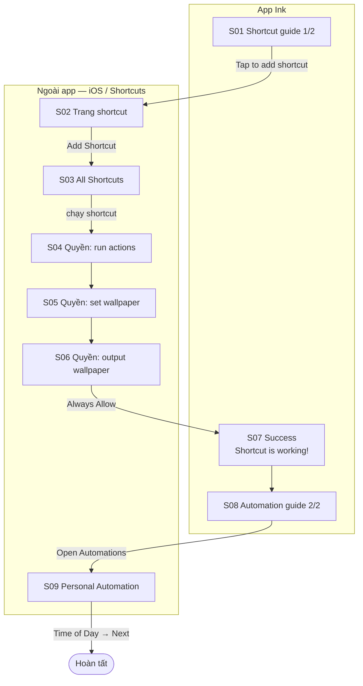

# 03 — Shortcut Setup

**Mục tiêu:** cài đặt một lần Apple Shortcut `Generate Latest Wallpaper` + Personal Automation "Time of Day", để mỗi sáng iOS tự chạy Ink và đổi wallpaper lock screen.

**Nguồn:** 9 screenshot trong [`screenshots/iphone/03_shortcut-setup/`](../screenshots/iphone/03_shortcut-setup/)
**Điểm vào:** onboarding (sau `Get started`) hoặc Settings → `Set up shortcut` (Flow 09).

> ⚠️ **4/9 màn hình nằm ngoài app Ink** (app Shortcuts của Apple + dialog hệ thống). Ink **không kiểm soát** được UI này — chỉ điều hướng sang và hướng dẫn. Đây là rủi ro UX lớn nhất của flow.

---

## Flow



---

## S01 — Hướng dẫn 1/2 · `03_shortcut-setup_01_shortcut-guide_default.png`

```
┌────────────────────────────────────────┐
│ ┌──┐                ● ○                │ ← nút X + pager 2 bước
│ │✕ │
│ └──┘
│ Your lock screen, fresh             ← headline
│ every day.
│
│ Ink refreshes your lock screen      ← body, nêu rõ cơ chế
│ through an Apple Shortcut. Tap
│ below, choose "Add Shortcut", then
│ come back here.
│
│      ┌────────────────────────┐
│      │ [ MOCK: Shortcuts      │      ← ảnh minh hoạ app Shortcuts
│      │   Gallery của Apple ]  │        (Gallery, Get Stuff Done…)
│      │   Search               │
│      │   Shortcuts for        │
│      │   Accessibility        │
│      │   Get Stuff Done       │
│      └────────────────────────┘
│
│ ┌────────────────────────────────────┐
│ │      +  Tap to add shortcut        │ ← primary
│ └────────────────────────────────────┘
└────────────────────────────────────────┘
```

**Ghi chú:** modal (nút ✕ đóng, không phải back) → flow có thể bỏ qua và làm lại sau từ Settings.
**Tương tác:** CTA → mở app Shortcuts qua deep link → **S02**.

---

## S02 — Trang shortcut *(external)* · `03_shortcut-setup_02_shortcuts-app_default.png`

```
┌────────────────────────────────────────┐
│ ◀ Ink                          [dark]  │ ← back-to-app banner của iOS
│ ┌──┐                            ┌──┐
│ │✕ │                            │ ⤴ │
│ └──┘                            └──┘
│         Generate Latest Wallpaper   ← tên shortcut
│            Shared 18 May 2026
│
│         ┌──────────────────────┐
│         │ 📋            •••    │    ← card shortcut, nền hồng
│         │ Generate Latest      │
│         │ Wallpaper            │
│         └──────────────────────┘
│
│
│ About This Shortcut
│  ◉  Say "Siri, Generate Latest Wall…"
│  ⌚  Appears on Apple Watch
│ ┌────────────────────────────────────┐
│ │       ⊕  Add Shortcut              │ ← nút hệ thống, màu xanh iOS
│ └────────────────────────────────────┘
└────────────────────────────────────────┘
```

**External — app Shortcuts.** Ink chỉ kiểm soát được **nội dung shortcut** (tên, icon, mô tả), không kiểm soát layout.
**Tương tác:** `Add Shortcut` → shortcut được thêm vào thư viện → **S03**.

---

## S03 — Thư viện shortcut *(external)* · `03_shortcut-setup_03_shortcuts-library_default.png`

```
┌────────────────────────────────────────┐
│ ◀ Ink                          [dark]  │
│ ┌──┐                    ┌────┐ ┌──┐
│ │ ‹│                    │Edit│ │ +│
│ └──┘                    └────┘ └──┘
│ All Shortcuts
│ ┌────────────────────────────────────┐
│ │ 🔍 Search                          │
│ └────────────────────────────────────┘
│ ┌──────────────────┐
│ │ 📋          •••  │                 ← shortcut vừa thêm, nổi bật lên đầu
│ │ Generate Latest  │
│ │ Wallpaper        │
│ └──────────────────┘
│
│ 📁 Starter Shortcuts                +
│ ┌────────────┐ ┌────────────┐
│ │What's a    │ │Take a Break│
│ │shortcut?   │ │            │
│ └────────────┘ └────────────┘
│ ┌────────────┐ ┌────────────┐
│ │Text Last   │ │Shazam s…   │
│ │Image       │ │            │
│ └────────────┘ └────────────┘
│ 📖 Books  ›     📷 Camera  ›
│ ┌────────┬───────────┬─────────┐
│ │Library │Automation │ Gallery │      ← tab bar app Shortcuts
│ └────────┴───────────┴─────────┘
└────────────────────────────────────────┘
```

**External.** User bấm vào card shortcut để chạy lần đầu → kích hoạt chuỗi 3 dialog quyền S04–S06.

---

## S04–S06 — Ba dialog quyền của Shortcuts *(external)*

Cả 3 đều là dialog hệ thống, xuất hiện **lần lượt** trên nền S03, chỉ trong **lần chạy đầu tiên**.

### S04 · `..._04_run-access_system-dialog.png`

```
┌────────────────────────────────────────┐
│ ┌────────────────────────────────────┐ │
│ │ Allow "Generate Latest Wallpaper"  │ │
│ │ to run actions from "Ink"?         │ │
│ │  ┌────────────┐  ┌──────────────┐  │ │
│ │  │ Don't Allow│  │    Allow     │  │ │
│ │  └────────────┘  └──────────────┘  │ │
│ └────────────────────────────────────┘ │
│ [ nền: All Shortcuts, card đang chạy ] │
└────────────────────────────────────────┘
```

### S05 · `..._05_wallpaper-access_system-dialog.png`

```
┌────────────────────────────────────────┐
│ ┌────────────────────────────────────┐ │
│ │ Allow "Generate Latest Wallpaper"  │ │
│ │ to set a wallpaper?                │ │
│ │  ┌────────────┐  ┌──────────────┐  │ │
│ │  │ Don't Allow│  │    Allow     │  │ │
│ │  └────────────┘  └──────────────┘  │ │
│ └────────────────────────────────────┘ │
└────────────────────────────────────────┘
```

### S06 · `..._06_output-access_system-dialog.png`

```
┌────────────────────────────────────────┐
│ ┌────────────────────────────────────┐ │
│ │ Allow "Generate Latest Wallpaper"  │ │
│ │ to output 1 wallpaper?             │ │
│ │                                    │ │
│ │      ┌──────────────┐              │ │
│ │      │ [ PREVIEW ]  │              │ │ ← preview wallpaper sắp đặt
│ │      │  9:41        │              │ │   (lịch Tháng 8, nền cây/mây)
│ │      │  Tháng 8     │              │ │
│ │      │  ○○○○○○○     │              │ │
│ │      └──────────────┘              │ │
│ │  ┌──────────────────────────────┐  │ │
│ │  │        Don't Allow           │  │ │
│ │  └──────────────────────────────┘  │ │
│ │  ┌──────────────────────────────┐  │ │
│ │  │        Allow Once            │  │ │
│ │  └──────────────────────────────┘  │ │
│ │  ┌──────────────────────────────┐  │ │
│ │  │        Always Allow          │  │ │ ← BẮT BUỘC chọn cái này
│ │  └──────────────────────────────┘  │ │
│ │                                    │ │
│ └────────────────────────────────────┘ │
└────────────────────────────────────────┘
```

> 🔴 **Điểm gãy nghiêm trọng nhất của flow.** S06 có **3 lựa chọn**, và chỉ `Always Allow` mới khiến automation hằng ngày chạy được. Nếu user chọn `Allow Once`, mọi thứ vẫn "thành công" ở S07 nhưng **hôm sau wallpaper không đổi**, và user không có cách nào biết vì sao.
>
> Màn hình hướng dẫn S01 hiện **không** nhắc gì tới 3 dialog này. **Đề xuất:** thêm hướng dẫn nhấn mạnh `Always Allow`, hoặc thêm bước kiểm tra trạng thái ở S07.

---

## S07 — Thành công · `03_shortcut-setup_07_shortcut-guide_success.png`

```
┌────────────────────────────────────────┐
│ ░░░░░ nền blur toàn màn hình ░░░░░     │
│
│
│                 ┌────┐
│                 │ ✓  │                 ← vòng tròn xanh lá, glow hồng
│                 └────┘
│
│         Shortcut is working!
│
│      Now let's make it run every day.  ← chuyển tiếp sang bước 2
│
│
│ ░░░░░░░░░░░░░░░░░░░░░░░░░░░░░░░░░░     │
└────────────────────────────────────────┘
```

**Loại:** overlay success, nền blur — không phải màn hình độc lập.
**Tương tác:** tự chuyển hoặc tap → **S08**.

---

## S08 — Hướng dẫn 2/2 · `03_shortcut-setup_08_automation-guide_default.png`

```
┌────────────────────────────────────────┐
│ ┌──┐                ○ ●                │ ← pager sang bước 2
│ │✕ │
│ └──┘
│ Never think about it again.         ← headline
│
│ Pick "Time of Day", choose a time,  ← body
│ then tap Next. Ink takes it from
│ there.
│
│      ┌────────────────────────┐
│      │ [ MOCK: Personal       │      ← ảnh minh hoạ, highlight
│      │   Automation ]         │        dòng "Time of Day"
│      │ ▸ Time of Day   ◄──    │
│      │ ▸ Alarm                │
│      │ ▸ Sleep                │
│      │ ▸ Arrive / Leave       │
│      │ ▸ Email / Message      │
│      └────────────────────────┘
│
│ ┌────────────────────────────────────┐
│ │      ⚡ Open Automations           │ ← primary
│ └────────────────────────────────────┘
│              Back                      ← text link
└────────────────────────────────────────┘
```

**Tương tác:** `Open Automations` → deep link vào tab Automation của app Shortcuts → **S09** · `Back` → S01.

---

## S09 — Personal Automation *(external)* · `03_shortcut-setup_09_automation_default.png`

```
┌────────────────────────────────────────┐
│ ◀ Ink                          [dark]  │
│ ┌──┐
│ │✕ │
│ └──┘
│ Personal Automation
│ An automation that runs on your iPhone.
│ ┌────────────────────────────────────┐
│ │ 🕐 Time of Day                   › │ ← mục user cần chọn
│ │    "At 8:00 AM, weekdays"          │
│ │ ⏰ Alarm                         › │
│ │ 🛏 Sleep                         › │
│ └────────────────────────────────────┘
│ ┌────────────────────────────────────┐
│ │ 🚶 Arrive  ·  Leave              › │
│ └────────────────────────────────────┘
│ ┌────────────────────────────────────┐
│ │ ✉️ Email  ·  💬 Message          › │
│ └────────────────────────────────────┘
│ ┌────────────────────────────────────┐
│ │ ✈️ Airplane Mode  ·  📶 Wi-Fi    › │
│ └────────────────────────────────────┘
│ ┌────────────────────────────────────┐
│ │ 🔍 Search                          │
│ └────────────────────────────────────┘
└────────────────────────────────────────┘
```

**External.** Từ đây user còn phải: chọn Time of Day → đặt giờ → Next → chọn shortcut `Generate Latest Wallpaper` → xong. **Không có screenshot nào cho các bước này.**

---

## Tổng kết flow

| # | Màn hình | Vị trí | State có ảnh |
|---|----------|--------|--------------|
| S01 | Shortcut guide 1/2 | Ink | default |
| S02 | Trang shortcut | **external** | default |
| S03 | All Shortcuts | **external** | default |
| S04 | Quyền run actions | **external** | system-dialog |
| S05 | Quyền set wallpaper | **external** | system-dialog |
| S06 | Quyền output wallpaper | **external** | system-dialog |
| S07 | Success | Ink | success |
| S08 | Automation guide 2/2 | Ink | default |
| S09 | Personal Automation | **external** | default |

**Rủi ro đã nhận diện**
1. `Allow Once` ở S06 làm hỏng automation trong im lặng (xem cảnh báo trên).
2. Flow bắt user rời app **2 lần** và tự quay lại — không có cơ chế nào đảm bảo user quay lại.
3. Các bước cuối trong app Shortcuts (đặt giờ, chọn shortcut) hoàn toàn không được hướng dẫn.

**Possible missing screen**
- `IMG_0056`, `IMG_0060`–`0062`: khoảng trống giữa S01 và S04 trong dãy ảnh gốc.
- Các bước sau S09: chọn giờ → Next → gán shortcut → màn hình automation đã tạo xong.
- Trạng thái lỗi: user bấm `Don't Allow` ở S04/S05/S06.
- Trạng thái đã setup rồi — Ink hiển thị gì khi user mở lại `Set up shortcut` từ Settings.
