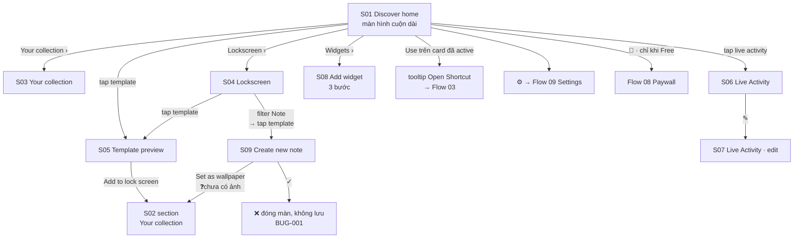

# 04 — Discover

**Mục tiêu:** kho nội dung của app — chọn template lock screen, live activity, widget và quản lý bộ sưu tập đã lưu. Đây là **tab mặc định** khi mở app.

**Nguồn:** 13 screenshot trong [`screenshots/iphone/04_discover/`](../screenshots/iphone/04_discover/) + **2 ảnh chưa lưu vào repo** (S02 v3, S09 — xem [`bugs/bug-log.md`](../../../../bugs/bug-log.md))
**Cấu trúc:** 1 màn hình cuộn dài (S01) chứa nhiều section, mỗi section có màn hình "xem tất cả" riêng.

---

## Flow



---

## S01 — Discover home · 3 state

### `04_discover_01_home_default.png`

```
┌────────────────────────────────────────┐
│ Discover                     👑    ⚙   │ ← crown = paywall, gear = settings
│
│ Lockscreen   (28)  ›                    ← section header + count + xem tất cả
│ Wallpaper designs for your lock screen
│ — tap Use to apply
│ ┌──────────┐ ┌──────────┐ ┌──────
│ │ 9:41     │ │ 9:41     │ │ 9:41      ← carousel ngang, tràn viền phải
│ │ Class    │ │ timetable│ │ lịch
│ │ schedule │ │ + to-do  │ │ tháng
│ │  [Use]   │ │  [Use]   │ │
│ └──────────┘ └──────────┘ └──────
│
│ Live Activities   (5)  ›
│ Live cards that keep your schedule
│ on the lock screen
│ ┌──────────────────┐ ┌───────────
│ │ Mon Tue Wed Thu… │ │ Today +1…
│ │ ▪▪  ▪▪  ▪▪  [Use]│ │ Prepare…
│ └──────────────────┘ └───────────
│  Weekly Schedule       Today Events…
│
│ Widgets   (93)  ›
│ Note widgets for your lock screen
│ ┌────────┬──────────┬───────┬───────┐
│ │Discover│ Calendar │ Tasks │ Notes │ ← tab bar
│ └────────┴──────────┴───────┴───────┘
└────────────────────────────────────────┘
```

### `04_discover_01_home_scrolled.png` — cuộn tới section Widgets

```
┌────────────────────────────────────────┐
│ Discover                     👑    ⚙   │ ← header dính, luôn hiển thị
│ Live cards that keep your schedule…
│ ┌──────────────────┐ ┌───────────
│ │ Weekly Schedule  │ │ Today Events
│ └──────────────────┘ └───────────
│
│ Widgets   (93)  ›
│ Note widgets for your lock screen
│ ┌──────────────┐ ┌──────────────┐ ┌───
│ │ August 2026  │ │ ☑ Write rep. │ │NEXT
│ │ [lịch tháng] │ │ ☐ Prepare…   │ │Team
│ │ ┌──────────┐ │ │ ☐ Exercise   │ │9:00
│ │ │Aug 2026  │ │ │ ☐ Pick up    │ │
│ │ │ [Add]    │ │ │      [Add]   │ │
│ │ └──────────┘ │ └──────────────┘ └───
│ └──────────────┘
│   Calendar          Tasks           Up…
│ ┌────────┬──────────┬───────┬───────┐
│ │Discover│ Calendar │ Tasks │ Notes │
│ └────────┴──────────┴───────┴───────┘
└────────────────────────────────────────┘
```

Widget chia 3 nhóm có caption: **Calendar** · **Tasks** · **Up…** (bị cắt). Nút trên card widget là `Add`, khác `Use` của lock screen.

### `04_discover_01_home_tooltip.png` — tooltip sau khi bấm Use

```
┌────────────────────────────────────────┐
│ 12:38  ┌─📋──────────── ✓ ─┐   ▮▮▮    │ ← Dynamic Island: shortcut đã chạy
│        └───────────────────┘
│ Disco┌──────────────────────────┐  ⚙   │
│      │ Set current wallpaper    │      │
│ Locks│                          │      │
│ Wallp│ Open Shortcuts to run    │      │
│      │ "Generate Latest         │      │
│      │ Wallpaper" and refresh   │      │
│      │ your Lock Screen image.  │      │
│      │ ┌──────────────────────┐ │      │
│      │ │    Open Shortcut     │ │      │ ← CTA sang app Shortcuts
│      │ └──────────────────────┘ │      │
│      └────────────▼─────────────┘      │ ← mũi tên trỏ vào card vừa chọn
│ ┌──────────┐ ┌──────────┐ ┌──────
│ │ [Use]    │ │ [Use]    │ │
│ └──────────┘ └──────────┘ └──────
└────────────────────────────────────────┘
```

> **Cơ chế then chốt:** chọn template **không** đổi wallpaper ngay. iOS không cho app đặt wallpaper trực tiếp — phải chạy shortcut. Đây là lý do tồn tại của Flow 03.

---

## S02 — Section "Your collection" · 3 state

### `04_discover_02_collection_section-focused.png` — 1 item

```
┌────────────────────────────────────────┐
│ Discover                     👑    ⚙   │
│
│ Your collection   (1)  ›
│ Designs you've saved — tap to reuse
│ or update
│ ┌──────────────────┐
│ │ ✓ Active Lockscreen │                ← badge xanh lá
│ │ 9:41                │
│ │ Class schedule      │
│ │ [ preview đầy đủ ]  │
│ │           [Update]  │                ← nút "Update", không phải "Use"
│ └──────────────────┘
│  Class Schedule — Timeline
│
│ Lockscreen   (28)  ›
│ …
└────────────────────────────────────────┘
```

### `..._section-focused-v2.png` — 2 item

```
┌────────────────────────────────────────┐
│ Your collection   (2)  ›
│ ┌────────────────┐ ┌──────────────────┐
│ │ ✓ Live         │ │ ✓ Active Lockscr.│ ← 2 loại badge khác nhau
│ │ [live activity │ │ [ lock screen    │
│ │  thu nhỏ]      │ │   preview ]      │
│ │       [Open]   │ │        [Update]  │ ← nút khác nhau theo loại
│ └────────────────┘ └──────────────────┘
│  Weekly Schedule      Class Schedule…
└────────────────────────────────────────┘
```

### `..._section-focused-v3.png` — 5 item, có item loại Note ⚠️ *chưa lưu vào repo*

```
┌────────────────────────────────────────┐
│ Discover              ┌─ ? Guide ─┐  ⚙ │ ← header ĐỔI: 👑 → nút "? Guide"
│                       └───────────┘
│ Your collection   (5)  ›
│ Designs you've saved — tap to reuse
│ or update
│ ┌────────────────┐ ┌──────────┐ ┌─────
│ │✓ Active Locksc.│ │ Note     │ │Locksc.  ← badge loại, góc trái trên
│ │ [week timetable│ │ [note    │ │[lịch +
│ │  + today +     │ │  giấy    │ │ biển]
│ │  nhân vật hồng]│ │  nền mây]│ │
│ │      [Update]  │ │   [Edit] │ │[Set as…
│ └────────────────┘ └──────────┘ └─────
│  Week Timetable      (Untitled)   Progress…
│  + Today                 ▲
│                          └─ BUG-002
└────────────────────────────────────────┘
```

**3 badge / 3 CTA khác nhau trong cùng một hàng:**

| Badge | CTA | Ý nghĩa |
|---|---|---|
| `✓ Active Lockscreen` | `Update` | đang là wallpaper hiện tại → chạy lại shortcut để refresh |
| `Note` | `Edit` | note do user tạo → mở lại editor S09 |
| `Lockscreen` | `Set as …` | đã lưu nhưng chưa active → áp dụng |

> 🐞 **[BUG-002](../../../../bugs/bug-log.md)** — item loại `Note` hiển thị label **`(Untitled)`**. Các item khác lấy tên từ template catalog (`Week Timetable + Today`, `Progress…`); note do user tạo không có nguồn tên nào → mọi note đã lưu đều trùng label.

**Quy tắc rút ra:** section "Your collection" **chỉ xuất hiện khi có item đã lưu** — không có ở `home_default`. Nhãn nút phụ thuộc loại item: lock screen `Update` (đang active) / `Set as …` (chưa active), live activity → `Open`, note → `Edit`.

> 📌 **Header khác các ảnh trước:** `? Guide` + `⚙`, **không còn `👑`** — vì tài khoản chụp ảnh này **đã mua Pro**. Đây là biến thể theo entitlement, không phải state của màn hình. Chi tiết ở [Tổng kết flow](#tổng-kết-flow).

---

## S03 — Your collection · `04_discover_03_collection_default.png`

```
┌────────────────────────────────────────┐
│ ┌──┐        Your collection            │
│ │ ‹│
│ └──┘
│ ┌──────┬───────────┬─────────────┬────┐
│ │ All  │ Lockscreen│ Live Activity│Note│ ← filter chip, All đang chọn
│ └──────┴───────────┴─────────────┴────┘
│ ┌────────────────────────────────────┐
│ │ Mon Tue Wed Thu Fri Sat Sun        │
│ │  3   4   5  (6)  7   8   9         │
│ │ ▪Study ▪Contract ▪Lunch ▪Monthly…  │
│ └────────────────────────────────────┘
│  Weekly Schedule
│
│ ┌──────────────────┐
│ │ 9:41             │
│ │ Class schedule   │
│ │ [ preview ]      │
│ └──────────────────┘
│  Class Schedule — Timeline
└────────────────────────────────────────┘
```

**Ghi chú:** filter có mục `Note` → hệ thống lưu cả item loại Note vào collection. Ảnh của màn full-list khi đã có item Note vẫn **chưa có** — nhưng section S02 v3 đã xác nhận item loại Note tồn tại thật (badge `Note`, CTA `Edit`).

---

## S04 — Lockscreen · `04_discover_04_lockscreen_default.png`

```
┌────────────────────────────────────────┐
│ ┌──┐          Lockscreen               │
│ │ ‹│
│ └──┘
│ ┌────┬─────────┬──────────┬──────────┬─
│ │All │Timeline │Timetable │Today's   │Mo…  ← filter cuộn ngang
│ └────┴─────────┴──────────┴──────────┴─
│ ┌──────────────┐  ┌──────────────┐
│ │ 9:41         │  │ 9:41         │
│ │ Class        │  │ [timetable   │
│ │ schedule     │  │  + to-do     │
│ │              │  │  + vịt]      │
│ │      [Use]   │  │      [Use]   │
│ └──────────────┘  └──────────────┘
│ ┌──────────────┐  ┌──────────────┐
│ │ 9:41         │  │ 9:41         │
│ │ [lịch tháng  │  │ 2026    59%  │      ← template "year progress"
│ │  nền mây]    │  │ [lịch tháng  │
│ │              │  │  nền tối]    │
│ └──────────────┘  └──────────────┘
└────────────────────────────────────────┘
```

**Layout:** grid 2 cột, cuộn dọc. Filter phân loại theo **kiểu bố cục** (Timeline / Timetable / Today's events / …), không theo màu hay chủ đề.

> 📌 **Filter có category `Note`** (nằm ngoài vùng ảnh, phải cuộn ngang). Chọn category này rồi tap template → mở **S09 Create new note**. Đây là đường vào duy nhất đã xác nhận của editor note dạng lock screen — **không** đi từ tab Notes (Flow 07).

---

## S05 — Template preview · `04_discover_05_template_preview.png`

```
┌────────────────────────────────────────┐
│ ┌──┐  Class Schedule — Timeline   ┌──┐ │
│ │ ‹│         Lockscreen           │ i│ │ ← nút info
│ └──┘                              └──┘ │
│      ┌────────────────────────┐
│      │                        │
│      │   [ PREVIEW LỚN ]      │
│      │   Class schedule       │
│      │   "The expert in       │
│      │    anything was once   │
│      │    a beginner"         │
│      │   Thu 6 ▸ Uống Creatine│        ← data thật của user
│      │         ▸ Gia hạn Gym… │
│      │         ▸ Uống Omega-3 │
│      │         ▸ Reading Streak│
│      │   Fri 7 ▸ … +5 more    │
│      │   Sat 8 ▸ … +5 more    │
│      │   Sun 9 ▸ … +4 more    │
│      └────────────────────────┘
│ ┌────────────────────────────────────┐
│ │      +  Add to lock screen         │ ← primary
│ └────────────────────────────────────┘
└────────────────────────────────────────┘
```

**Ghi chú:** preview render **event thật** của user, không phải placeholder → cần quyền Calendar (Flow 02) mới hiển thị đúng. Có logic gộp `+N more` khi ngày quá nhiều event.

---

## S06 — Live Activity · `04_discover_06_live-activity_default.png`

```
┌────────────────────────────────────────┐
│ ┌──┐     Weekly Schedule               │
│ │ ‹│       Live Activity               │
│ └──┘
│                  ┌──────────────────┐▶ │
│                  │ Lock your phone  │✕ │ ← tooltip có nút đóng
│                  │ to see it live   │  │
│                  └──────────────────┘  │
│ ┌────────────────────────────────────┐
│ │ Mon Tue Wed Thu Fri Sat Sun        │
│ │  3   4   5  (6)  7   8   9         │
│ │ ▪Study ▪Contract ▪Study ▪Lunch…    │ ← preview live activity
│ │ ▪Exercise ▪Pick Up      ▪Team…     │
│ └────────────────────────────────────┘
│
│
│ This Live Activity appears right on
│ your lock screen.
│  ① Turn it on, then go to your lock
│    screen.
│  ② Tap Allow to let it show.
│ ┌──────────────────────────┐   ┌────┐
│ │  ■  Stop Live Activity   │   │ ✎  │ ← đang chạy → nút Stop
│ └──────────────────────────┘   └────┘
└────────────────────────────────────────┘
```

**State đang chụp:** live activity **đang chạy** (nút `Stop`). Trạng thái chưa chạy (nút `Start`?) chưa có ảnh.

---

## S07 — Live Activity · edit · `04_discover_07_live-activity_editing.png`

```
┌────────────────────────────────────────┐
│ ┌──┐     Weekly Schedule          ┌──┐ │
│ │ ‹│                              │ ✓│ │ ← xác nhận, nền đen
│ └──┘                              └──┘ │
│ ┌────────────────────────────────────┐
│ │ Mon Tue Wed Thu Fri Sat Sun        │ ← preview cập nhật realtime
│ │ ▪Study ▪Contract ▪Study ▪Lunch…    │
│ └────────────────────────────────────┘
│ ┌────────────────────────────────────┐
│ │ Display Time            (●━━)      │ ← toggle, đang bật
│ └────────────────────────────────────┘
│ ┌────────────────────────────────────┐
│ │ Event Display                      │
│ │ ┌──────────────┬─────────────────┐ │
│ │ │    Block     │      List       │ │ ← segmented, Block đang chọn
│ │ └──────────────┴─────────────────┘ │
│ └────────────────────────────────────┘
└────────────────────────────────────────┘
```

**Tuỳ chọn:** `Display Time` (hiện/ẩn giờ) · `Event Display` (Block / List). Chỉ 2 tuỳ chọn — bộ config rất gọn.

---

## S08 — Add widget · 3 bước · `04_discover_08_add-widget_step-{1,2,3}.png`

Cùng một modal, pager 3 chấm ở dưới. Ink **không thể** tự thêm widget — chỉ hướng dẫn user tự làm trên Home Screen.

```
┌────────────────────────────────────────┐        ┌───── bước 1 ─────┐
│ ┌──┐        Add widget                 │        │ Press and hold   │
│ │✕ │                                   │        │ any empty space  │
│ └──┘                                   │        │ on your Home     │
│                                        │        │ Screen until the │
│         ┌──────────────┐               │        │ apps jiggle.     │
│         │              │               │        └──────────────────┘
│         │  [ MOCKUP    │               │        ┌───── bước 2 ─────┐
│         │    ĐIỆN       │               │        │ Tap the + (or    │
│         │    THOẠI ]    │               │        │ Edit) button in  │
│         │              │               │        │ the top corner,  │
│         │   thay đổi   │               │        │ then search for  │
│         │   theo bước  │               │        │ Ink.             │
│         │              │               │        └──────────────────┘
│         └──────────────┘               │        ┌───── bước 3 ─────┐
│                                        │        │ Choose the style │
│              Step N                    │        │ you like, tap    │
│         [ hướng dẫn bước N ]           │        │ "Add Widget",    │
│              ● ○ ○                     │        │ then "Done" to   │
│ ┌────────────────────────────────────┐ │        │ save.            │
│ │      I've added the widget         │ │        └──────────────────┘
│ └────────────────────────────────────┘ │
└────────────────────────────────────────┘
```

**Minh hoạ theo bước:** ① lưới app trống + ngón tay giữ · ② nút `+` tím góc trên · ③ widget Ink tím đã đặt trên lưới.
**Nút:** `I've added the widget` — dạng outline, không phải primary → user tự xác nhận, app không kiểm chứng được.

---

## S09 — Create new note ⚠️ *chưa lưu vào repo*

Editor của lock screen dạng Note. Vào từ **S04 → filter `Note` → tap template**.

```
┌────────────────────────────────────────┐
│ ┌──┐    Create new note           ┌──┐ │
│ │ ‹│                              │ ✓│ │ ← nền đen, enabled sẵn
│ └──┘                              └──┘ │
│              ▨▨▨ washi tape ▨▨▨
│         ┌──────👀👀──────────┐          ← sticker mắt (trang trí)
│         │                    │      ◎  ← sticker vòng, cạnh phải
│         │      Title         │         ← placeholder xám
│         │  ○ item 1          │
│         │  ○ item 2          │         ← checklist
│         │  ○ ▌               │         ← item mới, con trỏ, còn trống
│         │                    │
│         │  [ vùng giấy trống ]│
│         │                    │
│         │ ****************** │
│         │ PLEASE REMEMBER    │         ← chân template cố định
│         │ THIS EVERY DAY     │
│         │ ‖‖ barcode ‖‖      │
│         └────────────────────┘
│                                        │
│ ┌──────────────────────────┐  ┌──────┐
│ │ Aa   ☑—   📎   🎨   🔔   │  │ ⌨️   │ ← toolbar nổi trên bàn phím
│ └──────────────────────────┘  └──────┘
│ ┌────────────────────────────────────┐
│ │        [ bàn phím iOS · VI ]       │
│ └────────────────────────────────────┘
└────────────────────────────────────────┘
```

**Khác gì `07_note_02_create-note`?** Cùng tên header (`Create new note`) và cùng toolbar 5 công cụ, nhưng đây là **template giấy có sẵn** (washi tape · sticker mắt · barcode · dòng chữ chân trang cố định) chứ không phải editor trắng trơn. → 2 màn hình khác nhau, cùng dùng chung một editor engine.

> 🐞 **[BUG-001](../../../../bugs/bug-log.md)** — tap `✓` đóng màn edit nhưng **không lưu gì**, không toast, không confirm. Đường **duy nhất** để giữ note lại là đi tiếp bước `Set as wallpaper` → khi đó note mới vào `Your collection`. Không có cách lưu nháp.

**Chưa xác định**
- Ô `Title` là tiêu đề hiển thị **trên wallpaper**, hay tên của design trong collection? (liên quan trực tiếp BUG-002)
- Màn hình / bước **Set as wallpaper** sau editor — chưa có ảnh.
- Trạng thái của 5 công cụ toolbar (`Aa` `☑—` `📎` `🎨` `🔔`).
- Sticker (mắt, vòng, washi tape) là **cố định theo template** hay user thêm/di chuyển được?

---

## Tổng kết flow

| # | Màn hình | State có ảnh |
|---|----------|--------------|
| S01 | Discover home | default · scrolled · tooltip |
| S02 | Section Your collection | section-focused · section-focused-v2 · **v3** ⚠️ |
| S03 | Your collection (full) | default |
| S04 | Lockscreen (danh sách) | default |
| S05 | Template preview | preview |
| S06 | Live Activity | default (đang chạy) |
| S07 | Live Activity · edit | editing |
| S08 | Add widget | step-1 · step-2 · step-3 |
| S09 | **Create new note** | editing ⚠️ |

⚠️ = ảnh đã có nhưng **chưa lưu vào repo**, cần export + cập nhật `index.md`:
- `04_discover_02_collection_section-focused-v3.png`
- `04_discover_09_create-note_editing.png`

**Quan sát chung**
- 3 loại nội dung, 3 động từ khác nhau: lock screen `Use` → live activity `Use`/`Open` → widget `Add`.
- Số lượng chênh lệch lớn: Widgets **93**, Lockscreen **28**, Live Activities **5**.
- Cả 3 loại đều **không tự áp dụng được** — đều cần user thao tác ngoài app (shortcut / lock screen / home screen).
- Lock screen dạng `Note` là loại **duy nhất user tự tạo nội dung**, phần còn lại đều là template dựng sẵn — đây là lý do nó là loại duy nhất bị lỗi đặt tên (BUG-002).

**Possible missing screen**
- Màn hình "Widgets" xem tất cả (93 widget) — mới có section trong home.
- Trạng thái `locked` của template Pro và điểm chạm vào paywall.
- Live activity trạng thái **chưa chạy** (nút Start).
- Màn hình `Your collection` full-list khi **đã có** item loại Note (S03 hiện chụp lúc chưa có).
- Trạng thái `empty` của Your collection khi user chưa lưu gì.
- Danh sách S04 khi chọn filter category **`Note`**.
- Bước **Set as wallpaper** từ editor note (S09 → S02).
- Màn hình mở lại note đã lưu qua nút `Edit` trên card collection.

**Header Discover đổi theo trạng thái Pro**

| Trạng thái | Header | Ảnh |
|---|---|---|
| Free (chưa mua) | `👑` + `⚙` | `home_default` · `home_scrolled` · `section-focused` |
| **Pro (đã mua)** | `? Guide` + `⚙` | `section-focused-v3` |

Crown ẩn sau khi mua Pro — **đúng hành vi mong đợi**, không phải bug. Nút `? Guide` chiếm đúng vị trí crown vừa nhả ra.

> ❓ **Cần xác nhận:** `? Guide` là phần tử **chỉ có ở bản Pro**, hay vốn luôn tồn tại và trước đó bị crown đẩy khuất? Nếu là cái đầu thì header có 2 biến thể theo entitlement, cần cover cả 2 khi test. Chưa có ảnh header Pro nào khác để đối chiếu.

**Thay đổi build cần xác nhận**
- Tab bar ảnh mới dùng icon + label và có nền nổi (floating), khác tab bar phẳng ở ảnh cũ.
