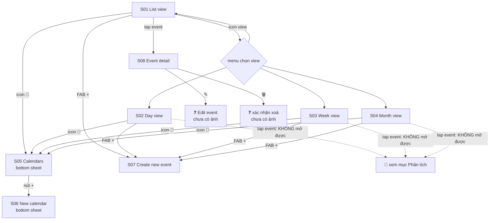

# 05 — Calendar

**Mục tiêu:** xem và quản lý lịch được đồng bộ từ iOS Calendar; chọn calendar nào được hiển thị (và đưa lên lock screen).

**Nguồn:** 11 screenshot trong [`screenshots/iphone/05_calendar/`](../screenshots/iphone/05_calendar/)

---

## Flow



---

## Cấu trúc chung của 4 view

Cả 4 view dùng chung một khung, chỉ đổi vùng nội dung:

```
┌────────────────────────────────────────┐
│ <tiêu đề>          [Today]  <view>  📅 │ ← header
│ <week strip hoặc weekday header>       │ ← thanh ngày (không có ở Month)
│ ────────────────────────────────────────
│                                        │
│         [ VÙNG NỘI DUNG THEO VIEW ]    │
│                                        │
│                                 ┌────┐ │
│                                 │ +  │ │ ← FAB tạo event
│                                 └────┘ │
│ ┌────────┬──────────┬───────┬───────┐  │
│ │Discover│ Calendar │ Tasks │ Notes │  │
│ └────────┴──────────┴───────┴───────┘  │
└────────────────────────────────────────┘
```

**Nút chọn view mang icon của view đang bật** — tap để mở menu (S01 · dialog):

| View | Tiêu đề | Icon nút | Thanh ngày |
|------|---------|----------|------------|
| List | `Aug, 2026` | ☰ list | week strip |
| Day | `Aug, 2026` | ▤ day | week strip |
| Week | `Aug, 2026` | ▥ 3 cột | week strip |
| Month | **`2026`** (chỉ năm) | ▦ lưới 9 ô | chỉ chữ cái M T W T F S S |

> ⚠️ **Không nhất quán — nút "về hôm nay".** Month view có pill **`Today`** ở header. List view lại dùng **FAB `📅6`** ở góc phải dưới. Day/Week view **không có** cả hai. Ba cách xử lý khác nhau cho cùng một hành động. **Cần thống nhất.**

---

## S01 — List view · 2 state

### `05_calendar_01_list-view_empty.png`

```
┌────────────────────────────────────────┐
│ Jul, 2026                    ☰     📅  │
│ Mon  Tue  Wed  Thu  Fri  Sat  Sun
│  27   28   29  ┌30┐  31    1    2      ← ngày dương
│  14   15   16  │17│  18   19   20      ← ngày âm lịch
│                └──┘
│ ────────────────────────────────────────
│      This day doesn't have any
│              events yet                 ← empty state
│
│                         ┌────┐ ┌──────┐
│                         │ 📅6│ │  +   │ ← "về hôm nay" + tạo event
│                         └────┘ └──────┘
└────────────────────────────────────────┘
```

### `05_calendar_01_list-view_dialog.png` — menu chọn view

```
┌────────────────────────────────────────┐
│ Aug, 2┌──────────────────────┐     📅  │
│       │ ✓  ☰  List           │
│ Mon  T│    ▤  Day            │    Sun
│  27   │    ▥  Week           │     2
│  14   │    ▦  Month          │    20
│       └──────────────────────┘
│ ┌────────────────────────────────────┐
│ │▎Uống Creatine                      │ ← thanh màu = màu calendar
│ │ 🕐 08:35 – 08:40      ↻            │ ← icon lặp lại
│ └────────────────────────────────────┘
│ ┌────────────────────────────────────┐
│ │▎Gia hạn Gym Membership ngày 6      │
│ │ hàng tháng      🕐 10:00 – 10:30 ↻ │
│ └────────────────────────────────────┘
│ ┌────────────────────────────────────┐
│ │▎Uống Omega-3    🕐 13:00 – 13:10 ↻ │
│ └────────────────────────────────────┘
│ ┌────────────────────────────────────┐
│ │▎Reading Streak 📖                  │ ← nền xanh = calendar khác
│ │                 🕐 23:00 – 23:30 ↻ │
│ └────────────────────────────────────┘
│ ┌────────────────────────────────────┐
│ │▎Uống Magie      🕐 23:50 – 23:55 ↻ │
│ └────────────────────────────────────┘
└────────────────────────────────────────┘
```

**Đặc điểm:** danh sách event của **một ngày** đang chọn, card đầy đủ tiêu đề + khung giờ + icon lặp.

---

## S02 — Day view · `05_calendar_02_day-view_default.png`

```
┌────────────────────────────────────────┐
│ Aug, 2026                    ▤     📅  │ ← không có pill Today
│ Mon  Tue  Wed  Thu  Fri  Sat  Sun
│  27   28   29   30   31    1    2
│  14   15   16   17   18   19   20
│ ────────────────────────────────────────
│ 13:00 ┌──────────────────────────────┐
│       │▎Uống Omega-3                 │ ← block full width, 1 cột
│       └──────────────────────────────┘
│ 14:00 ─────────────────────────────────
│      ●━━━━━━━━━━━━━━━━━━━━━━━━━━━━━━━━ ← ĐƯỜNG ĐỎ = giờ hiện tại (14:14)
│ 15:00 ─────────────────────────────────
│ 16:00 ─────────────────────────────────
│ 17:00 ─────────────────────────────────
│ 18:00 ─────────────────────────────────
│ 19:00 ─────────────────────────────────
│ 20:00 ─────────────────────────────────
│ 21:00 ─────────────────────────────────
│                                 ┌────┐
│ 22:00 ─────────────────────────  │ + │
│                                 └────┘
│ ┌────────┬──────────┬───────┬───────┐
│ │Discover│ Calendar │ Tasks │ Notes │
│ └────────┴──────────┴───────┴───────┘
│  ▎Uống Magie                            ← nội dung cuộn phía sau tab bar
└────────────────────────────────────────┘
```

**Đặc điểm mới so với List:**
- **Lưới thời gian dọc**, cuộn được, mỗi giờ một dòng kẻ.
- **Chỉ báo giờ hiện tại**: đường đỏ + chấm tròn bên trái. Chỉ thấy ở view này.
- Block event chiếm full bề ngang, cao **tối thiểu 1 dòng** kể cả event 10 phút (Uống Omega-3 13:00–13:10 vẫn cao gần 1 giờ) → có min-height.
- Tab bar **trong suốt**, nội dung cuộn xuyên qua phía sau.

---

## S03 — Week view · `05_calendar_03_week-view_default.png`

```
┌────────────────────────────────────────┐
│ Aug, 2026                    ▥     📅  │
│ Mon  Tue  Wed  Thu  Fri  Sat  Sun
│  27   28   29   30   31    1    2
│  14   15   16   17   18   19   20
│ ────────────────────────────────────────
│       │    │    │▓▓▓▓│ ┃  │ ┃ ┃│ ┃ ┃   ← cột hồng = ngày đang chọn (Thu 30)
│ 15:00 │    │    │▓▓▓▓│ ┃  │ ┃ ┃│ ┃ ┃   ← dải xanh dọc = event nhiều ngày
│ 16:00 │    │    │▓▓▓▓│ ┃  │ ┃ ┃│ ┃ ┃
│ 17:00 │    │    │▓▓▓▓│ ┃  │ ┃ ┃│ ┃ ┃
│ 18:00 │    │    │▓▓▓▓│ ┃  │ ┃ ┃│ ┃ ┃
│ 19:00 │ ┌──┐   │▓▓▓▓│┌─┐ │ ┃ ┃│ ┃ ┃
│       │ │Tennis │▓▓▓▓││Te│ │ ┃ ┃│ ┃ ┃  ← block hẹp → chữ cắt "Te…"
│ 20:00 │ │Day 🎾│    │└─┘ │
│ 21:00 │ └──┘   │▓▓▓▓│
│ 22:00 ┌──┐ │ ┌──┐│▓▓▓▓│    │┌─┐│
│       │Upper│ │Lower│      ││Up│           ← Upper Day / Lower Day 22:00
│       │Day🏋│ │Day🏋│      ││…│
│ 23:00 ┌────┬────┬────┬────┬─┬─┬─┐
│       │Read│Read│Read│Read│R│R│…│      ← Reading Streak lặp mỗi ngày
│       │ing │ing │ing │ing │…│…│ │
│       └────┴────┴────┴────┴─┴─┴─┘
│                 ┌────┐        ┌────┐
│                 │Uống│        │ +  │   ← Uống Magie 23:50
│                 │Magie        └────┘
│ ┌────────┬──────────┬───────┬───────┐
│ │Discover│ Calendar │ Tasks │ Notes │
│ └────────┴──────────┴───────┴───────┘
└────────────────────────────────────────┘
```

**Đặc điểm:**
- **7 cột × lưới thời gian**, cuộn dọc theo giờ.
- **Cột nền hồng** (Thu 30) = ngày đang chọn — dấu hiệu duy nhất, không có highlight ở week strip phía trên.
- **Dải màu dọc suốt chiều cao** ở Fri/Sat/Sun = event kéo dài nhiều ngày hoặc all-day. Chúng chiếm chỗ trong lưới giờ chứ **không** có hàng all-day riêng như Apple Calendar.
- Cột hẹp → tên event cắt mạnh (`Te…`, `Up…`, `R…`), gần như không đọc được ở cuối tuần.
- **FAB `+` đè lên nội dung** ở góc phải dưới, che mất event của Sat/Sun khung 23:00.

> ⚠️ **Vấn đề khả dụng:** với mật độ event dày (ảnh này là data thật của user), week view gần như không đọc được — chữ cắt còn 1–2 ký tự và FAB che nội dung. **Cần đánh giá lại** cách hiển thị event nhiều ngày và vị trí FAB.

---

## S04 — Month view · `05_calendar_04_month-view_default.png`

```
┌────────────────────────────────────────┐
│ 2026                [Today]   ▦    📅  │ ← tiêu đề chỉ có NĂM
│  M    T    W    T    F    S    S       │ ← chỉ chữ cái, dính khi cuộn
│ August                                  ← tiêu đề tháng trong nội dung
│                              1     2
│                             19    20    ← âm lịch
│
│  3     4     5    (6)    7     8     9  ← ngày 6 màu ĐỎ = hôm nay
│ 21    22    23   (24)  25    26    27
│ ▎Upper▎Tennis▎Lower▎Uống ▎Uống ▎Uống ▎Uống
│ ▎Readin▎Readin▎Readin▎Gia hạ▎Uống ▎Uống ▎Uống
│                    +3    +5    +5    +4  ← số event còn lại
│
│ 10    11    12    13    14    15    16
│ 28    29    30   1/7     2     3     4  ← "1/7" = mùng 1 tháng 7 âm
│ ▎Uống ▎Uống ▎Uống ▎Uống ▎Uống ▎Uống ▎Uống
│ ▎Uống ▎Uống ▎Uống ▎Uống ▎Uống ▎Uống ▎Uống
│  +5    +5    +5    +4    +5    +5    +4
│
│ 17 … 23     [ tương tự ]
│ 24 … 30     [ tương tự ]
│
│ 31
│ 19
│ ▎Uống                            ┌────┐
│ ▎Uống                            │ +  │
│  +5                              └────┘
│
│ September                               ← THÁNG TIẾP THEO, cuộn liên tục
│ ┌────────┬──────────┬───────┬───────┐
│ │Discover│ Calendar │ Tasks │ Notes │
│ └────────┴──────────┴───────┴───────┘
└────────────────────────────────────────┘
```

**Đặc điểm:**
- **Cuộn dọc liên tục qua nhiều tháng** — hết August là tới September ngay, không phân trang. Vì vậy tiêu đề header chỉ hiển thị **năm**, tên tháng nằm trong luồng nội dung.
- Mỗi ô ngày: số dương (đậm) + số âm (xám) + **tối đa 2 chip event** + `+N`.
- **Hôm nay (6/8)** tô đỏ cả số dương lẫn số âm.
- Chip event: thanh màu trái + tên cắt ngắn (`Upper…`, `Readin…`), nền nhuộm theo màu calendar.
- Ngày 13 hiển thị âm lịch là **`1/7`** — định dạng riêng cho mùng 1 (ngày/tháng âm), khác các ngày khác chỉ hiện số ngày.
- Ô ngày **không có event** vẫn giữ nguyên chiều cao (xem 1–2/8) → chiều cao hàng cố định.

---

## S05 — Calendars · `05_calendar_05_calendars_bottom-sheet.png`

```
┌────────────────────────────────────────┐
│ ░░░░░░░░ nền mờ ░░░░░░░░░░░░░░░░░░░░   │
│ ┌──────────────────────────────────────┐
│ │              ▬▬                      │ ← grabber
│ │          Calendars            ┌───┐  │
│ │                               │ + │  │ ← tạo calendar mới
│ │ ICLOUD                        └───┘  │
│ │ ┌──────────────────────────────────┐ │
│ │ │ ● Lịch                       ✓🔵 │ │
│ │ │ ● Công Việc                  ✓🟠 │ │
│ │ │ ● Nhà                        ✓🔴 │ │
│ │ │ ● Calendar                   ✓🟢 │ │
│ │ └──────────────────────────────────┘ │
│ │ OTHER                                │
│ │ ┌──────────────────────────────────┐ │
│ │ │ ● Birthdays                  ✓⚪ │ │
│ │ └──────────────────────────────────┘ │
│ │ SUBSCRIBED CALENDARS                 │
│ │ ┌──────────────────────────────────┐ │
│ │ │ ● Ngày lễ Việt Nam           ✓🟣 │ │
│ │ └──────────────────────────────────┘ │
│ │ SUGGESTED                            │
│ │ ┌──────────────────────────────────┐ │
│ │ │ 📖 Class Schedule             ⊕  │ │ ← nút thêm, không phải checkbox
│ │ │ ❤️ Dates                      ⊕  │ │
│ │ │ ✈️ Travel                     ⊕  │ │
│ │ └──────────────────────────────────┘ │
│ └──────────────────────────────────────┘
└────────────────────────────────────────┘
```

| Nhóm | Nguồn | Thao tác |
|------|-------|----------|
| ICLOUD | đồng bộ từ tài khoản iCloud | bật/tắt hiển thị |
| OTHER | calendar hệ thống (Birthdays) | bật/tắt hiển thị |
| SUBSCRIBED CALENDARS | lịch đăng ký (Ngày lễ Việt Nam) | bật/tắt hiển thị |
| SUGGESTED | Ink gợi ý tạo mới | `⊕` để tạo |

**Ghi chú:** SUGGESTED là tính năng riêng của Ink (Apple Calendar không có) — đề xuất calendar theo chủ đề để user phân loại event, phục vụ việc tô màu trên lock screen.

---

## S06 — New calendar · `05_calendar_06_new-calendar_bottom-sheet.png`

```
┌────────────────────────────────────────┐
│ ░░ nền: sheet Calendars (mờ hơn) ░░    │
│ ┌──────────────────────────────────────┐
│ │              ▬▬                      │
│ │          New calendar                │
│ │ ┌──────────────────────────────────┐ │
│ │ │ 📖 Class Schedule              › │ │
│ │ │ 💼 Work                        › │ │
│ │ │ ❤️ Dates                       › │ │
│ │ │ ✈️ Travel                      › │ │
│ │ │ 🏋️ Fitness                     › │ │
│ │ │ 🏠 Family                      › │ │
│ │ │ ✎  Custom name…                › │ │
│ │ └──────────────────────────────────┘ │
│ └──────────────────────────────────────┘
└────────────────────────────────────────┘
```

**Sheet chồng sheet** — S06 mở đè lên S05, không thay thế.
**6 preset + 1 custom.** Mỗi dòng có `›` → còn ít nhất **1 bước nữa** (chọn màu? xác nhận tên?) chưa có ảnh.

**Đối chiếu:** SUGGESTED ở S05 chỉ có 3 mục trong khi S06 có 6 → SUGGESTED nhiều khả năng đã lọc bỏ preset trùng với calendar user đang có.

---

## S07 — Create new event · 3 state

### `05_calendar_07_create-event_default.png`

```
┌────────────────────────────────────────┐
│ ┌──┐    Create new event          ┌──┐ │
│ │ ‹│                              │ ✓│ │ ← xám = disabled (chưa có Title)
│ └──┘                              └──┘ │
│ ┌────────────────────────────────────┐
│ │ ┌──┐                               │
│ │ │⭐│  Title                        │ ← icon ⭐ bên trái ô Title
│ │ └──┘                               │
│ │ ────────────────────────────────── │
│ │ Notes                              │
│ │ ────────────────────────────────── │
│ │ URL                                │ ← chỉ event mới có trường URL
│ └────────────────────────────────────┘
│ ┌────────────────────────────────────┐
│ │ 🕐 All day                 (━━○)   │ ← toggle, mặc định tắt
│ │ ────────────────────────────────── │
│ │ 📅 Start        Today, 9:00 AM  ⌄  │
│ │ ────────────────────────────────── │
│ │ 🕐 End         Today, 10:00 AM  ⌄  │ ← mặc định +1 giờ
│ └────────────────────────────────────┘
│ ┌────────────────────────────────────┐
│ │ 🎨 Color                    🔵  ⌄  │
│ │ ────────────────────────────────── │
│ │ 🗂 Calendar        🟢 Calendar  ⌄  │ ← chọn calendar đích
│ │ ────────────────────────────────── │
│ │ ↻  Repeat                None  ⌄  │
│ │ ────────────────────────────────── │
│ │ 🔔 Reminder              None  ⌄  │
│ └────────────────────────────────────┘
└────────────────────────────────────────┘
```

**9 trường:** Title · Notes · URL · All day · Start · End · Color · Calendar · Repeat · Reminder.
**Nút ✓ disabled** khi chưa nhập Title → Title là trường bắt buộc duy nhất (giống Create task).

### `05_calendar_07_create-event_expanded.png` — mở picker ngày giờ

```
┌────────────────────────────────────────┐
│ ┌──┐    Create new event          ┌──┐ │
│ │ ‹│                              │ ✓│ │
│ └──┘                              └──┘ │
│ ┌────────────────────────────────────┐
│ │ 🕐 All day                 (━━○)   │
│ │ ────────────────────────────────── │
│ │ 📅 Start        Today, 9:00 AM  ⌃  │ ← đã mở
│ │    Time              [ 9:00 AM ]   │ ← chip giờ
│ │ ────────────────────────────────── │
│ │    August 2026 ›          ‹    ›   │ ← điều hướng tháng, màu ĐỎ
│ │    MON TUE WED THU FRI SAT SUN     │
│ │                          1    2    │
│ │     3   4   5  (6)  7    8    9    │ ← (6) = chấm đỏ đặc, hôm nay
│ │    10  11  12   13  14   15   16   │
│ │    17  18  19   20  21   22   23   │
│ │    24  25  26   27  28   29   30   │
│ │    31                              │
│ │ ────────────────────────────────── │
│ │ 🕐 End         Today, 10:00 AM  ⌃  │ ← MỞ CÙNG LÚC với Start
│ │    Time             [ 10:00 AM ]   │
│ │    August 2026 ›          ‹    ›   │
│ │    MON TUE WED THU FRI SAT SUN     │
│ │                          1    2    │
│ │     3   4   5  (6)  7    8    9    │
│ │    …                               │
│ └────────────────────────────────────┘
└────────────────────────────────────────┘
```

**Picker dạng inline accordion** — mở ra ngay trong form, không phải sheet hay modal. **Start và End mở được đồng thời**, đẩy form dài ra rất nhiều (mỗi picker ~1 màn hình).

### `05_calendar_07_create-event_editing.png` — đang nhập tên

```
┌────────────────────────────────────────┐
│ ┌──┐    Create new event          ┌──┐ │
│ │ ‹│                              │ ✓│ │ ← ĐEN = enabled sau khi có Title
│ └──┘                              └──┘ │
│ ┌────────────────────────────────────┐
│ │ ┌──┐                               │
│ │ │⭐│  Event name▌                  │ ← đã nhập
│ │ └──┘                               │
│ │ Notes                              │
│ │ URL                                │
│ └────────────────────────────────────┘
│ ┌────────────────────────────────────┐
│ │ 🕐 All day                 (━━○)   │
│ │ 📅 Start        Today, 9:00 AM  ⌃  │
│ │    Time              [ 9:00 AM ]   │
│ │    August 2026 ›          ‹    ›   │
│ │     3   4   5  (6)  7    8    9    │ ← picker vẫn mở, bị bàn phím che
│ └────────────────────────────────────┘
│ ┌────────────────────────────────────┐
│ │  q w e r t y u i o p               │
│ │   a s d f g h j k l                │
│ │  ⇧  z x c v b n m  ⌫               │
│ │  123 😀 [  space  VI  ] ↵          │
│ └────────────────────────────────────┘
└────────────────────────────────────────┘
```

**Ghi chú thiết kế**

Icon **⭐ cạnh ô Title** chưa rõ chức năng — có thể là chọn icon/emoji cho event (khớp với việc các event mẫu đều có emoji: `Tennis Day 🎾`, `Upper Day 🏋`), hoặc đánh dấu quan trọng. **Cần xác nhận.**

**Màu nhấn của picker là ĐỎ** (chấm ngày hiện tại, mũi tên điều hướng), trong khi toàn app dùng **tím/đen**. Nhiều khả năng đang dùng component ngày tháng mặc định của hệ thống chưa theme lại.

**Không có trường Location**, dù dialog xin quyền ở Flow 02 có nhắc *"Calendar events may include additional data, such as locations…"*. Event tạo bằng Ink sẽ không có địa điểm.

**So với Create task** (Flow 06): event có thêm `URL`, `All day`, `End`, `Calendar`, `Reminder`; task có `High priority` mà event không có. Hai form không dùng chung layout.

---

## S08 — Event detail · `05_calendar_08_event-detail_default.png`

```
┌────────────────────────────────────────┐
│ ┌──┐          Event               ┌──┐ │
│ │ ‹│                              │ ⤴│ │ ← share
│ └──┘                              └──┘ │
│ ┌──┐
│ │📅│                                    ← icon tròn, nền nhuộm màu calendar
│ └──┘
│ Uống Creatine                           ← tiêu đề lớn
│
│ 📅 Thursday, 6 August 2026
│ 🕐 08:35 – 08:40
│ ↻  Every day                            ← quy tắc lặp, dạng chữ
│
│
│
│
│
│
│ ┌────┐                          ┌────┐
│ │ 🗑 │                          │ ✎  │ ← xoá (trái) · sửa (phải)
│ └────┘                          └────┘
└────────────────────────────────────────┘
```

**Chỉ hiển thị 3 thuộc tính:** ngày · khung giờ · quy tắc lặp. Event mẫu không có Notes/URL nên chưa rõ chúng hiển thị thế nào.

**Không có nút hành động chính.** Đối chiếu [Task detail](06_task.md#s03--task-detail--06_task_03_task-detail_defaultpng) — cùng bố cục nhưng ở giữa có nút lớn `Mark it completed`. Event thì bỏ trống khoảng giữa, chỉ còn 2 nút tròn ở hai góc. Hợp lý về mặt ngữ nghĩa (event không "hoàn thành" được), nhưng để lại một vùng trống rất lớn.

**Không hiển thị calendar nguồn** dưới dạng chữ — chỉ suy ra được qua màu icon (xanh lá = calendar "Calendar"). Người dùng có nhiều calendar sẽ khó biết event thuộc lịch nào.

**Điểm vào duy nhất hiện tại:** tap event từ **List view**. Xem mục phân tích ngay dưới.

---

## 🔴 Phân tích: chỉ mở được chi tiết event ở List view

**Hiện trạng:** tap vào event ở **List view** → mở chi tiết. Tap ở **Day / Week / Month view** → không có gì xảy ra.

### Kết luận: đây là lỗi, không phải chủ ý thiết kế

**Bằng chứng 1 — Month view tạo ngõ cụt dữ liệu.**
Mỗi ô ngày chỉ hiện tối đa 2 event rồi ghi `+3`, `+5`. Nếu tap không mở được gì thì chỉ báo `+N` **không dẫn tới đâu cả** — người dùng biết có 5 event nữa nhưng không có đường nào xem. Một chỉ báo số lượng mà không mở ra được nội dung là dấu hiệu chức năng bị thiếu, không phải quyết định thiết kế.

**Bằng chứng 2 — Week view cắt chữ tới mức vô nghĩa.**
Ở [S03](#s03--week-view--05_calendar_03_week-view_defaultpng), tên event cột cuối tuần bị cắt còn `Te…`, `R…`, `U…`, `Up…`. Cắt chữ như vậy **chỉ chấp nhận được khi có thao tác xem chi tiết**. Không có tap-to-detail thì Week view hiển thị dữ liệu mà người dùng vĩnh viễn không đọc được.

**Bằng chứng 3 — affordance giống hệt nhau.**
Event ở cả 4 view đều vẽ cùng một ngôn ngữ thị giác: nền nhuộm màu, bo góc, thanh màu trái, có tiêu đề. Không có tín hiệu nào cho biết ở 3 view kia chúng "không bấm được". Người dùng sẽ tap và tưởng app bị treo.

**Bằng chứng 4 — trái quy ước nền tảng.**
Apple Calendar, Google Calendar, Fantastical đều cho tap event ở mọi chế độ xem. Đây là kỳ vọng mặc định của người dùng iOS.

**Bằng chứng 5 — chi phí sửa gần như bằng 0.**
Màn hình chi tiết [S08](#s08--event-detail--05_calendar_08_event-detail_defaultpng) **đã tồn tại và đã chạy được** từ List view. Nó nhận vào một event và hiển thị 3 thuộc tính — không phụ thuộc gì vào ngữ cảnh List. Ba view kia chỉ cần gắn cùng một hành động điều hướng vào cùng một đối tượng dữ liệu. Không có lý do kỹ thuật hay sản phẩm nào để cố tình bỏ.

**Bằng chứng 6 — mất luôn đường xoá và sửa event.**
Nút 🗑 và ✎ **chỉ nằm trong màn hình chi tiết**. Không mở được chi tiết đồng nghĩa với việc từ Day/Week/Month view, người dùng **không thể sửa hay xoá bất kỳ event nào**. Đây không còn là vấn đề xem thông tin nữa mà là mất chức năng chỉnh sửa ở 3 trong 4 chế độ xem.

### Cần kiểm chứng trước khi kết luận cuối cùng

Có **một** kịch bản khiến đây là thiết kế hợp lý: nếu tap vào **ô ngày** (không phải event) ở Month/Week view sẽ chuyển sang List view của ngày đó — tức mô hình drill-down `tháng → ngày → danh sách → chi tiết`, giống Apple Calendar.

**Cách kiểm tra:** ở Month view, tap vào vùng trống của ô ngày 13/8 (ngày có `+4`). Nếu app nhảy sang List view ngày 13/8 → có đường đi, vấn đề hạ xuống mức *khó khám phá*. Nếu không có gì xảy ra → xác nhận là ngõ cụt.

### Phân loại và mức ưu tiên

| View | Mức độ | Lý do |
|------|--------|-------|
| **Month** | 🔴 Cao | `+N` không dẫn tới đâu, phần lớn event không xem được · không sửa/xoá được |
| **Week** | 🔴 Cao | Tên event bị cắt, không tap được thì không biết đó là gì · không sửa/xoá được |
| **Day** | 🟠 Cao | Tên đọc được nên còn xem được, nhưng vẫn **mất hoàn toàn** đường sửa và xoá event |

**Phân loại:** lỗi nhất quán UX / chức năng cài đặt thiếu (incomplete implementation), không phải lỗi hiển thị. Nhiều khả năng là do phạm vi MVP — làm chi tiết từ List trước rồi chưa gắn cho các view còn lại.

**Đề xuất:** gắn tap-to-detail cho cả 3 view, dùng lại đúng màn hình chi tiết hiện có. Nếu chưa làm kịp, tối thiểu cho tap ô ngày ở Month/Week để nhảy sang List view của ngày đó — chi phí thấp hơn và gỡ được ngõ cụt.

---

## Tổng kết flow

| # | Màn hình | State có ảnh |
|---|----------|--------------|
| S01 | List view | empty · dialog (menu chọn view) |
| S02 | Day view | default |
| S03 | Week view | default |
| S04 | Month view | default |
| S05 | Calendars | bottom-sheet |
| S06 | New calendar | bottom-sheet |
| S07 | Create new event | default · editing · expanded |
| S08 | Event detail | default |

**Vấn đề đã nhận diện**
1. 🔴 **Không mở được chi tiết event ở Day/Week/Month** — kéo theo mất luôn chức năng sửa và xoá event ở 3 view này. Xem mục phân tích ở trên.
2. **Nút "về hôm nay" ba kiểu khác nhau** — pill ở Month, FAB ở List, không có ở Day/Week.
3. **Week view quá tải** — tên event cắt còn 1–2 ký tự, FAB che nội dung khung 23:00.
4. **Event nhiều ngày chiếm nguyên cột** trong lưới giờ ở Week view, không có hàng all-day riêng.
5. **Màu nhấn picker ngày tháng là đỏ**, lệch với hệ màu tím/đen của app.
6. **Thiếu trường Location** khi tạo event.

**Possible missing screen**
- **Edit event** — nút ✎ ở S08 dẫn tới đâu chưa có ảnh (dùng lại form S07 hay form riêng?).
- Dialog **xác nhận xoá** event, và cách xử lý khi xoá event lặp (xoá 1 lần hay cả chuỗi?).
- Event detail có **Notes / URL / Location** — event mẫu không có nên chưa rõ cách hiển thị.
- Các picker con của S07: Color, Calendar, Repeat, Reminder, và chức năng của icon ⭐.
- Trạng thái `All day` bật.
- Bước sau khi chọn preset ở S06.
- Day/Week/Month view ở trạng thái **không có event**.
- Menu chọn view mở từ Day/Week/Month (chỉ có ảnh mở từ List).
