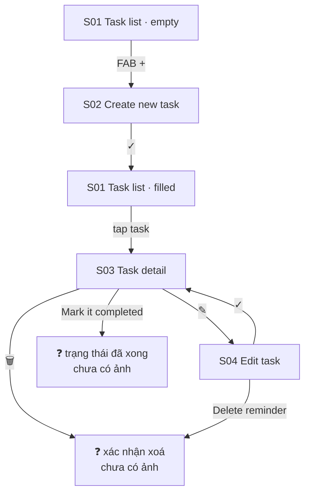

# 06 — Task

**Mục tiêu:** quản lý to-do, đồng bộ 2 chiều với Apple Reminders, để hiển thị lên lock screen / widget.

**Nguồn:** 5 screenshot trong [`screenshots/iphone/06_task/`](../screenshots/iphone/06_task/)

---

## Flow



---

## S01 — Task list · 2 state

### `06_task_01_task-list_empty.png`

```
┌────────────────────────────────────────┐
│ Tasks                            ☑     │ ← icon góc phải (lọc đã xong?)
│
│ Today                                   ← section 1: hôm nay
│
│       Today doesn't have any tasks yet
│
│
│ Plan tasks                              ← section 2: kế hoạch
│ ┌──────────┬────────────┬─────────────┐
│ │   All    │  Reminder  │     Ink     │ ← segmented, All đang chọn
│ └──────────┴────────────┴─────────────┘
│
│      Click "+" to create your first task
│
│
│
│                                 ┌────┐
│                                 │ +  │ ← FAB
│                                 └────┘
│ ┌────────┬──────────┬───────┬───────┐
│ │Discover│ Calendar │ Tasks │ Notes │
│ └────────┴──────────┴───────┴───────┘
└────────────────────────────────────────┘
```

**Kiến trúc dữ liệu lộ ra từ segmented control:** task đến từ **2 nguồn** — `Reminder` (Apple Reminders) và `Ink` (tạo trong app). `All` gộp cả hai.

### `06_task_01_task-list_filled.png`

```
┌────────────────────────────────────────┐
│ Tasks                            ☑     │
│ Today
│ ┌──────────────────────┐
│ │ ☐  Task 1            │                ← card hẹp, chỉ chiếm ~60% bề ngang
│ │    🕐 13:21          │
│ │    📅 Today          │
│ └──────────────────────┘
│
│ Plan tasks
│ ┌──────────┬────────────┬─────────────┐
│ │   All    │  Reminder  │     Ink     │
│ └──────────┴────────────┴─────────────┘
│ ┌────────────────────────────────────┐
│ │ ☐  Task 1                          │  ← card full width
│ │    🕐 13:21  —  📅 Today           │
│ └────────────────────────────────────┘
│ ┌────────────────────────────────────┐
│ │ ☐  Task 2                          │
│ │    🕐 13:17  —  📅 Tomorrow        │
│ └────────────────────────────────────┘
│                                 ┌────┐
│                                 │ +  │
│                                 └────┘
└────────────────────────────────────────┘
```

**Lưu ý:** `Task 1` xuất hiện ở **cả hai** section — "Today" là view lọc theo ngày, "Plan tasks" là toàn bộ danh sách. Không phải 2 task khác nhau.
**Checkbox màu vàng** = màu người dùng chọn cho task đó (xem S02).

---

## S02 — Create new task · `06_task_02_create-task_default.png`

```
┌────────────────────────────────────────┐
│ ┌──┐     Create new task          ┌──┐ │
│ │ ‹│                              │ ✓│ │ ← xám = disabled (chưa có Title)
│ └──┘                              └──┘ │
│ ┌────────────────────────────────────┐
│ │ Title                              │ ← placeholder
│ │ ────────────────────────────────── │
│ │ Notes                              │
│ └────────────────────────────────────┘
│ ┌────────────────────────────────────┐
│ │ 🎨 Color                    🟡  ⌄  │
│ └────────────────────────────────────┘
│ ┌────────────────────────────────────┐
│ │ 📅 Date                  Today  ⌄  │
│ └────────────────────────────────────┘
│ ┌────────────────────────────────────┐
│ │ 🕐 Time                1:18 PM  ⌄  │ ← mặc định = giờ hiện tại
│ └────────────────────────────────────┘
│ ┌────────────────────────────────────┐
│ │ 🚩 High priority           (━━○)   │ ← toggle, mặc định tắt
│ └────────────────────────────────────┘
│ ┌────────────────────────────────────┐
│ │ ↻  Repeat                  (━━○)   │
│ └────────────────────────────────────┘
└────────────────────────────────────────┘
```

**6 thuộc tính:** Title · Notes · Color · Date · Time · High priority · Repeat.
**Nút ✓ disabled** khi chưa nhập Title → Title là trường bắt buộc duy nhất.
Các dòng có `⌄` mở picker — **chưa có ảnh** của bất kỳ picker nào.

---

## S03 — Task detail · `06_task_03_task-detail_default.png`

```
┌────────────────────────────────────────┐
│ ┌──┐          Task                ┌──┐ │
│ │ ‹│                              │ ⤴│ │ ← share
│ └──┘                              └──┘ │
│ ┌──┐
│ │☐ │                                    ← checkbox lớn, nền vàng nhạt
│ └──┘
│ Task 1                                  ← tiêu đề lớn
│
│ 📅 Thursday, 6 August 2026
│ 🕐 13:21
│
│
│
│
│
│ ┌────┐ ┌────────────────────┐ ┌────┐
│ │ 🗑 │ │ ✓ Mark it completed│ │ ✎  │  ← xoá · hoàn tất · sửa
│ └────┘ └────────────────────┘ └────┘
└────────────────────────────────────────┘
```

**Bố cục 3 nút dưới cùng:** phụ (xoá) — chính (hoàn tất) — phụ (sửa). Hành động chính là **đánh dấu xong**, không phải sửa.
Màn hình rất thoáng vì task mẫu không có Notes.

---

## S04 — Edit task · `06_task_04_edit-task_default.png`

```
┌────────────────────────────────────────┐
│ ┌──┐        Edit task              ┌──┐│
│ │ ‹│                               │ ✓ ││ ← đen = enabled (đã có Title)
│ └──┘                               └──┘│
│ ┌────────────────────────────────────┐
│ │ Task 1                             │ ← đã điền
│ │ ────────────────────────────────── │
│ │ Notes                              │
│ └────────────────────────────────────┘
│ ┌────────────────────────────────────┐
│ │ 🎨 Color                    🟡  ⌄  │
│ └────────────────────────────────────┘
│ ┌────────────────────────────────────┐
│ │ 📅 Date                  Today  ⌄  │
│ └────────────────────────────────────┘
│ ┌────────────────────────────────────┐
│ │ 🕐 Time                1:21 PM  ⌄  │
│ └────────────────────────────────────┘
│ ┌────────────────────────────────────┐
│ │ 🚩 High priority           (━━○)   │
│ └────────────────────────────────────┘
│ ┌────────────────────────────────────┐
│ │ ↻  Repeat                  (━━○)   │
│ └────────────────────────────────────┘
│ ┌────────────────────────────────────┐
│ │        Delete reminder             │ ← chữ đỏ, chỉ có ở màn Edit
│ └────────────────────────────────────┘
└────────────────────────────────────────┘
```

**Khác S02:** trường đã điền sẵn · nút ✓ enabled · thêm **`Delete reminder`** cuối form.

> ✅ **Đã xác nhận — không phải lỗi copy:** nút ghi "Delete **reminder**" vì task này đến từ nguồn Reminder,
> và nút **xoá đúng bản ghi Reminder** đó (không phải xoá khỏi Ink). Chữ "task" ở tiêu đề màn hình là tên gọi
> chung trong Ink, còn nút hành động gọi đúng tên đối tượng thật sự bị xoá. Hành vi chủ ý, giữ nguyên chữ.

---

## Tổng kết flow

| # | Màn hình | State có ảnh |
|---|----------|--------------|
| S01 | Task list | empty · filled |
| S02 | Create new task | default |
| S03 | Task detail | default |
| S04 | Edit task | default |

**Possible missing screen**
- Task **đã hoàn thành** — sau khi bấm "Mark it completed" (gạch ngang? chuyển section?).
- Dialog **xác nhận xoá**.
- Các **picker**: Color, Date, Time, và tuỳ chọn khi bật Repeat.
- Filter `Reminder` và `Ink` đang chọn (chỉ có ảnh tab `All`).
- Chức năng của icon ☑ góc trên phải.
- `IMG_0088`, `IMG_0090` thiếu trong dãy gốc.
