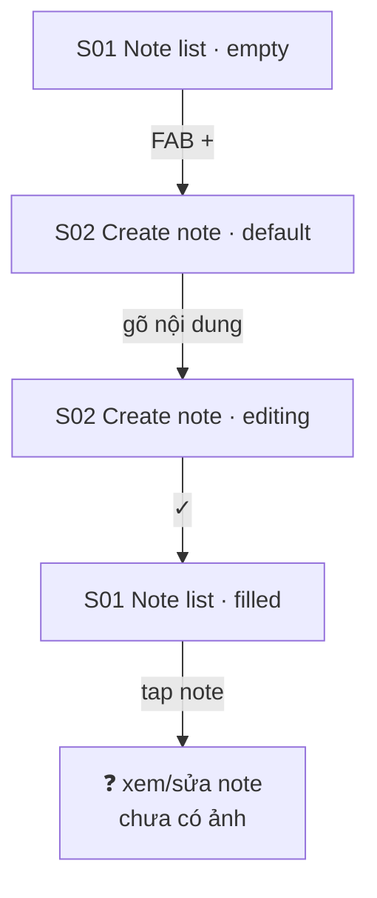

# 07 — Note

**Mục tiêu:** ghi chú nhanh, để đưa lên lock screen / home screen dưới dạng note widget.

**Nguồn:** 4 screenshot trong [`screenshots/iphone/07_note/`](../screenshots/iphone/07_note/)
**Liên hệ:** Discover có section **Widgets (93)** mô tả là *"Note widgets for your lock screen"* → note ở đây là nguồn dữ liệu cho widget đó.

---

## Flow



---

## S01 — Note list · 2 state

### `07_note_01_note-list_empty.png`

```
┌────────────────────────────────────────┐
│ Notes                                   ← không có icon phụ ở header
│
│      Click "+" to create your first note
│
│
│
│
│
│
│
│                                 ┌────┐
│                                 │ +  │ ← FAB
│                                 └────┘
│ ┌────────┬──────────┬───────┬───────┐
│ │Discover│ Calendar │ Tasks │ Notes │
│ └────────┴──────────┴───────┴───────┘
└────────────────────────────────────────┘
```

**So với Tasks:** header trống trơn, không section, không filter → Notes là tab đơn giản nhất.

### `07_note_01_note-list_filled.png`

```
┌────────────────────────────────────────┐
│ Notes
│ ┌──────────────────────┐
│ │ Note 1               │                ← card hẹp ~50% bề ngang
│ │ Des 1                │                ← preview nội dung
│ └──────────────────────┘
│
│
│
│                                 ┌────┐
│                                 │ +  │
│                                 └────┘
└────────────────────────────────────────┘
```

**Card note:** tiêu đề đậm + dòng preview. Bề rộng cố định (không full width) → gợi ý layout **grid 2 cột** khi có nhiều note.

---

## S02 — Create new note · 2 state

### `07_note_02_create-note_default.png`

```
┌────────────────────────────────────────┐
│ ┌──┐    Create new note           ┌──┐ │
│ │ ‹│                              │ ✓│ │ ← đen = enabled ngay từ đầu
│ └──┘                              └──┘ │
│ ┌────────────────────────────────────┐
│ │ Title                              │ ← placeholder
│ │                                    │
│ │ Write something                    │ ← placeholder body
│ │                                    │
│ │                                    │
│ │        [ vùng soạn thảo lớn ]      │
│ │                                    │
│ │                                    │
│ └────────────────────────────────────┘
│
│ ┌──────────────────────────┐  ┌──────┐
│ │ Aa   ☑—   📎   🎨   🔔   │  │  ▣+  │ ← toolbar + nút phụ
│ └──────────────────────────┘  └──────┘
└────────────────────────────────────────┘
```

**Toolbar 5 công cụ:** `Aa` định dạng chữ · `☑—` checklist · `📎` đính kèm · `🎨` màu · `🔔` nhắc nhở.

> ⚠️ **Nút phụ bên phải chưa xác định.** Ở state `default` icon trông như **thêm note vào widget**; ở state `editing` cùng vị trí đó là **icon bàn phím**. Có thể là nút đổi ngữ cảnh, hoặc 2 nút khác nhau. **Cần xác nhận**, không suy diễn.

### `07_note_02_create-note_editing.png`

```
┌────────────────────────────────────────┐
│ ┌──┐    Create new note           ┌──┐ │
│ │ ‹│                              │ ✓│ │
│ └──┘                              └──┘ │
│ ┌────────────────────────────────────┐
│ │ Note 1                             │ ← đã nhập
│ │ Des 1▌                             │ ← con trỏ
│ └────────────────────────────────────┘
│
│ ┌──────────────────────────┐  ┌──────┐
│ │ Aa   ☑—   📎   🎨   🔔   │  │ ⌨️   │ ← toolbar nổi lên trên bàn phím
│ └──────────────────────────┘  └──────┘
│ ┌────────────────────────────────────┐
│ │  1 2 3 4 5 6 7 8 9 0               │
│ │  - / : ; ( ) đ & @ "               │ ← bàn phím số/ký hiệu, layout VI
│ │  #+= . , ? ! ' ⌫                   │
│ │  ABC 😀 [  space  VI  ] ↵          │
│ │  🌐                                │
│ └────────────────────────────────────┘
└────────────────────────────────────────┘
```

**Ghi chú:** bàn phím tiếng Việt (`đ`, chỉ báo `VI`) — xác nhận thị trường mục tiêu.

---

## Tổng kết flow

| # | Màn hình | State có ảnh |
|---|----------|--------------|
| S01 | Note list | empty · filled |
| S02 | Create new note | default · editing |

**Quan sát**
- Note **không có** Date/Time/Repeat như Task → là ghi chú tự do, không phải việc cần làm.
- Nút ✓ **enabled ngay cả khi note trống** (khác Task — Task bắt buộc có Title). Cần xác nhận app có chặn lưu note rỗng không.
  > 🐞 Ở màn hình song song [`04_discover` S09](04_discover.md) (note dạng lock screen, cùng header + cùng toolbar), nút ✓ **không lưu gì cả** — xem [BUG-001](../../../../bugs/bug-log.md). Cần test lại nút ✓ của chính màn này để xác định lỗi nằm ở editor dùng chung hay chỉ riêng nhánh lock screen.
- Toolbar có `🔔` (nhắc nhở) — chồng lấn chức năng với Task. Cần làm rõ ranh giới hai tính năng.

**Possible missing screen**
- Xem / sửa note đã tạo (tap vào card ở S01 filled).
- Trạng thái các công cụ trong toolbar: định dạng chữ, checklist, đính kèm, bảng màu, đặt nhắc nhở.
- Xoá note.
- Note list khi có **nhiều** note — xác nhận layout 1 cột hay 2 cột.
- Luồng đưa note lên widget (liên kết với Flow 04 · S08).
