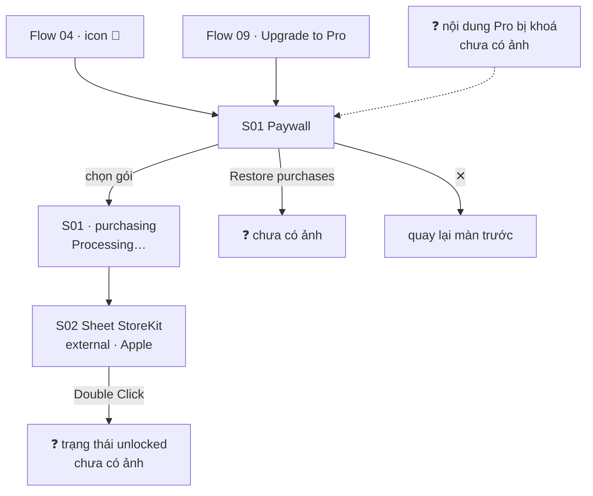

# 08 — Paywall

**Mục tiêu:** bán gói Pro (mở khoá calendar không giới hạn, template premium, tuỳ biến màu/nền).

**Nguồn:** 3 screenshot trong [`screenshots/iphone/08_paywall/`](../screenshots/iphone/08_paywall/)

---

## Flow



---

## S01 — Unlock everything · `08_paywall_01_upgrade_default.png`

```
┌────────────────────────────────────────┐
│           ┌──────────────┐         ┌──┐│
│  ⭐  ┌────│ [ MOCKUP     │──┐      │ ✕││ ← đóng, góc phải
│  ┌───┴──┐ │   ĐIỆN THOẠI │  │──┐   └──┘│
│  │▪▪▪▪▪▪│ │   + card     │  │  │       │
│  └──────┘ │   lịch màu ] │  │──┘       │
│    ┌────┐ └──────────────┘  │          │
│    │▪▪▪ │                   │          │
│    └────┘                              │
│
│         Unlock everything               ← headline
│  Make your lock screen feel made        ← subtitle
│           just for you.
│
│   ┌──┐
│   │📅│  Unlimited calendars             ← 3 lợi ích, icon nền pastel
│   └──┘
│   ┌──┐
│   │✨│  All premium templates
│   └──┘
│   ┌──┐
│   │🎨│  Day colors & backgrounds
│   └──┘
│
│ ┌────────────────────────────────────┐
│ │ 3-day free                  ₩3,300 │ ← gói 1: dùng thử → tuần
│ │ Weekly                             │
│ └────────────────────────────────────┘
│ ┏━━━━━━━━━━━━━━━━━━━━━━━━━━━━━━━━━━━━┓
│ ┃ Lifetime  [BEST VALUE]     ₩33,000 ┃ ← gói 2: ĐANG CHỌN (viền tím)
│ ┃ One-time purchase                  ┃
│ ┗━━━━━━━━━━━━━━━━━━━━━━━━━━━━━━━━━━━━┛
│ ┌────────────────────────────────────┐
│ │ Annual                     ₩17,000 │ ← gói 3
│ │ ₩1,417/month      Just ₩327/week   │
│ └────────────────────────────────────┘
│
│ ┌────────────────────────────────────┐
│ │            Continue                │ ← primary, gradient đen→tím
│ └────────────────────────────────────┘
│  Restore purchases   Terms   Privacy   ← link bắt buộc của App Store
└────────────────────────────────────────┘
```

---

## S01 · purchasing — `08_paywall_01_upgrade_purchasing.png`

```
┌────────────────────────────────────────┐
│ ░░░░░░ toàn màn hình mờ đi ░░░░░░  ┌──┐│
│         [ hero illustration ]      │ ✕ ││
│                                    └──┘│
│         Unlock everything               │
│  Make your lock screen feel made        │
│           just for you.                 │
│   📅  Unlimited calendars               │
│   ✨  All premium templates             │
│   🎨  Day co┌──────────────────────┐    │
│             │ ⟳  Processing…       │    │ ← toast đen, giữa màn hình
│ ┏━━━━━━━━━━━┗━━━━━━━━━━━━━━━━━━━━━━┛━━┓ │
│ ┃ 3-day free                  ₩3,300 ┃ │ ← WEEKLY đang chọn (viền tím)
│ ┃ Weekly                             ┃ │
│ ┗━━━━━━━━━━━━━━━━━━━━━━━━━━━━━━━━━━━━┛ │
│ ┌────────────────────────────────────┐ │
│ │ Lifetime  [BEST VALUE]     ₩33,000 │ │
│ └────────────────────────────────────┘ │
│ ┌────────────────────────────────────┐ │
│ │ Annual                     ₩17,000 │ │
│ └────────────────────────────────────┘ │
│                                        │
│      Auto-renew. Cancel anytime.       │ ← ⚠️ dòng MỚI, xem ghi chú
│ ┌────────────────────────────────────┐ │
│ │              ⟳                     │ │ ← CTA chuyển sang spinner
│ └────────────────────────────────────┘ │
│  Restore purchases   Terms   Privacy   │
└────────────────────────────────────────┘
```

**Phát hiện:** dòng **`Auto-renew. Cancel anytime.`** chỉ xuất hiện ở ảnh này (gói Weekly đang chọn), **không có** ở ảnh `default` (gói Lifetime đang chọn). Hợp lý — Lifetime là mua đứt, không tự gia hạn → dòng này hiển thị **có điều kiện theo loại gói**.

**Trạng thái loading:** toàn màn hình mờ + toast `Processing…` + CTA thành spinner. Khoá tương tác trong lúc gọi StoreKit.

---

## S02 — Sheet StoreKit *(external)* · `08_paywall_02_storekit-sheet_system-dialog.png`

```
┌────────────────────────────────────────┐
│ ░░ paywall mờ phía sau ░░              │
│                          ┃ Double Click│ ← gợi ý cạnh nút nguồn
│                          ┃ to Subscribe│
│ ┌──────────────────────────────────────┐
│ │ TestFlight                      ┌──┐ │ ← môi trường sandbox
│ │                                 │ ✕│ │
│ │ ┌──┐ Weekly                     └──┘ │
│ │ │📋│ Ink: Lockscreen Calendar,       │ ← TÊN APP ĐẦY ĐỦ
│ │ └──┘ Note  [4+]                      │
│ │      Subscription                    │
│ │ ──────────────────────────────────── │
│ │ 3-day free trial                     │
│ │ Starting today                       │
│ │ 59 000đ per week                     │ ← 🔴 GIÁ BẰNG VND
│ │ Starting on 9 Aug 2026               │
│ │ ──────────────────────────────────── │
│ │ For testing purposes only. You will  │ ← chỉ có ở TestFlight
│ │ not be charged for confirming this   │
│ │ purchase.                            │
│ │ ──────────────────────────────────── │
│ │ Account: <email tester>              │
│ │                                      │
│ │            ⊂|←                       │
│ │    Confirm with Side Button          │
│ └──────────────────────────────────────┘
└────────────────────────────────────────┘
```

**Sheet của Apple** — Ink chỉ kiểm soát được tên gói, tên sản phẩm và giá đăng ký ở App Store Connect.

**Thông tin mới:** tên app đầy đủ trên App Store là **"Ink: Lockscreen Calendar, Note"**, xếp hạng **4+**.

---

## 🔴 Giá hiển thị trong app không khớp giá thật

| Nơi hiển thị | Giá gói Weekly |
|---|---|
| Paywall trong app (S01) | **₩3,300** (Won Hàn Quốc) |
| Sheet thanh toán của Apple (S02) | **59 000đ** (VND) |

Đây là **lỗi**, không phải khác biệt hiển thị chấp nhận được:

**Sai đơn vị tiền tệ.** Tài khoản App Store của người dùng là Việt Nam (sheet Apple hiển thị VND), nhưng paywall lại vẽ giá bằng KRW. Giá đúng phải lấy từ `SKProduct.price` + `priceLocale` của StoreKit, khi đó nó tự khớp với sheet. Việc hiện KRW cho tài khoản VN cho thấy giá đang bị **hard-code hoặc format sai locale**.

**Không chỉ sai đơn vị mà sai cả con số.** ₩3,300 ≈ 62.000đ theo tỷ giá, gần bằng 59.000đ — tức bảng giá được quy đổi thủ công theo từng thị trường chứ không đọc từ StoreKit. Mọi biến động tỷ giá hay thay đổi giá trên App Store Connect sẽ khiến hai nơi lệch nhau.

**Rủi ro bị App Store từ chối.** Guideline 3.1.2 yêu cầu giá hiển thị trong app phải khớp giá thật người dùng bị tính. Hiển thị sai đơn vị tiền tệ là lý do reject phổ biến.

**Đề xuất:** bỏ toàn bộ giá hard-code, lấy chuỗi giá đã format sẵn từ StoreKit (`displayPrice` của StoreKit 2). Đồng thời kiểm tra lại 2 gói còn lại (Lifetime ₩33,000 · Annual ₩17,000) — nhiều khả năng cũng sai tương tự.

> Câu hỏi "thị trường mục tiêu là ₩ hay ₫" ở các bản ghi chú trước **đã được trả lời**: người dùng ở **Việt Nam**, App Store tính bằng **VND**. Con số ₩ trong app là lỗi hiển thị.

> ⚠️ **Lưu ý dữ liệu cá nhân:** ảnh `08_paywall_02_storekit-sheet_system-dialog.png` có chứa **email tài khoản tester**. Cân nhắc che lại trước khi chia sẻ tài liệu này ra ngoài team.

---

## Cấu trúc gói

| Gói | Giá | Nhãn | Mặc định |
|-----|-----|------|----------|
| Weekly | ₩3,300/tuần | `3-day free` (dùng thử 3 ngày) | |
| **Lifetime** | ₩33,000 một lần | `BEST VALUE` | ✅ **chọn sẵn** |
| Annual | ₩17,000/năm | quy đổi ₩1,417/tháng · ₩327/tuần | |

**Quan sát về pricing**

Đơn vị tiền hiển thị là **₩ (KRW)** nhưng App Store tính bằng **VND** — xem mục lỗi ở trên. Số liệu ₩ trong bảng này **không dùng được cho PRD**, phải lấy lại từ App Store Connect.

Gói **Lifetime được chọn sẵn** thay vì gói rẻ nhất hay gói có dùng thử — ưu tiên doanh thu một lần. Đáng chú ý: Lifetime (₩33,000) chỉ gấp **1,94 lần** Annual (₩17,000), tức hoà vốn sau chưa tới 2 năm — mức chênh rất hẹp so với chuẩn ngành.

Gói Annual hiển thị **3 mức giá cùng lúc** (năm/tháng/tuần) để trông rẻ, trong khi Weekly chỉ hiện giá tuần — cách trình bày không đối xứng.

---

## Tổng kết flow

| # | Màn hình | State có ảnh |
|---|----------|--------------|
| S01 | Unlock everything | default (Lifetime chọn) · purchasing (Weekly chọn) |
| S02 | Sheet StoreKit *(external)* | system-dialog |

**Vấn đề đã nhận diện**
1. 🔴 **Giá trong app (₩) không khớp giá App Store tính (₫)** — xem mục phân tích ở trên.
2. Dòng `Auto-renew. Cancel anytime.` hiển thị có điều kiện — cần xác nhận đây là chủ ý (đúng cho Lifetime) chứ không phải lỗi ẩn/hiện.
3. Ảnh S02 chứa email tester — cân nhắc che trước khi chia sẻ ra ngoài team.

**Possible missing screen**
- Trạng thái **`unlocked`** — app trông thế nào sau khi mua (icon 👑 đổi? Settings đổi?).
- Trạng thái chọn gói **Annual**.
- **Lỗi thanh toán** — user huỷ giữa chừng, mạng lỗi, giao dịch thất bại.
- Luồng **Restore purchases** — thành công và thất bại.
- Nội dung Pro **bị khoá** (`locked`) — điểm chạm tự nhiên nhất dẫn tới paywall, hiện chưa có ảnh nào cho thấy template nào là premium.
