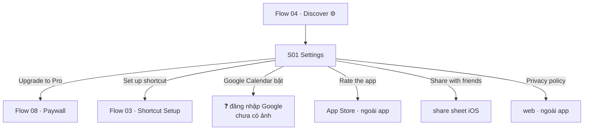

# 09 — Settings

**Mục tiêu:** quản lý gói đăng ký, nguồn calendar, cài lại shortcut và các mục About.

**Nguồn:** 1 screenshot trong [`screenshots/iphone/09_settings/`](../screenshots/iphone/09_settings/)
**Điểm vào:** icon ⚙ ở header tab Discover (Flow 04 · S01).

---

## Flow



---

## S01 — Settings · `09_settings_01_home_default.png`

```
┌────────────────────────────────────────┐
│ ┌──┐          Settings                 │
│ │ ‹│
│ └──┘
│ SUBSCRIPTION
│ ┌────────────────────────────────────┐
│ │ 👑  Upgrade to Pro               › │
│ │     Annual plan for ₩17,000/year   │ ← chỉ nêu gói Annual
│ └────────────────────────────────────┘
│
│ CALENDARS
│ ┌────────────────────────────────────┐
│ │ iOS Calendar               (●━━)   │ ← toggle, đang BẬT
│ │ Sync and show events from          │
│ │ Apple Calendar.                    │
│ │ ────────────────────────────────── │
│ │ Google Calendar            (●━━)   │ ← toggle, đang BẬT
│ │ Sign in to sync and show events    │
│ │ from Google Calendar.              │
│ └────────────────────────────────────┘
│
│ ┌────────────────────────────────────┐
│ │ ⚡  Set up shortcut              › │ ← điểm vào lại Flow 03
│ └────────────────────────────────────┘
│
│ ABOUT
│ ┌────────────────────────────────────┐
│ │ ☆  Rate the app                  › │
│ │ ────────────────────────────────── │
│ │ ⤴  Share with friends            › │
│ │ ────────────────────────────────── │
│ │ 🖐  Privacy policy               › │
│ └────────────────────────────────────┘
│
│           Version 1.2.10 (27)          ← số build, canh giữa
└────────────────────────────────────────┘
```

---

## Phân tích

**4 nhóm:** SUBSCRIPTION · CALENDARS · (Set up shortcut — đứng riêng, không có tiêu đề nhóm) · ABOUT.

**`Set up shortcut` cố ý tách riêng** — không nằm trong CALENDARS cũng không nằm trong ABOUT. Hợp lý: đây là bước sửa lỗi quan trọng nhất khi wallpaper ngừng cập nhật, cần dễ thấy.

**Đăng ký:** dòng phụ chỉ nêu **Annual ₩17,000/year**, trong khi paywall (Flow 08) chọn sẵn **Lifetime ₩33,000**. Hai màn hình đang quảng bá 2 gói khác nhau → cần thống nhất thông điệp.

**Google Calendar:** mô tả ghi *"Sign in to sync…"* nhưng toggle đang ở trạng thái **bật**. Chưa rõ bật toggle sẽ mở luồng đăng nhập Google, hay tài khoản đã đăng nhập từ trước. **Cần xác nhận.**

> 🔴 **Một dòng toggle, một hệ thống phụ thuộc.** Đây là **nguồn dữ liệu duy nhất cần mạng, cần tài khoản và
> phụ thuộc bên thứ ba** — khác hẳn iOS Calendar/Reminders vốn nằm sẵn trên máy. Nó kéo theo cả luồng OAuth,
> token hết hạn, thu hồi quyền từ phía Google, hành vi offline, và ghi ngược lên cloud (xoá nhầm ở đây là mất
> dữ liệu của cả người được mời trong event). **Toàn bộ luồng này chưa có screenshot nào.**
>
> Đáng chú ý nhất: onboarding khẳng định *"Your data stays on your device"* — cần làm rõ câu này còn đúng
> không khi bật đồng bộ Google. Bộ câu hỏi đầy đủ ở
> [exploratory-references §1.6](../../../../references/exploratory-references.md#16--google-calendar-nguồn-dữ-liệu-duy-nhất-cần-mạng-và-tài-khoản).

**Thiếu so với thông lệ:** không có mục quản lý/huỷ subscription cho user **đã mua**, không có cài đặt thông báo, không có chọn ngôn ngữ, không có liên hệ hỗ trợ. Có thể do ảnh chụp ở trạng thái chưa mua.

---

## Tổng kết flow

| # | Màn hình | State có ảnh |
|---|----------|--------------|
| S01 | Settings | default (chưa mua Pro) |

**Possible missing screen**
- Settings ở trạng thái **đã mua Pro** — mục SUBSCRIPTION hiển thị gì thay cho "Upgrade to Pro".
- **Toàn bộ luồng Google Calendar**: đăng nhập OAuth · chọn tài khoản · chọn lịch nào để đồng bộ · đăng xuất ·
  trạng thái token hết hạn · trạng thái offline. Đây là mảng trống lớn nhất của flow này.
- Trạng thái toggle **tắt** của iOS / Google Calendar.
- Màn hình **Privacy policy** (in-app webview hay mở Safari).
- Trạng thái quyền bị từ chối — Settings có hiển thị cảnh báo và lối dẫn ra iOS Settings không.
