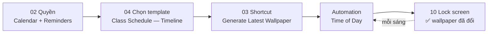

# 10 — Lock Screen (kết quả)

**Mục tiêu:** đây không phải màn hình trong app, mà là **sản phẩm cuối** — lock screen thật của iPhone sau khi toàn bộ chuỗi setup chạy thành công.

**Nguồn:** 1 screenshot trong [`screenshots/iphone/10_lockscreen/`](../screenshots/iphone/10_lockscreen/)

> Flow này là **màn hình xác minh** cho cả Flow 03 và Flow 04. Nếu ảnh này đúng, nghĩa là quyền đã cấp, shortcut đã chạy, template đã áp dụng. Nếu sai, một trong ba khâu đó hỏng.

---

## Toàn bộ chuỗi dẫn tới màn hình này



---

## S01 — Lock screen đã áp dụng · `10_lockscreen_01_wallpaper_applied.png`

```
┌────────────────────────────────────────┐
│ Viettel              ▮▮▮ ᯤ  80⚡       │ ← nhà mạng VN, đang sạc
│                                        │
│              Thu 6 Aug                 │ ← ngày do iOS vẽ
│                                        │
│               3:31                     │ ← đồng hồ iOS, font trong suốt
│                                        │
│         [ ẢNH NỀN: biển + đồi cỏ ]     │
│                                        │
│ ┌────────────────────────────────────┐ │
│ │                                    │ │ ← panel kính mờ, DO INK VẼ
│ │        Class schedule              │ │   (nằm trong ảnh nền)
│ │  "The expert in anything was       │ │
│ │        once a beginner"            │ │
│ │                                    │ │
│ │ Thu ●┌──────────────────────────┐  │ │
│ │  6  │ Uống Creatine             │  │ │
│ │     │ 🕐 08:35 - 08:40          │  │ │
│ │     ├──────────────────────────┤  │ │
│ │     │ Gia hạn Gym Membership   │  │ │
│ │     │ ngày 6 hàng tháng        │  │ │
│ │     │ 🕐 10:00 - 10:30         │  │ │
│ │     ├──────────────────────────┤  │ │
│ │     │ Uống Omega-3             │  │ │
│ │     │ 🕐 13:00 - 13:10         │  │ │
│ │     ├──────────────────────────┤  │ │
│ │     │ Reading Streak 📖        │  │ │
│ │     │ 🕐 23:00 - 23:30         │  │ │
│ │     ├──────────────────────────┤  │ │
│ │     │ Uống Magie               │  │ │
│ │     │ 🕐 23:50 - 23:55         │  │ │
│ │ Fri │├─────────────────────────┤  │ │
│ │  7  ││ Uống Creatine           │  │ │ ← ngày sau: nền xanh nhạt hơn
│ │     ││ 🕐 08:35 - 08:40        │  │ │
│ │     │ +5 more                  │  │ │
│ │ Sat │┌─────────────────────────┐  │ │
│ │  8  ││ Uống Creatine           │  │ │
│ │     │ +5 more                  │  │ │
│ │ Sun │┌─────────────────────────┐  │ │
│ │  9  ││ Uống Creatine           │  │ │
│ │  ┌──┴┴─────────────────────┐+4 more│ │
│ │  │🔦│                    │📷│      │ ← nút iOS ĐÈ LÊN panel
│ └──┴──┴────────────────────┴──┴──────┘ │
│                ▬▬▬▬▬▬                  │
└────────────────────────────────────────┘
```

---

## Phân tích

### Khớp với preview trong app

Bố cục trùng khớp gần như hoàn toàn với [Flow 04 · S05 Template preview](04_discover.md#s05--template-preview--04_discover_05_template_previewpng): cùng tiêu đề, cùng câu quote, cùng timeline có mốc ngày bên trái, cùng logic gộp `+N more`. **Preview trong app đáng tin** — người dùng thấy gì lúc chọn thì nhận đúng cái đó.

Khác biệt duy nhất: ảnh nền thật sáng và tương phản hơn preview, nhưng chữ vẫn đọc tốt nhờ panel kính mờ.

### Toàn bộ lịch nằm trong ảnh nền, không phải widget

Đây là điểm quan trọng nhất về mặt kỹ thuật. Không có widget nào dưới đồng hồ — cả panel lịch là **một phần của ảnh wallpaper**. Hệ quả:

**Nội dung đứng yên giữa hai lần chạy shortcut.** Ảnh chụp lúc 3:31 chiều nhưng vẫn hiển thị "Uống Omega-3 13:00–13:10" như mọi mục khác — không có đánh dấu việc đã qua, không có làm nổi việc đang diễn ra, không đếm ngược. Đúng như thiết kế (ảnh tĩnh thì không làm được), nhưng cần nêu rõ trong PRD để không ai kỳ vọng cập nhật realtime.

**Sự kiện thêm trong ngày sẽ không xuất hiện** cho tới lần chạy automation kế tiếp. Nếu automation đặt 8:00 sáng, event tạo lúc 9:00 sáng phải đợi tới hôm sau — trừ khi người dùng tự chạy shortcut thủ công.

**Đổi múi giờ hay đổi ngày không tự vẽ lại.** Qua nửa đêm, lock screen vẫn hiện lịch của hôm trước cho tới khi automation chạy.

### Vùng an toàn xử lý đúng — trừ đáy màn hình

Panel bắt đầu **dưới đồng hồ**, không đè lên `Thu 6 Aug` và `3:31`. Đây là xử lý đúng và khó, vì đồng hồ iOS có kích thước thay đổi theo độ dài nội dung.

Nhưng ở đáy, **nút đèn pin 🔦 và camera 📷 của iOS đè lên panel** — che một phần dòng `Sun 9` và `+4 more`. Hai nút này luôn cố định ở vị trí đó trên mọi iPhone, nên đây là vùng cấm cần chừa ra. **Đề xuất:** kết thúc panel cao hơn ~120pt so với đáy màn hình, hoặc không đặt nội dung có nghĩa vào dải cuối cùng.

### Xác nhận thị trường Việt Nam

Nhà mạng **Viettel** trên status bar, cộng với giá thật **59 000đ** ở [Flow 08](08_paywall.md), xác nhận người dùng ở Việt Nam. Điều này khép lại câu hỏi về đơn vị tiền tệ và khẳng định con số ₩ trên paywall là lỗi.

---

## Tổng kết flow

| # | Màn hình | State có ảnh |
|---|----------|--------------|
| S01 | Lock screen | applied (template Class Schedule — Timeline) |

**Possible missing screen**
- Lock screen với các template khác (timetable + linh vật, lịch tháng, year progress) — để kiểm tra vùng an toàn của từng bố cục.
- Lock screen khi **Live Activity đang bật** — kiểm tra nó chồng lên panel thế nào.
- Lock screen có **thông báo đẩy** — thông báo iOS chiếm nửa dưới màn hình, nhiều khả năng che gần hết panel lịch. **Đây là kịch bản cần kiểm tra gấp**, vì lock screen có thông báo là trạng thái thường gặp nhất trong ngày.
- Lock screen trên máy màn hình nhỏ (iPhone SE / mini) — panel dài có thể bị cắt.
- Trạng thái **automation chưa chạy** — wallpaper cũ còn lại từ hôm trước, hiển thị sai ngày.
