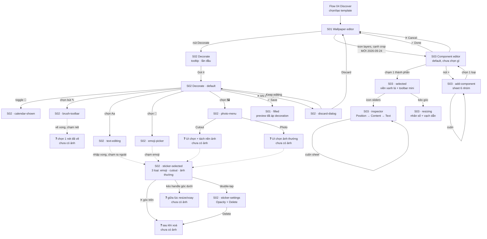

# 14 — Edit Wallpaper (Decorate + Component Editor)

**Mục tiêu:** trang trí wallpaper (vẽ tay, chữ, emoji, ảnh/cắt nền) **và** ráp/chỉnh từng thành phần lịch riêng lẻ (component editor) ngay trong màn chỉnh wallpaper, trước khi lưu thành lock screen thật.

**Nguồn S01/S02 (Decorate):** 16 screenshot trong [`screenshots/iphone/14_edit-wallpaper/`](../screenshots/iphone/14_edit-wallpaper/) — build TestFlight **1.2.15 (56)**, PR [#185](https://github.com/sfunvn/lockscreen-calendar/pull/185), change note [qc-wallpaper-decoration.md](../../../specs/wallpaper-decoration/qc-wallpaper-decoration.md).

**Nguồn S03 (Component editor, bổ sung 2026-09-24):** 15 screenshot cùng thư mục trên — nhánh `feat/component-editor`, **build/commit chưa xác nhận qua công cụ** (chụp ngoài quy trình batch; 11 ảnh đầu có file gốc dạng `Screenshot ... .png`, 4 ảnh sau dán trực tiếp không có tên gốc). Đối chiếu bàn giao QC [`QC — Component Editor 1.2.md`](../../../specs/wallpaper-component/QC%20—%20Component%20Editor%201.2.md) (TestFlight 1.2.17 (103)) — khả năng cao cùng lứa vì cùng ngày, nhưng chưa có bằng chứng build number khớp nhau (xem TB-7 trong [test-analysis-component-editor.md](../../../test-plans/component-editor/test-analysis-component-editor.md)). PRD nền [`wallpaper-component-editor-prd.md`](../../../specs/wallpaper-component/wallpaper-component-editor-prd.md) và wireframe đề xuất [`wallpaper-component-editor-wireframe.html`](../../../specs/wallpaper-component/wallpaper-component-editor-wireframe.html) đều còn **Draft** — phần S03 dưới đây mô tả **UI thực tế quan sát được từ ảnh**, không phải bản đề xuất.

> ⚠️ Flow **mới hoàn toàn**, chưa từng có wireframe trước đó — khác các file khác trong bộ này vốn đã có ít nhất 1 phiên bản cũ để đối chiếu. Mọi mô tả dưới đây dựng lần đầu, hoàn toàn từ ảnh.
> Bộ ảnh **iPad** (15 ảnh, cả 2 chiều) cũng tồn tại ở [`screenshots/ipad/14_edit-wallpaper/`](../screenshots/ipad/14_edit-wallpaper/) nhưng theo đúng quy ước của thư mục này (nguồn chính là iPhone), wireframe chính dựng từ iPhone — khác biệt/bổ sung quan sát được từ iPad gom riêng ở mục cuối. **Chưa có ảnh iPad nào cho S03** — chỉ chụp trên iPhone.

---

## Flow



---

## S01 — Wallpaper editor · 2 state (+ 1 annotation bổ sung 2026-09-24)

### `14_edit-wallpaper_01_wallpaper-editor_default.png`

```
┌────────────────────────────────────────┐
│           Balance                  ┌──┐│ ← tên template
│  ✕      Mix ✓ Current              │…│ │ ← menu thêm, góc phải
│                                     └──┘│
│         ┌──────────────────┐           │
│         │                  │           │
│         │  [ wallpaper     │           │
│         │    preview +     │           │
│         │    1 nét vẽ mảnh │           │ ← đã có sẵn 1 decoration từ trước
│         │    trên lịch ]   │           │
│         │                  │           │
│         └──────────────────┘           │
│  ┌──────────┐            ┌────┐┌────┐ │
│  │✎ Decorate│            │ ⧉  ││ ⛶ │  │ ← pill trái: vào Decorate
│  └──────────┘            └────┘└────┘ │ ← ⧉ layers (MỚI) · ⛶ crop
│                                        │
│ ┌──────────┬──────────┬─────────────┐ │
│ │Background│ Calendar │    Style    │ │ ← 3 tab, Background đang chọn
│ └──────────┴──────────┴─────────────┘ │
│                                        │
│ Change daily                    (○──) │ ← toggle tắt
│ One photo from your set each day      │
│                                        │
│ Auto contrast                   (──●) │ ← toggle bật
│ Adapts colors to the photo behind them│
│                                        │
│ Intensity                              │
│ ●━━━━━━━━━━━━━━━○──────────────────── │ ← slider ~45%
│                                        │
│ ┌────────────────────────────────────┐│
│ │              Update                ││ ← CTA đen
│ └────────────────────────────────────┘│
└────────────────────────────────────────┘
```

**Đây là màn hình có sẵn từ trước**, không phải mới build — chỉ có **pill "Decorate"** ở góc dưới trái là bổ sung mới của build 1.2.15 (đường vào duy nhất tới S02).

> 🆕 **Bổ sung 2026-09-24 — icon layers (⧉), đường vào S03:** xem [`14_edit-wallpaper_01_wallpaper-editor_component-editor-entry.png`](../screenshots/iphone/14_edit-wallpaper/14_edit-wallpaper_01_wallpaper-editor_component-editor-entry.png) — ảnh có mũi tên đỏ chèn tay (annotation, không phải UI thật) trỏ vào icon hình chồng lớp mới, nằm cạnh icon crop (⛶). Theo QC spec 1.2.17: **chỉ hiện với template dạng stack** (template lịch đời mới) — template cũ không có icon này, không phải lỗi. Bấm vào mở màn **S03 — Component editor** full-screen.

### `14_edit-wallpaper_01_wallpaper-editor_filled.png`

```
┌────────────────────────────────────────┐
│           Balance                  ┌──┐│
│  ✕      Mix ✓ Current              │…│ │
│                                     └──┘│
│         ┌──────────────────┐           │
│         │  🤫  [heart nét   │           │
│         │       vẽ]         │           │
│         │  [cutout người]   │           │
│         │  [ảnh thường]     │           │
│         │  đè lên lịch      │           │ ← toàn bộ decoration đã lưu
│         └──────────────────┘           │
│  ┌──────────┐                  ┌────┐  │
│  │✎ Decorate│                  │ ⛶ │  │
│  └──────────┘                  └────┘  │
│                                        │
│ Darken                                 │ ← ⚠️ khác ảnh default — xem ghi chú
│ ●━━━━━━━━━━○───────────────────────── │
│                                        │
│ Change daily                    (○──) │
│ Auto contrast                   (──●) │
│ Intensity  (bị cắt dưới khung ảnh)     │
│ ┌────────────────────────────────────┐│
│ │              Update                ││
│ └────────────────────────────────────┘│
└────────────────────────────────────────┘
```

**Xác nhận trực tiếp giá trị cốt lõi của cả tính năng:** wallpaper preview ở đây **khớp đúng** với những gì đã trang trí trong S02 (mục 2.5 của change note) — emoji, cutout, ảnh, nét vẽ đều lưu lại đúng vị trí.

> ⚠️ **Khác biệt cần xác nhận:** ảnh này có thêm control **"Darken"** ở đầu panel mà ảnh `default` không thấy (ảnh `default` bắt đầu ngay từ tab Background/Calendar/Style). Có thể do 2 ảnh cuộn ở vị trí khác nhau trong cùng 1 panel dài (Darken nằm phía trên tab, đã cuộn qua ở ảnh kia), không chắc là 2 trạng thái khác nhau thật sự — cần xác nhận, không suy diễn là bug hay tính năng ẩn/hiện có điều kiện.

---

## S02 — Decorate canvas · 10 state có ảnh

Toolbar dọc bên phải xuất hiện xuyên suốt mọi state (trừ lúc đang vẽ, xem ghi chú `drawing`): 6 icon xếp dọc — **grid** (chưa rõ chức năng, xem *Possible missing screen*) · **lịch** (toggle Show calendar) · **bút** (Draw) · **Aa** (Text) · **mặt cười** (Emoji) · **ảnh** (Photo/Cutout).

### `14_edit-wallpaper_02_decorate_tooltip.png` — lần đầu mở

```
┌────────────────────────────────────────┐
│ ┌──┐        ┌──┐  ┌──┐            ┌──┐ │
│ │✕ │        │↶│  │↷│            │✓│ │ ← header: đóng · undo · redo · lưu
│ └──┘        └──┘  └──┘            └──┘ │
│         Saturday, 12 September          │
│               13:26                     │ ← lock screen preview mờ phía sau
│  ┌──────────────────────────┐    ┌──┐  │
│  │                          │    │▦│  │ ← toolbar mờ nhạt, chỉ icon bút
│  │                          │    ├──┤  │   sáng rõ + có tay chạm minh hoạ
│  │      Your toolbar        │    │✎│◄┼─ đang trỏ vào
│  │  Text, emoji, photos     │    ├──┤  │
│  │   and a pen. The top     │    │Aa│  │
│  │  two switches preview    │    ├──┤  │
│  │  the clock and calendar. │    │🙂│  │
│  │                          │    ├──┤  │
│  │      ┌────────┐         │    │🖼│  │
│  │      │ Got it │         │    └──┘  │
│  │      └────────┘         │           │
│  └──────────────────────────┘           │
└────────────────────────────────────────┘
```

**Coach mark chỉ xuất hiện đúng 1 lần** (lần đầu mở Decorate) — không thấy trong bất kỳ ảnh nào khác của bộ. Đây là **cơ hội duy nhất** người dùng học ý nghĩa 6 icon toolbar; các icon **không có label chữ** ở mọi state khác.

### `14_edit-wallpaper_02_decorate_default.png`

```
┌────────────────────────────────────────┐
│ ✕          ↶   ↷              ✓        │
│         Saturday, 12 September          │
│               13:26                     │
│ ┌────────────────────────────┐   ┌──┐  │
│ │                            │   │▦│  │
│ │   [ canvas trống, chỉ có   │   ├──┤  │
│ │     lưới safe-zone mờ ]    │   │📅│  │
│ │                            │   ├──┤  │
│ │                            │   │✎│  │
│ │                            │   ├──┤  │
│ │                            │   │Aa│  │
│ │                            │   ├──┤  │
│ │                            │   │🙂│  │
│ │                            │   ├──┤  │
│ │                            │   │🖼│  │
│ └────────────────────────────┘   └──┘  │
│  🔦                              📷    │ ← đèn pin · camera của lock screen thật
└────────────────────────────────────────┘
```

### `14_edit-wallpaper_02_decorate_calendar-shown.png`

Giống `default`, icon **📅** đang bật (nền đậm hơn) → canvas hiện thêm panel lịch tuần + heatmap tháng, đúng nội dung sẽ lên lock screen thật khi áp dụng template lịch.

### `14_edit-wallpaper_02_decorate_brush-toolbar.png` *(+ `-v2`, gần như giống hệt)*

```
┌────────────────────────────────────────┐
│ ✕          ↶   ↷              ✓        │
│  [ canvas: đang kéo thanh trượt cỡ nét, │
│    thấy hình dấu ! trắng đang vẽ dở ]   │
│                                    ┌──┐ │
│                                    │▦│ │
│                                    ├──┤ │
│                                    │📅│ │
│                                    └──┘ │
│ 💧 ⚪ ⚪ ⚫ ⚫ ⚫ 🟡 🟠 🔴 🩷           │ ← eyedropper + palette màu
│┌──┬────┬────┬────┬──┬──────────────┐  │
││𝒜 │ 🖌 │ ✏ │ ▢ │  │  ⌫            │✓│ ← 4 loại nét + | + eraser + save
│└──┴────┴────┴────┴──┴──────────────┘  │
└────────────────────────────────────────┘
```

**4 icon loại nét không có label** — thứ tự quan sát được: `𝒜` (chữ ký hoa, có lẽ = Pen) · brush = Marker · bút chì = Highlighter · ô vuông nét đứt = Dotted. **Suy luận theo thứ tự liệt kê trong change note (Pen · Marker · Highlighter · Dotted)**, chưa có cách nào xác nhận chắc chắn từ ảnh tĩnh vì 4 icon khá giống nhau.

### `14_edit-wallpaper_02_decorate_text-editing.png`

```
┌────────────────────────────────────────┐
│ ✕                                       │
│         Saturday, 12 September          │
│               13:27                     │
│ ┌────────────────────────────┐         │
│ │      Type something        │         │ ← placeholder, con trỏ nhấp nháy
│ └────────────────────────────┘         │
│ ⚪ Aa ☰ B AA ◐                    ✓    │ ← màu · font · canh lề · đậm · cỡ · tương phản
│ [ bàn phím QWERTY tiếng Anh ]          │
└────────────────────────────────────────┘
```

Header rút gọn còn mỗi nút ✕ khi đang gõ — undo/redo/toolbar bên phải **biến mất** trong lúc này (khác `drawing`, xem ghi chú iPad cuối file).

### `14_edit-wallpaper_02_decorate_emoji-picker.png`

Bottom-sheet kéo lên, tiêu đề **"Emoji · Smileys"**, lưới emoji 9 cột, thanh 7 tab nhóm ở đáy sheet (khớp đúng 7 nhóm change note liệt kê: Smileys · Hearts · Animals · Nature · Food · Travel · Objects — quan sát được icon nhưng **không thấy tên nhóm dịch tiếng Việt trong ảnh này**, máy đang để tiếng Anh).

### `14_edit-wallpaper_02_decorate_photo-menu.png`

Popup nhỏ nổi cạnh toolbar, 2 dòng: **"Cutout"** (icon người chấm nền) và **"Photo"** (icon khung ảnh). Bấm xong → **chưa có ảnh** cho bước chọn ảnh từ thư viện tiếp theo (xem *Possible missing screen*).

### `14_edit-wallpaper_02_decorate_sticker-selected.png` · 3 biến thể

```
┌────────────────────────────────────────┐
│ ✕          ↶   ↷              ✓        │
│         Saturday, 12 September          │
│               13:28                     │
│ ┌──────┐                          ┌──┐ │
│ │ 😗   │✕                        │▦│ │ ← ✕ xoá, góc trên phải khung chọn
│ │(emoji)│                        ├──┤ │
│ └──────┘                          │📅│ │
│           ⤡                       └──┘ │ ← handle resize+xoay, góc dưới phải
└────────────────────────────────────────┘
```

- **`sticker-selected.png`** — sticker **emoji** 😗 đang chọn, kèm 1 nét vẽ trái tim đã có sẵn trên canvas.
- **`sticker-selected-v2.png`** — cùng bố cục, nhưng sticker đang chọn là **ảnh cutout** (đã tách nền, chỉ còn hình người) thay vì emoji.
- **`sticker-selected-v3.png`** — cùng bố cục, sticker đang chọn là **ảnh thường** (còn nguyên khung chữ nhật, không cắt nền) — trên canvas lúc này đã có đủ cả 4 loại: emoji, nét vẽ, cutout, ảnh thường xếp chồng.

**Cả 3 biến thể dùng chung 1 kiểu khung chọn** (viền màu, ✕ góc trên phải, handle góc dưới phải) bất kể loại sticker — nhất quán tốt.

> ⚠️ **Kích thước tap target:** ước lượng bằng mắt trên ảnh, nút ✕ và handle đều khá nhỏ so với ngón tay thật — cần đo trực tiếp trên máy thật để xác nhận có đạt chuẩn 44×44pt hay không, ảnh tĩnh không đo chính xác được.

> **Đối chiếu Instagram Stories editor** (cùng thể loại: sticker đè lên khung ảnh cố định): Instagram cho pinch/xoay **tự do ở bất kỳ đâu trên sticker**, không cần trúng 1 handle, và không hiện khung/handle rõ như Ink. Khung viền + handle rõ ràng của Ink **dễ nhận biết hơn cho người mới** (điểm cộng), nhưng nếu Ink lại **bắt buộc** phải chạm đúng handle nhỏ mới scale/xoay được (khác Instagram cho phép pinch tự do) thì tap target nhỏ ở trên trở thành vấn đề nghiêm trọng hơn — chưa xác nhận được từ ảnh tĩnh, xem exploratory checklist `DEC-H28b`/`DEC-Q11`. Instagram cũng có affordance kéo-thả-vào-thùng-rác để xoá (không chỉ nút ✕) — Ink chưa thấy bằng chứng có tương tự, xem `DEC-H33b`.

### `14_edit-wallpaper_02_decorate_sticker-settings.png` · 2 biến thể

```
┌────────────────────────────────────────┐
│ ✕          ↶   ↷              ✓        │
│ [ canvas: sticker đang chọn (khung xanh│
│   + ✕), các sticker khác + nét vẽ ]    │
│┌────────────────────────────────────┐  │
││              ▔▔                    │  │ ← grabber
││              Emoji                 │  │ ← tiêu đề — đổi theo loại sticker
││                                    │  │
││ Opacity                            │  │
││ ●━━━━━━━━━━━━━━━━━━━━━━━━━━━━━━━━━○│  │ ← slider, đang ở 100%
││                                    │  │
││ ┌────────────────────────────────┐ │  │
││ │             Delete             │ │  │ ← chữ đỏ, nền xám nhạt — nút phụ chuẩn
││ └────────────────────────────────┘ │  │
│└────────────────────────────────────┘  │
└────────────────────────────────────────┘
```

- **`sticker-settings.png`** — tiêu đề sheet **"Emoji"** khi sticker đang chọn là emoji.
- **`sticker-settings-v2.png`** — cùng sheet, tiêu đề đổi thành **"Photo"** khi sticker đang chọn là ảnh — xác nhận **tiêu đề sheet đổi theo loại sticker đang chọn** (chưa có ảnh nào cho biến thể "Text").

**Cách mở sheet này: double-tap** trực tiếp vào sticker/ảnh (1 gesture nhấn đúp, không phải chạm 1 lần chọn rồi chạm rời rạc lần 2 như câu chữ change note "chạm lần 2" có thể gây hiểu lầm — xác nhận từ QA 2026-09-12).

> ✅ Nút **Delete** ở đây dùng đúng pattern chuẩn iOS cho hành động phá huỷ (chữ đỏ, nền nhạt, không nổi bật quá mức) — **khác hẳn** nút **Discard** ở popup kế tiếp (nền tối, chiếm vị trí chính). Cùng 1 tính năng nhưng 2 dialog xử lý hành động phá huỷ theo 2 pattern khác nhau — đáng để hỏi dev/design có phải chủ ý hay chỉ 2 người làm rời nhau không rà lại.

### `14_edit-wallpaper_02_decorate_discard-dialog.png`

```
┌────────────────────────────────────────┐
│ ✕          ↶   ↷              ✓        │
│         Saturday, 12 September          │
│               14:18                     │
│  [ canvas: nét vẽ nguệch ngoạc trắng +  │
│    đỏ, sticker emoji 😇 đè lên giữa ]   │
│┌────────────────────────────────────┐  │
││              ▔▔                    │  │ ← grabber
││          Discard changes?          │  │ ← tiêu đề
││   Your decorations won't be saved. │  │ ← subtitle
││                                    │  │
││ ┌────────────────────────────────┐ │  │
││ │            Discard             │ │  │ ← nút TỐI MÀU, nổi bật nhất
││ └────────────────────────────────┘ │  │
││ ┌────────────────────────────────┐ │  │
││ │          Keep editing          │ │  │ ← nút viền, phụ
││ └────────────────────────────────┘ │  │
│└────────────────────────────────────┘  │
└────────────────────────────────────────┘
```

> ⚠️ **Quan sát UX đáng chú ý:** nút **"Discard" (hành động phá huỷ, mất dữ liệu) được style là nút chính** —
> nền tối, chiếm vị trí trên cùng — trong khi **"Keep editing" (hành động an toàn) lại là nút phụ dạng viền**.
> Đây là **ngược** với khuyến nghị phổ biến cho dialog xác nhận huỷ (thường đặt hành động an toàn/mặc định làm
> nút nổi bật hơn, hành động phá huỷ làm nút phụ hoặc tô màu cảnh báo) — tăng khả năng bấm nhầm Discard theo
> phản xạ "nút đậm màu = nút nên bấm". Cần xác nhận đây có phải chủ ý thiết kế hay chưa được rà theo pattern
> chuẩn của app (so sánh với các dialog xác nhận khác trong app, nếu có).

---

## S03 — Component editor · 15 ảnh / 6 state chính (bổ sung 2026-09-24, cập nhật cùng ngày)

**Vào từ:** icon layers (⧉) ở S01, xem ghi chú trên. **Chỉ hiện với template dạng stack.**

Header full-screen: **✕ · Undo · Redo · ✓** — hoàn toàn khác header S02 (không có tên template ở giữa). Đáy màn có nút **+** (Add component) và **Show grid**. Lần đầu vào có bước hướng dẫn "Tap to edit a piece" (chưa có ảnh riêng cho bước này — xem *Possible missing screen*).

### `14_edit-wallpaper_03_component-editor_default.png`

```
┌────────────────────────────────────────┐
│ ✕          ↶   ↷              ✓        │ ← khác S02: không có tên template
│         Thursday, 24 September          │
│               2:28                      │
│  Tân Sửu · Hắc đạo (Câu Trần)           │
│  Trực Định: tốt ký kết, cưới hỏi...     │
│ ┌────────────────────────────────────┐ │
│ │ Mon Tue Wed Thu Fri Sat Sun         │ │
│ │ [ bảng lịch tuần, đủ 7 cột × ~10    │ │
│ │   dòng event, cột Thu đang highlight│ │
│ │   nhẹ = hôm nay ]                   │ │
│ └────────────────────────────────────┘ │
│                                        │
│  🔦              ┌──┬──┐         📷    │ ← đèn pin · [+ ┊ ▦] · camera (lock thật)
└────────────────────────────────────────┘
```

Canvas hiện đủ nội dung template, **chưa chọn thành phần nào** — không có khung viền hay pill nào nổi lên. Nút **+** và **Show grid (▦)** gộp chung 1 pill ở giữa đáy màn, khác hẳn vị trí toolbar dọc bên phải của S02.

### `14_edit-wallpaper_03_component-editor_default-v2.png`

Cùng state `default`, chụp ở **thời điểm khác trong flow** (sau khi đóng sheet Add component, quay lại canvas) — nội dung gần như giống hệt ảnh trên, giữ theo rule §5.3 (không xoá ảnh gần trùng).

### `14_edit-wallpaper_03_component-editor_default-v3.png` — band **Month grid**

```
┌────────────────────────────────────────┐
│ ✕          ↶   ↷              ✓        │
│         Thursday, 24 September          │
│               16:17                     │
│                                        │
│ September                              │
│  M   T   W   T   F   S   S             │
│  1   2   3   4   5   6                 │ ← mỗi ngày có 0–3 chấm màu (event)
│ •·· ··· ··· ··· ··· ···                │
│  7   8   9  10  11  12  13             │
│ ··· ··· ··· ··· ··· ··· ···            │
│ 14  15  16  17  18  19  20             │
│ ··· ··· ··· ··· ··· ··· ···            │
│ 21  22  23 [24] 25  26  27             │ ← 24 tô nền XÁM NHẠT = hôm nay
│ ··· ··· ··· ··· ··· ···                │
│ 28  29  30                             │
│ ···                                    │
└────────────────────────────────────────┘
```

Không toast, không chọn — canvas chỉ còn đúng band **Month grid**, đủ tháng 9, mỗi ngày có 1–3 chấm màu nhỏ bên dưới số (ứng với event ngày đó).

### `14_edit-wallpaper_03_component-editor_default-v4.png` — band **Mini month**

Cùng bố cục lịch tháng như Month grid, nhưng **khác 2 điểm rõ rệt**: (1) **không có chấm màu event** dưới bất kỳ ngày nào, (2) ngày hôm nay (24) tô nền **hồng đậm hình tròn**, không phải ô xám nhạt như Month grid. Xác nhận đây là 2 component khác nhau về nội dung hiển thị, không chỉ khác tên/kích thước như tên gọi "Mini" có thể gợi ý.

### `14_edit-wallpaper_03_component-editor_add-component.png`

```
┌────────────────────────────────────────┐
│              Add component          ✕  │
│                                        │
│ CALENDAR                               │
│ ▦ Month grid     The whole month...    │
│ ▦ Mini month     A small month...      │
│ ☾ Lunar calendar The month with...     │
│ ▦ Timetable      This week as cards... │
│ ▤ Week schedule  This week by hour...  │
│                                        │
│ EVENTS                                 │
│ ☰ Today's events What is on today...   │
│ ▭ Timeline       Today's events as...  │
│ ◗ Hour timeline  Today as one line...  │
│ ▯ Week events    A bar for each day... │
│ ▦ Activity grid  How busy each day...  │
└────────────────────────────────────────┘
```

Bottom-sheet, mỗi item có icon + tên + 1 dòng mô tả. **Không thấy badge PRO** trên bất kỳ item nào trong 2 ảnh chụp được (kể cả `Activity grid` — tương đương "Contribution grid" mà PRD §1.3 gợi ý có thể gate Pro).

### `14_edit-wallpaper_03_component-editor_add-component-scrolled.png`

Cùng sheet, cuộn xuống — lộ thêm 2 nhóm:

```
 TASKS                                   PROGRESS
 ⊙ Reminders        Your reminders...    ◐ Year progress   How much...
 ⊞ Priority matrix   Reminders split...  ▤ Month progress  How much...
                                          # Countdown       Days until...

 TEXT                                    LAYOUT
 " Quote            A line of text...    ▯▯ Row     Two components side by side.
 ☀ Almanac day      Today's almanac...   ▭  Column  Two components stacked, as one band.
```

> ⚠️ **6 nhóm quan sát được: Calendar · Events · Tasks · Progress · Text · Layout** — khớp đúng danh sách QC spec 1.2.17 mục "Thêm thành phần" (`Calendar · Events · Tasks · Progress · Text · Layout`). Nhóm **Layout** (Row/Column) là cơ chế lồng container — xem QC spec mục "Giới hạn lồng nhau" (tối đa 3 cấp).

### `14_edit-wallpaper_03_component-editor_added.png` / `-v2.png` — toast sau khi thêm

```
┌────────────────────────────────────────┐
│ ✕    ┌──────────────────────────┐   ✓  │
│      │✓ Added Year progress Undo│      │ ← chữ "Undo" màu XANH LÁ, bấm được
│      └──────────────────────────┘      │
│         Thursday, 24 September          │
│               16:17                     │
│                                        │
│  2026                            73%   │
│  ●━━━━━━━━━━━━━━━━━━━━━━━○──────────  │
│  73% of this year has passed  98 days  │
│                                   left  │
└────────────────────────────────────────┘
```

- **`added.png`** — vừa chọn **Year progress** từ sheet → toast **"✓ Added Year progress · Undo"** nổi ngay dưới vùng header (thay thế hẳn cụm ↶/↷, không che nút ✕/✓ hai đầu), band Year progress xuất hiện trên canvas.
- **`added-v2.png`** — cùng toast, đổi nội dung thành **"Added Timetable"**.

> ✅ **Lần đầu có bằng chứng ảnh cho toast "Added ..."** mà QC spec dòng 75 mô tả — trước đó là *Possible missing screen*. **Phát hiện quan trọng: thành phần vừa thêm KHÔNG tự động được chọn** (không có khung viền/pill nổi lên ở cả 2 ảnh) — khác hẳn kỳ vọng của bản đề xuất cũ trong `wallpaper-component-editor-wireframe.html` (WPC-4b: *"Chèn ngay sau thành phần đang chọn, **tự chọn nó**, mở luôn Inspector"*). QC spec 1.2.17 (test basis chính) không nói gì về việc tự động chọn — 2 ảnh này là bằng chứng thực tế đầu tiên cho thấy **không** tự chọn, nên coi hành vi của đề xuất cũ là đã lỗi thời, không dùng để viết case.

### `14_edit-wallpaper_03_component-editor_selected.png`

```
┌────────────────────────────────────────┐
│ ✕          ↶   ↷              ✓        │
│  ... (header ngày giờ như trên) ...     │
│                        ┌──┬──┐         │ ← pill nổi: [ ⚙ sliders │ 🗑 trash ]
│ ┏━━━━━━━━━━━━━━━━━━━━━━━━━━━━━━━━━┓   │ ← viền XANH LÁ (khác S02 dùng xanh dương)
│ ┃ Mon Tue Wed Thu Fri Sat Sun     ┃   │
│ ┃ [ bảng tuần, đang được chọn ]    ┃   │
│ ┗━━━━━━━━━━━━━━━━━━━━━━━━━━━━━━━━━┛   │
└────────────────────────────────────────┘
```

Chạm vào bảng "Timetable" → viền **xanh lá** bao trọn khung thật của thành phần + pill mini nổi ngay phía trên (icon sliders + icon thùng rác). QC spec mô tả pill này là **"2 mục: Edit component và Delete component"** — 2 icon quan sát được khớp đúng 2 hành động đó (sliders ≈ Edit, trash ≈ Delete), dù pill không có chữ label, chỉ icon.

> ⚠️ **Chưa xác nhận màu viền có khác S02 hay không.** `index.md` mô tả viền chọn sticker ở S02 chỉ bằng chữ "khung xanh" (không rõ xanh lá hay xanh dương) — không đủ căn cứ để khẳng định 2 flow dùng màu khác nhau hay giống nhau, dù trực quan trên ảnh S03 rõ ràng là xanh lá.

### `14_edit-wallpaper_03_component-editor_inspector.png` — đầu sheet

```
┌────────────────────────────────────────┐
│  ... (canvas + band đang chọn, thu nhỏ) │
│┌────────────────────────────────────┐  │
││ Timetable              ⧉  🗑  ✕    │  │ ← tiêu đề = tên component + duplicate/delete/close
││                                    │  │
││ POSITION                           │  │
││ ↕ Placement                  Auto ⌄│  │
││ Width                          354 │  │
││ ●━━━━━━━━━━━━━━━━━━━━━━━━━━━━━○   │  │
││ Horizontal offset                0 │  │
││ ━━━━━━━━━●━━━━━━━━━━━━━━━━━━━━━   │  │
││ Size                          1.00×│  │
││ ━━━━━━━━━●━━━━━━━━━━━━━━━━━━━━━   │  │
│└────────────────────────────────────┘  │
└────────────────────────────────────────┘
```

Mở ra **thẳng vào nhóm Position** (Placement/Width/Horizontal offset/Size) — **không có thanh tab** Content/Text/Background/Position để bấm chuyển như wireframe đề xuất từng vẽ; đây là **1 sheet cuộn dọc duy nhất**, các nhóm nối tiếp nhau theo chiều cuộn.

### `14_edit-wallpaper_03_component-editor_inspector-scrolled.png` → `-v4.png` — cuộn tiếp

Cuộn xuống lần lượt lộ ra, **theo đúng thứ tự Position → Content → Text**:

| Ảnh | Lộ ra |
|---|---|
| `inspector-scrolled` | Cuối Position (Size) → đầu **CONTENT**: `Cards per day` (10) |
| `inspector-scrolled-v2` | `Cards per day` → đầu **TEXT**: Font (Rounded), Size (29), Color (bắt đầu lộ) |
| `inspector-scrolled-v3` | TEXT đủ: Font · Size · Color · Bold (bật) · Italic (tắt) · Alignment (cắt ở mép) |
| `inspector-scrolled-v4` | Cuối sheet: Color · Bold · Italic · Alignment (Left) · **More options** (chevron, chưa lộ nội dung) |

> ⚠️ **Thứ tự Position → Content → Text** khác thứ tự Content → Text → Background → Position mà wireframe đề xuất (`wallpaper-component-editor-wireframe.html`, rule L4) từng vẽ — QC spec 1.2.17 không quy định thứ tự cụ thể nên **không tính là mâu thuẫn với test basis**, chỉ là điểm khác so với bản đề xuất cũ (đã ghi chú riêng ở file wireframe đó). Không thấy nhóm **Background** cho Timetable trong 4 ảnh cuộn — khớp mô tả QC spec "Thanh Size chỉ có với thành phần ngoài cùng" (Timetable đang ở ngoài cùng nên có Size, nhưng band này có thể đơn giản không có control nền).

### `14_edit-wallpaper_03_component-editor_resizing.png`

```
┌────────────────────────────────────────┐
│ ✕          ↶   ↷              ✓        │
│  ┊106                                   │ ← nhãn số nổi, giá trị đang kéo
│┏━┋━━━━━━━━━━━━━━━━━━━━━━━━━━━━━━━━━━┓  │
│┃ ┋Mon Tue Wed Thu Fri Sat Sun       ┃  │
│┃ ┋[ bảng tuần đang bị kéo mép trái ]┃  │ ← vạch xanh lá đứt nét giữa canvas = snap guide
│┗━┋━━━━━━━━━━━━━━━━━━━━━━━━━━━━━━━━━┛  │
└────────────────────────────────────────┘
```

Đang kéo góc trái: nhãn số (`106`) hiện realtime ngay trên khung, vạch dẫn đứt nét màu xanh lá xuất hiện ở giữa canvas — khớp mô tả QC spec "Bề rộng đổi realtime theo ngón tay, không phải chờ nhả tay". Chưa xác nhận từ ảnh tĩnh đây là kéo góc (theo spec: 4 góc là vùng kéo, không vẽ vòng tròn) hay kéo qua thanh Width trong Inspector — **cả 2 khớp với mô tả "đồng bộ 2 chiều"** của QC spec nên không phân biệt được chỉ bằng ảnh.

---

## Tổng kết flow

| # | Màn hình | State có ảnh |
|---|----------|--------------|
| S01 | Wallpaper editor | default · filled · 🆕 `component-editor-entry` (annotation, entry point icon layers) |
| S02 | Decorate canvas | tooltip · default · calendar-shown · brush-toolbar (+v2) · text-editing · emoji-picker · photo-menu · sticker-selected (+v2, +v3) · sticker-settings (+v2) · discard-dialog |
| S03 🆕 | Component editor | default (+v2, +v3 Month grid, +v4 Mini month) · add-component (+scrolled) · added (+v2 Timetable) · selected · inspector · inspector-scrolled (+v2, +v3, +v4) · resizing |

**Vấn đề đã nhận diện**

Không có mục nào đủ bằng chứng để khẳng định là **lỗi (🔴)** — mọi quan sát bất thường ở trên đều dừng ở mức ⚠️ cần xác nhận, vì đây là build mới hoàn toàn và các note nguồn (`qc-wallpaper-decoration.md`, `QC — Component Editor 1.2.md`) tự liệt kê phần lớn rủi ro dưới dạng "cần test", không phải "đã biết là sai".

**Possible missing screen**

*S01/S02 (Decorate):*
- Chức năng của icon **▦ (grid)** đầu toolbar — xuất hiện xuyên suốt nhưng không thấy trạng thái nào cho biết nó dùng để làm gì (không khớp trực tiếp với mô tả "Toggle Lock screen" trong change note — cần xác nhận).
- UI chọn ảnh từ thư viện sau khi bấm **Cutout** hoặc **Photo** ở menu (chỉ có ảnh menu, chưa có ảnh bước kế tiếp).
- Trạng thái **giữa lúc** resize/xoay sticker (chỉ có ảnh trước và sau, không có ảnh đang kéo).
- Trạng thái **sau khi xoá** sticker (chỉ có ảnh trước khi xoá).
- **Eyedropper đang hút màu** — change note mục 2.2 mô tả nhưng không có ảnh.
- **Thông báo hết chỗ vẽ** (>50 nét, R6 trong change note) — không có ảnh.
- **Zoom/pan cấp canvas** (phóng to/cuộn cả bức tranh, khác pinch/kéo trên 1 sticker) — change note mục 2.2/2.3 chỉ mô tả pinch/kéo **trên sticker**, không nhắc gì tới thao tác ở cấp canvas. Không có ảnh nào cho thấy canvas zoom được. *(Instagram Stories — cùng thể loại khung cố định — cũng không có zoom/pan canvas, nên nhiều khả năng đây là đúng convention chứ không phải thiếu sót; vẫn cần xác nhận bằng lời, không mặc định.)*

*S03 (Component editor) — 🆕 cập nhật 2026-09-24 (đợt 2): đã có bằng chứng cho 4/16 loại thành phần (Timetable, Year progress, Month grid, Mini month) và toast "Added ...":*
- Coach mark lần đầu **"Tap to edit a piece"** — QC spec nhắc tới nhưng chưa có ảnh.
- **12/16 loại thành phần còn lại** (đã có Timetable, Year progress, Month grid, Mini month) — chưa biết Inspector của các loại còn lại (quote, countdown, reminderMatrix...) có nhóm/knob gì khác, có nhóm **Background** hay không.
- Trạng thái **đang kéo di chuyển** (move, không phải resize) một thành phần — chưa có ảnh giữa lúc kéo.
- Trạng thái **kéo cả 1 Row/Column** (cả container di chuyển cùng lúc) — chưa có ảnh.
- **Row/Column sau khi thêm** — 2 ô trống nét đứt, mỗi ô có nút + riêng — chưa có ảnh (QC spec mô tả bằng chữ, chưa có ảnh minh hoạ).
- **Container rỗng bị tự xoá** + toast "Removed the empty layout" — chưa có ảnh.
- **Ở cấp lồng thứ 3** (Column > Row > Column), sheet Add component ẩn nhóm Layout — chưa có ảnh xác nhận trực quan.
- **Cảnh báo tràn màn** "Part of this runs off the screen" — chưa có ảnh.
- **Nút ẩn/hiện chrome** (ẩn hết control để xem wallpaper sạch) — chưa có ảnh 2 trạng thái.
- ~~Dialog xác nhận Cancel khi bấm ✕~~ — ✅ **đã kiểm tra thực tế 2026-09-24: KHÔNG có dialog**, thoát thẳng mất hết thay đổi không cảnh báo. Đúng theo QC spec (chỉ nói "mọi thay đổi bị bỏ", không nhắc dialog) — nhưng khác hẳn S02 (có popup "Discard changes?" cho cùng loại hành động). QA khuyến nghị bổ sung để nhất quán, cần PO/design xác nhận chính thức (xem câu hỏi #9, test-plan mục 10).
- ~~Toast "Added ..." sau khi thêm component~~ — ✅ **đã có ảnh** (`added.png`, `added-v2.png`), xem mục ngay trên.
- Badge **PRO** trên item trong sheet Add component — chưa thấy ở 2 ảnh hiện có (có thể do chưa build gate, hoặc account demo đã Pro).
- Bản **iPad** cho toàn bộ S03 — chưa chụp.

> ✅ Không cần chụp **Dark Mode** — xác nhận 2026-09-12: app hiện **chưa hỗ trợ Dark Mode**, không phải gap.

---

## Ghi chú bổ sung từ bộ ảnh iPad

Bộ [`screenshots/ipad/14_edit-wallpaper/`](../screenshots/ipad/14_edit-wallpaper/) (15 ảnh, cả 2 chiều) không phải nguồn chính của wireframe này nhưng có vài quan sát đáng ghi lại vì **lấp được đúng chỗ trống ở trên**:

- **`filled` / `filled-landscape`** (không có sticker nào đang chọn) — cho thấy canvas ở trạng thái nghỉ sau khi trang trí xong, cả 2 chiều xoay. Vị trí sticker giữ nguyên khi xoay ngang.
- **`text-collapsed`** — cùng tool Text nhưng bàn phím đã tắt (chạm ra ngoài), thanh format vẫn còn hiện — trạng thái trung gian mà bộ iPhone chưa chụp.
- **`drawing`** (chỉ có ở iPad) — ⚠️ cho thấy **toàn bộ header (✕/↶/↷/✓) và toolbar biến mất hoàn toàn** trong lúc đang kéo nét vẽ, không chỉ ẩn brush bar. Chưa xác nhận đây là ẩn tạm chủ ý (hiện lại khi buông tay) hay là dấu hiệu của bug đã biết (toolbar kẹt cứng sau thao tác resize, ghi trong change note) — **cần verify trên máy thật trước tiên**, xem [test plan mục 11](../../../test-plans/decoration-inkai/1.2.15-decoration-inkai.md).
- **Emoji picker trên iPad landscape** không giãn theo chiều ngang — giữ nguyên bề rộng như bản portrait, nổi giữa màn hình rộng, hai bên trống trải.
- iPad **không có** state `tooltip`, `sticker-selected`, `sticker-settings`, hay `discard-dialog` trong bộ đã chụp — chưa rõ hành vi coach-mark, sheet cài đặt sticker, và popup Discard trên iPad có giống iPhone không (chưa chụp, không suy diễn).
