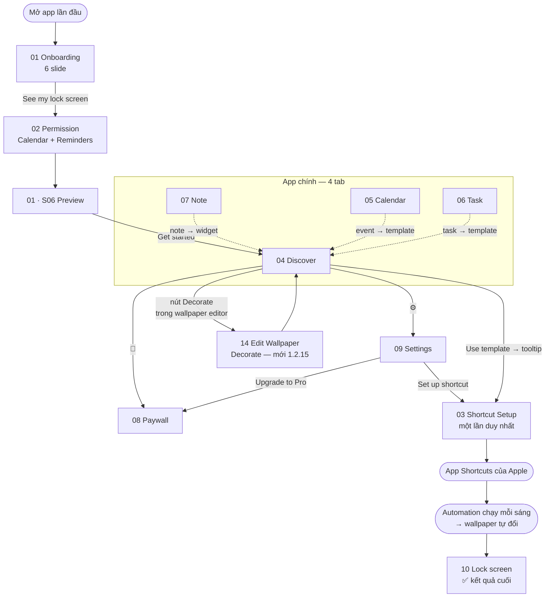

# Wireframes — Ink Calendar iOS

Wireframe được dựng **từ screenshot thật**, mỗi flow một file. Dùng làm đầu vào cho PRD, user story và spec kỹ thuật.

**Nguồn:** [`../screenshots/iphone/`](../screenshots/iphone/) — 45 ảnh, quy ước tên trong [`.claude/rules/screenshot-naming.md`](../../../../.claude/rules/screenshot-naming.md)
**Phiên bản app:** TestFlight 1.2.10 (27)

---

## Danh sách flow

| Flow | File | Màn hình | Ảnh | Ghi chú |
|------|------|----------|-----|---------|
| 01 | [Onboarding](01_onboarding.md) | 6 | 6 | Carousel 6 slide, đủ |
| 02 | [Permission](02_permission.md) | 4 | 4 | 🔴 Từ chối Reminders chặn cả task nguồn Ink |
| 03 | [Shortcut Setup](03_shortcut-setup.md) | 9 | 9 | 4/9 màn ngoài app — rủi ro cao |
| 04 | [Discover](04_discover.md) | 8 | 13 | Tab chính, phủ tốt nhất |
| 05 | [Calendar](05_calendar.md) | 8 | 11 | Phủ đủ nhất · 🔴 có lỗi nghiêm trọng, xem file |
| 06 | [Task](06_task.md) | 4 | 5 | Thiếu trạng thái đã hoàn thành, các picker |
| 07 | [Note](07_note.md) | 2 | 4 | Thiếu xem/sửa note |
| 08 | [Paywall](08_paywall.md) | 2 | 3 | 🔴 Giá trong app sai đơn vị tiền tệ, xem file |
| 09 | [Settings](09_settings.md) | 1 | 1 | ⚠️ Chỉ trạng thái chưa mua |
| 10 | [Lock Screen](10_lockscreen.md) | 1 | 1 | Kết quả cuối, ngoài app — xác minh cả 03 + 04 |
| | | **45** | **57** | |
| 11 | Share | — | 0 | 🚧 Phase 2 — chưa build, chưa có wireframe. Xem [phase-2-feedback.md § P3](../../specs/phase-2-feedback.md#p3--share-lịch-tạo-lịch-gss) |
| 12 | AI Assistant | — | 0 | 🚧 Phase 2 — chưa build, chưa có wireframe. Xem [phase-2-feedback.md § P4](../../specs/phase-2-feedback.md#p4--ai-assistant-vào-calendarevent-improve-home-theo-category) |
| 13 | Community | — | 0 | 🚧 Phase 2 — chưa build, chưa có wireframe. Xem [phase-2-feedback.md § P6](../../specs/phase-2-feedback.md#p6--build-community-co-edit-lịch-âm---tâm-linh) |
| 14 | [Edit Wallpaper (Decorate)](14_edit-wallpaper.md) | 2 | 13 | Mới hoàn toàn, build 1.2.15 (56) · ⚠️ nhiều *Possible missing screen* (sheet cài đặt sticker, eyedropper, discard dialog...) |

---

## Bản đồ toàn app



---

## Cách hoạt động của sản phẩm

Ink **không** tự đổi được wallpaper — iOS không cho phép. Toàn bộ kiến trúc sản phẩm xoay quanh cách đi vòng này:

```
Dữ liệu người dùng          Ink render          iOS thực thi
─────────────────           ──────────          ────────────
iOS Calendar   ─┐
Reminders      ─┼─→  chọn template   ─→  Apple Shortcut  ─→  Lock screen
Note trong Ink ─┘    (Flow 04)           "Generate Latest     đổi mỗi sáng
                                          Wallpaper"
                                         (Flow 03)
```

Hệ quả kéo theo, thấy rõ trong wireframe:

**Flow 02 (quyền) là bắt buộc** — không có Calendar/Reminders thì không có gì để vẽ.

**Flow 03 là điểm gãy lớn nhất** — bắt user rời app 2 lần, đi qua 3 dialog quyền của Shortcuts, rồi tự cấu hình automation. Chi tiết rủi ro `Allow Once` nằm trong [03_shortcut-setup.md](03_shortcut-setup.md).

**Không có nội dung nào áp dụng được ngay.** Lock screen cần chạy shortcut, live activity cần khoá máy và bấm Allow, widget cần user tự thêm trên Home Screen. Cả 3 loại đều là hướng dẫn, không phải hành động.

**Lịch trên lock screen là ảnh tĩnh, không phải widget.** [Flow 10](10_lockscreen.md) xác nhận toàn bộ panel lịch được vẽ vào chính ảnh nền. Nội dung chỉ đổi khi automation chạy lại — event thêm giữa ngày sẽ không xuất hiện cho tới sáng hôm sau.

---

## Quy ước trong các file wireframe

Mỗi file gồm: mục tiêu flow → sơ đồ mermaid → từng màn hình (ASCII layout + thành phần + tương tác) → bảng tổng kết + *Possible missing screen*.

| Ký hiệu | Nghĩa |
|---------|-------|
| `S01`, `S02`… | mã màn hình trong flow, khớp `screen-no` của tên file ảnh |
| `❓` trong mermaid | bước suy ra được từ UI nhưng **chưa có screenshot** |
| ⚠️ | thông tin cần người xác nhận, chưa đủ bằng chứng trong ảnh |
| 🔴 | rủi ro UX đã nhận diện |
| `[ … ]` trong ASCII | vùng hình ảnh / minh hoạ |
| `←` bên phải khung | chú thích thành phần |

**Nguyên tắc:** wireframe chỉ mô tả **những gì nhìn thấy trong ảnh**. Bước thiếu được ghi vào *Possible missing screen*, không tự bịa nội dung.

---

## Việc cần làm tiếp

**Lỗi cần xử lý — ưu tiên cao nhất**

🔴 **Giá trong app sai đơn vị tiền tệ** ([08_paywall.md](08_paywall.md#-giá-hiển-thị-trong-app-không-khớp-giá-thật)). Paywall hiển thị **₩3,300** (Won Hàn Quốc) trong khi App Store thực tế tính **59 000đ** (VND). Giá đang bị hard-code/format sai locale thay vì lấy từ StoreKit. Rủi ro bị App Store reject theo guideline 3.1.2.

🔴 **Không mở được chi tiết event ở Day/Week/Month view** ([05_calendar.md](05_calendar.md#-phân-tích-chỉ-mở-được-chi-tiết-event-ở-list-view)). Hệ quả: ở 3 trong 4 chế độ xem, người dùng **không sửa và không xoá được event nào**, vì hai nút đó chỉ nằm trong màn hình chi tiết. Màn hình chi tiết đã tồn tại và chạy được từ List view nên chi phí sửa rất thấp.

🔴 **`Allow Once` ở Shortcut Setup làm hỏng automation trong im lặng** ([03_shortcut-setup.md](03_shortcut-setup.md)).

**Chụp bổ sung** — ưu tiên theo thứ tự:
1. **Paywall** — trạng thái `unlocked` sau khi mua, lỗi thanh toán, Restore purchases, nội dung Pro bị khoá.
2. **Shortcut Setup** — các bước cuối trong app Shortcuts (đặt giờ, gán shortcut).
3. **Calendar** — Edit event, dialog xác nhận xoá. *(4 view + tạo + chi tiết event đã đủ ✅)*
4. Trạng thái `denied` của quyền, `completed` của task, xem/sửa note.

**Cần xác nhận với team** *(đã ghi chi tiết trong từng file)*:
- Nút **"Delete reminder"** trên màn hình **Edit task** — lỗi copy hay đúng chủ ý?
- Biến thể CTA `Sync my data` + link `Skip for now` ở Flow 01 · S05 — A/B test hay trạng thái khác?
- Nút phụ cạnh toolbar ở màn hình soạn note — một nút đổi ngữ cảnh hay hai nút khác nhau?
- Paywall chọn sẵn **Lifetime** nhưng Settings quảng bá **Annual** — thông điệp nào là chuẩn?
